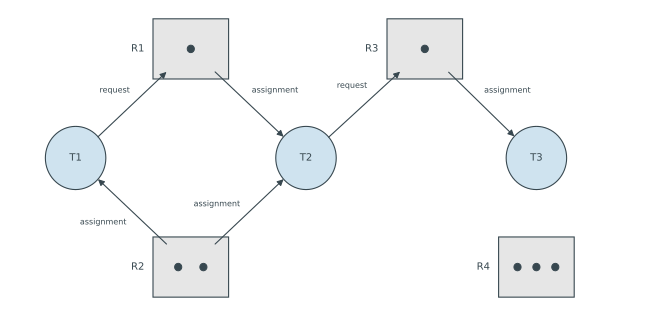

---
aliases:
  - deadlock
  - deadlock (computer science)
  - deadlock problem
tags:
  - flashcard/active/special/academia/HKUST/COMP_3511/deadlock_(computer_science)
  - language/in/English
---

# deadlock (computer science)

A deadlock is a set of processes in which each holds a resource and waits for one held by another. None can run, so none releases anything. The wait lasts until something outside the set acts.

Systems handle deadlock in four ways. Prevention forbids one of the conditions a deadlock needs. Avoidance uses advance knowledge of what each process may request, and refuses a request that could lead there. Detection lets a deadlock happen, finds it, and recovers. The fourth way ignores the problem.

---

Flashcards for this section are as follows:

- what is a deadlock ::@:: A set of processes in which each holds a resource and waits for one held by another. None can run, so none releases anything.
- what ends a deadlock ::@:: Something outside the set of waiting processes. No member of the set can release what it holds.
- four ways to handle deadlock ::@:: Prevention forbids a condition a deadlock needs. Avoidance refuses a request that could lead to one. Detection finds one after it happens and recovers. The last way is to ignore the problem.
- what many desktop and phone systems do about deadlock ::@:: They ignore it, and the user restarts the system.

## system model

A system has resource types $R_1, \dots, R_m$: processors, memory space, files, devices, semaphores. Each type holds a fixed number of identical instances, and type $R_i$ has $W_i$ of them. A process uses a resource in three steps. It requests an instance, uses it, then releases it. A request that cannot be met at once leaves the process waiting.

A deadlock is possible only when four conditions hold together: mutual exclusion, hold and wait, no preemption and circular wait. They are necessary, not sufficient: a system can meet all four and never deadlock.

Mutual exclusion lets one process at a time use an instance of a resource. Hold and wait: a process holds at least one instance while it waits for more. No preemption: only the holder releases an instance, and only after it has finished with it. Circular wait closes a loop of waits. $P_0$ waits for what $P_1$ holds, $P_1$ for what $P_2$ holds, and so on until the last waits for what $P_0$ holds.

---

Flashcards for this section are as follows:

- resource type $R_i$ with $W_i$ instances ::@:: A class of identical resources: processors, memory, files or semaphores. A request asks for one of the $W_i$ instances.
- three steps in the use of a resource ::@:: Request an instance, use it, release it. A request that cannot be met at once leaves the process waiting.
- four conditions a deadlock needs ::@:: Mutual exclusion, hold and wait, no preemption and circular wait, all holding at once.
- mutual exclusion as a condition of deadlock ::@:: At most one process uses an instance of the resource at a time.
- hold and wait as a condition of deadlock ::@:: A process holding at least one instance waits to acquire further instances held by other processes.
- no preemption as a condition of deadlock ::@:: Only the holder releases an instance, and only after it has finished using it.
- circular wait among processes $P_0, \dots, P_n$ ::@:: Each process waits for an instance held by the next, and the last waits for one held by $P_0$.
- why the four conditions are not sufficient ::@:: They say a deadlock is possible, not that one exists, so a system can satisfy all four and never deadlock.

## resource-allocation graph

The graph records who holds what and who waits for what. Its vertices come in two sets: the processes $P = \{P_1, \dots, P_n\}$ as circles, and the resource types $R = \{R_1, \dots, R_m\}$ as rectangles with one dot per instance.

Two kinds of edge join them. A request edge runs from a process to a resource type, $P_i \to R_j$: the process waits for an instance of that type. An assignment edge runs from a resource type to a process, $R_j \to P_i$: an instance of the type belongs to that process.

A cycle makes a deadlock possible. A graph without one rules it out, because a deadlock always leaves a cycle behind. When every resource type has exactly one instance, a cycle means the system is deadlocked. When a type has several instances, that possibility is all a cycle shows: a process outside it can hold an instance that lies on it, then release it and break the cycle.

The drawing has one instance of R1, two of R2, one of R3 and three of R4. T1 holds one instance of R2 and requests R1. T2 holds one instance of R1 and one of R2, and requests R3. T3 holds R3 and waits for nothing. It can finish and give R3 back, which lets T2 go on. The graph has no cycle.

---

Flashcards for this section are as follows:

- resource-allocation graph ::@:: A directed graph whose vertices are the processes as circles and the resource types as rectangles with one dot per instance.
- request edge $P_i \to R_j$ in a resource-allocation graph ::@:: A directed edge from a process to a resource type, meaning that the process waits for an instance of that type.
- assignment edge $R_j \to P_i$ in a resource-allocation graph ::@:: A directed edge from a resource type to a process, meaning that an instance of that type belongs to that process.
- what a cycle means when each resource type has one instance ::@:: A deadlock. Each process on the cycle waits for the only instance of a type held by the next process on it.
- what a cycle means when a resource type has several instances ::@:: Only a possible deadlock. A process off the cycle may hold an instance that lies on it and release it, which breaks the cycle.
- resource-allocation graph with no cycle ::@:: The system cannot be deadlocked, since a deadlock always leaves a cycle in the graph.
- reading the graph where T1 holds R2 and requests R1, T2 holds R1 and R2 and requests R3, and T3 holds R3 ::@:: No cycle appears. T3 requests nothing, so it finishes and releases R3, which lets T2 continue, and the waits then clear in turn.
-  ::@:: Processes as circles, resource types as rectangles holding one dot per instance, an arrow from a process to a resource type for a request, an arrow from a resource type to a process for an assignment.
- how a resource-allocation graph is drawn, and what each of its two arrows means ::@:: 

## wait-for graph

When every resource type has exactly one instance, the graph reduces. Each instance has one holder, so a request and the assignment edge to it name the same pair of processes. The reduced graph, the wait-for graph, keeps the processes alone. An edge $P_i \to P_j$ means $P_i$ waits for a resource $P_j$ holds.

A process with one incoming edge and one outgoing edge is a link in a chain: it waits for one process, and one process waits for it. That is ordinary contention. Such a chain ends at a process that waits for nothing, finishes, and releases what it holds. A deadlock needs an outgoing edge on every member, so following the edges from any process either reaches a process that waits for nothing or returns to the start.

In a resource-allocation graph, a resource type with one incoming request edge and one outgoing assignment edge collapses. The request names the type, the assignment names its only holder, and the two become one wait-for edge. A type with no outgoing assignment edge has a free instance, so the request is met at once and no wait-for edge appears.

Detection then becomes a search for a cycle. With one instance per type that test is necessary and sufficient: the system is deadlocked exactly when the graph has one. The search costs on the order of $n^2$ operations for $n$ processes.

The reduction stops working once a resource type has several instances. A request then names any free instance of the type, so an edge to one holder no longer says which instance is waited for. Detection then needs the full graph, or the algorithm for several instances.

---

Flashcards for this section are as follows:

- wait-for graph with an edge $P_i \to P_j$ ::@:: The resource-allocation graph of a system with one instance of every resource type, keeping only the processes as vertices. The edge means $P_i$ waits for a resource $P_j$ holds.
- when a resource-allocation graph reduces to a wait-for graph ::@:: When every resource type has exactly one instance, since each request then has a single identifiable holder.
- cycle test in a wait-for graph ::@:: A cycle means a deadlock. With one instance of each type, a cycle is both necessary and sufficient.
- cost of cycle detection in a wait-for graph of $n$ processes ::@:: On the order of $n^2$ operations.
- why the wait-for graph fails with several instances ::@:: A request may target any free instance of the type, so an edge to one holder no longer says which instance is waited for.
- process with one incoming edge and one outgoing edge in a wait-for graph ::@:: A link in a chain: it waits for one process and one process waits for it. That is contention, not a deadlock, since a chain ends at a process that waits for nothing.
- resource type with one incoming request edge and one outgoing assignment edge ::@:: The pair collapses into one wait-for edge, because the request names the type and the assignment names its only holder.
- resource type with no outgoing assignment edge in a resource-allocation graph ::@:: It has a free instance, so the requesting process takes one at once and no wait-for edge appears.

## prevention

Each attack below removes one of the four conditions, and each costs throughput or leaves resources idle.

1. Mutual exclusion goes where several processes can share the resource.
2. Hold and wait goes when a process cannot hold one resource while waiting for another.
3. No preemption goes when a request that cannot be met takes resources back from its holder.
4. Circular wait goes when every request must name a resource numbered above every one already held.

---

Flashcards for this section are as follows:

- deadlock prevention ::@:: Restricting how resources may be requested so that at least one of the four conditions can never hold.
- usual price of deadlock prevention ::@:: Resources sit idle or waits grow, because the restriction makes processes hold what they do not yet need, or wait longer.
- the four conditions of deadlock and the prevention attack against each ::@:: Mutual exclusion: share whatever can be shared. Hold and wait: request everything before starting, or request only while holding nothing. No preemption: take back what a refused requester holds. Circular wait: order the resource types and request only upwards.

### mutual exclusion

Mutual exclusion can go only where several processes can share the resource. A read-only file is the usual case: any number open it at once and none changes it. Anything a process updates stays exclusive, so the attack does nothing there.

---

Flashcards for this section are as follows:

- attacking mutual exclusion ::@:: Allow sharing wherever the resource permits it. A read-only file can be opened by any number of processes at once.
- limit of attacking mutual exclusion ::@:: A resource that a process updates cannot be shared, so the condition stays for it and the attack does nothing there.

### hold and wait

The condition goes if no process holds one resource while waiting for another, and two rules achieve that. A process may request everything it will ever need before it starts, then run to completion holding all of it. Or it may request a resource only while holding none, giving back what it has first.

Both rules cost. The first needs every process to know its whole demand in advance, and keeps each resource idle until its holder finishes. The second throws progress away each time a process returns resources, and a process can starve while others take what it gave up.

---

Flashcards for this section are as follows:

- two rules that remove hold and wait ::@:: Request every resource before starting, or request a resource only while holding none.
- cost of removing hold and wait ::@:: Low utilisation, because resources sit allocated and unused, and possible starvation, because a process can lose its progress while it waits to start again.
- extra cost of the rule that removes hold and wait by requesting every resource before a process starts ::@:: Every process has to know its whole demand in advance.

### no preemption

Here a resource is taken from its holder. When a process holding resources requests one that is not free, it gives up everything it holds. Those resources join what it already waits for, and it restarts once it can have them all at once.

The rule applies only where a resource can be saved and restored, as registers, memory space and database transactions can. It fails for a lock or a semaphore, because being held is all the state one has, so taking it away would put two processes inside the same critical section.

---

Flashcards for this section are as follows:

- attacking no preemption ::@:: When a request cannot be met, take back every resource the requester holds, add them to what it waits for, and let it restart once it can have all of them.
- which resources survive preemption ::@:: Those whose state can be saved and restored, such as registers, memory space and database transactions.
- why a lock or semaphore cannot be preempted ::@:: The only state it has is that it is held. Taking it away would admit a second process to the critical section.

### circular wait

This condition is the one most often removed. Number the resource types once, then require every process to request them in increasing order: a process holding $R_i$ may ask for $R_j$ only when $i < j$.

No cycle can then form. On a cycle every process holds one resource and waits for another, so the rule puts the held resource below the requested one for each of them. Walk once around the cycle and the numbers strictly increase, yet the last step must return to the first.

The rule needs no knowledge of future demand. Its price is a resource left idle while a process waits for a lower-numbered one.

In a program the numbering is chosen once. Two mutexes guarding one shared counter get an order, say `left` before `right`. Every thread takes `left` first and `right` second, and releases them in reverse. No thread holds `right` and then asks for `left`, the request that would close a cycle.

Only the acquisition order carries the argument: at each request the held resource must sit below the requested one. Releasing in reverse unwinds the acquisition the way a stack does, and a missed release then stands out.

---

Flashcards for this section are as follows:

- ordering rule against circular wait ::@:: Number every resource type and require each request to name a type numbered above every type the process already holds.
- why ordering forbids circular wait ::@:: A process on a cycle holds a lower-numbered resource and waits for a higher-numbered one. Going once around the cycle gives a strictly increasing list that ends where it began.
- cost of ordering against circular wait ::@:: The order constrains every program that shares the resources, and a resource stays idle while a process waits for a lower-numbered one.
- why ordering is the most used prevention ::@:: It needs no knowledge of a process's future demand, only a fixed numbering and a consistent order in every request.
- rule that orders mutex acquisition in a program ::@:: Give the mutexes a fixed order and have every thread acquire them in that order, releasing in reverse, so no thread holds one while asking for a lower-numbered one.
- why only the acquisition order matters against circular wait ::@:: The cycle argument uses the held resource sitting below the requested one at each request. Releasing in any order leaves that true.

## avoidance

Avoidance forbids nothing. Each request is checked against a model of what every process may still ask for, and granted only when the result cannot deadlock. The model needs one piece of advance knowledge: each process's maximum claim, the number of instances of each type it may ever need.

A state is safe when some order of all the processes lets each one finish with what will then be available. That order is a safe sequence $P_1, \dots, P_n$: the needs of $P_1$ fit the available instances, and each later $P_i$ fits what is available plus everything the processes before it hold. Without such an order the state is unsafe.

A safe state cannot be deadlocked: the safe sequence runs every process to completion. The sequence also states a liveness property. Some process can be given what it still needs and finish. Once it finishes, the same holds for the rest, so the system never reaches a point where every process waits for a release another must make.

An unsafe state need not be deadlocked. No sequence means a deadlock is reachable, now or later, not that one is present. A process may never submit the request the model allows, and the requests that do arrive may be harmless, so an unsafe state can run indefinitely. Avoidance still treats it as too risky to enter, not as already stuck.

A refused process may wait for an instance that is free at that moment, so utilisation and throughput fall below what the resources allow.

---

Flashcards for this section are as follows:

- deadlock avoidance ::@:: Check each request against a model of what every process may still need, and grant it only when the resulting state cannot deadlock.
- what avoidance needs in advance ::@:: A maximum claim from every process: the number of instances of each resource type it may ever request.
- safe state ::@:: A state with an order of all processes in which each one finishes using the resources available at its turn.
- safe sequence $P_1, \dots, P_n$ ::@:: An order of the processes where the need of $P_1$ fits the available instances, and each later one fits what is available plus what the finished ones released.
- a safe state cannot be deadlocked ::@:: The safe sequence is a run to completion for every process, and a deadlocked state has no such run.
- why an unsafe state is not a deadlock ::@:: It only makes a deadlock reachable, now or later. Processes may never ask for what the model allows, or may ask in an order that keeps the system working.
- liveness property that a safe sequence states ::@:: Some process can always be given what it still needs and finish, and after it finishes the rest can. The system never runs out of progress.
- price of avoidance ::@:: A process may be made to wait for an instance that is free, so utilisation and throughput stay below what the resources allow.

## banker's algorithm

The banker's algorithm is the avoidance scheme for several instances of each resource type. Every process declares its maximum claim in advance, and each request is checked for safety before it is granted. The name comes from a bank with fixed capital, which lends against credit lines only while it could still meet every remaining line.

---

Flashcards for this section are as follows:

- banker's algorithm ::@:: The deadlock-avoidance scheme for several instances of each resource type. It grants a request only when the resulting state is safe, using each process's declared maximum claim.
- banking analogy behind the banker's algorithm ::@:: A bank with fixed capital lends to customers with credit lines only while every remaining credit line could still be met.

### state structures

Four structures describe one state, for $n$ processes and $m$ resource types. `Available`, a vector of length $m$, gives the free instances: `Available[j] = k` means $k$ instances of type $R_j$ are free. `Max` is an $n \times m$ matrix, where `Max[i][j] = k` means process $P_i$ may request at most $k$ instances of $R_j$. `Allocation`, also $n \times m$, records what is held: `Allocation[i][j] = k` means $P_i$ holds $k$ instances of $R_j$. `Need` is derived, `Need[i][j] = Max[i][j] - Allocation[i][j]`, and holds the largest request $P_i$ can still make for $R_j$.

---

Flashcards for this section are as follows:

- `Available` vector of length $m$ in the banker's algorithm ::@:: `Available[j] = k` means $k$ instances of resource type $R_j$ are free.
- `Max` matrix of $n$ processes and $m$ resource types in the banker's algorithm ::@:: The matrix where `Max[i][j] = k` means process $P_i$ may request at most $k$ instances of $R_j$.
- `Allocation` matrix of $n$ processes and $m$ resource types in the banker's algorithm ::@:: The matrix where `Allocation[i][j] = k` means process $P_i$ currently holds $k$ instances of $R_j$.
- `Need` matrix in the banker's algorithm for process $P_i$ and resource type $R_j$ ::@:: `Need[i][j] = Max[i][j] - Allocation[i][j]`, the largest request $P_i$ can still make for $R_j$.

### safety algorithm

The check builds an order of processes that can finish as it goes.

1. Set `Work = Available` and `Finish[i] = false` for every process.
2. Find a process with `Finish[i] = false` whose `Need` row fits in `Work`, entry by entry. If there is none, stop.
3. Add what that process holds, `Work = Work + Allocation[i]`, set `Finish[i] = true`, and return to step 2.
4. If every process now has `Finish[i] = true`, the state is safe. Otherwise it is unsafe.

A finished process gives everything back, so its whole allocation joins `Work`, not just its need.

---

Flashcards for this section are as follows:

- what `Work` holds during the safety algorithm ::@:: The instances the algorithm may treat as free: the available ones plus everything held by the processes it has already shown can finish.
- test that decides whether a process can finish in the safety algorithm ::@:: Its `Need` row must fit in `Work` entry by entry: every need entry at most the matching `Work` entry.
- update after a process finishes in the safety algorithm ::@:: `Work = Work + Allocation[i]` and `Finish[i] = true`. The whole allocation comes back, not only the need.
- verdict of the safety algorithm ::@:: Safe when every process ends with `Finish` true, and unsafe as soon as no unfinished process fits.
- why the safety algorithm adds the whole allocation ::@:: A finished process releases everything it holds, so all of its allocation becomes available again.

### worst-case assumption

At every step the check assumes the worst. A process whose `Need` row fits `Work` counts as about to ask for all of it, taking its allocation up to its whole `Max`. Anything smaller is not credited.

Under that assumption the algorithm is one step repeated: take a process whose whole remaining claim could be met now, suppose it takes all of it, let it finish, and take back everything it held. If all $n$ processes come out that way, their order is a safe sequence. Every step assumed the worst request, so that order finishes every process even if each one asks for its whole remaining claim. Finding a sequence proves the state safe. Failing to find one says the worst case can end in a deadlock, not that one exists, since the processes may ask for less than the model allows.

`Need` is the additional maximum: `Need[i][j] = Max[i][j] - Allocation[i][j]`. The worst case for $P_i$ is that it asks for `Need[i]` more, since it already holds `Allocation[i]`, and a request past `Need[i]` is refused outright instead of queued.

---

Flashcards for this section are as follows:

- what the banker's safety algorithm assumes about each process's next request ::@:: The worst case: a process whose `Need` row fits is treated as about to ask for all of it, taking its allocation up to its whole `Max`.
- why a sequence found by the safety algorithm is safe ::@:: Every step assumed the worst request, so the sequence still finishes every process even if each one asks for its whole remaining claim.
- what the safety algorithm does in one sentence ::@:: Finish the processes one at a time, each time taking one whose whole remaining claim could be met now, and taking back all it held.
- why `Need` is the additional maximum and not the maximum ::@:: `Need = Max - Allocation`. The process already holds `Allocation`, so the worst case is that it asks for `Need` more, and a request past `Need` is refused.

### resource request

A request is checked in three steps. It must fit the process's remaining `Need`, $Request[i] \le Need[i]$, the same test as $Allocation[i] + Request[i] \le Max[i]$: a request past the declared maximum is an error, so it is rejected rather than queued. It must fit `Available`, or the process waits for the resources to appear. Then the state is updated as though the request had been granted, the safety algorithm runs, and an unsafe result undoes the update and sends the process back to waiting.

---

Flashcards for this section are as follows:

- checks before the banker's algorithm grants a request ::@:: The request must fit the remaining `Need` and the `Available` instances. The state is then updated as if granted, and the safety algorithm runs.
- request in the banker's algorithm with $Request[i] > Need[i]$ ::@:: An error, because $Request[i] > Need[i]$ says $Allocation[i] + Request[i] > Max[i]$, which breaks the declared claim. The request is rejected, not queued.
- what happens when the banker's algorithm finds the grant unsafe ::@:: The process waits, and the state is put back as it was before the pretended grant.
- state update for a pretended grant in the banker's algorithm ::@:: `Available` loses the request, `Allocation[i]` gains it, and `Need[i]` loses it.

### five-process walkthrough

Five processes and three resource types, with 10 instances of A, 5 of B and 7 of C. `Available` is $(3,3,2)$ and the rest of the state is:

| process | `Allocation` | `Max` | `Need` |
| --- | --- | --- | --- |
| $P_0$ | $(0,1,0)$ | $(7,5,3)$ | $(7,4,3)$ |
| $P_1$ | $(2,0,0)$ | $(3,2,2)$ | $(1,2,2)$ |
| $P_2$ | $(3,0,2)$ | $(9,0,2)$ | $(6,0,0)$ |
| $P_3$ | $(2,1,1)$ | $(2,2,2)$ | $(0,1,1)$ |
| $P_4$ | $(0,0,2)$ | $(4,3,3)$ | $(4,3,1)$ |

With `Work` at $(3,3,2)$, $P_1$ needs $(1,2,2)$ and fits, so it finishes and its allocation $(2,0,0)$ takes `Work` to $(5,3,2)$. $P_3$ needs $(0,1,1)$ and fits, so `Work` becomes $(7,4,3)$. $P_4$ needs $(4,3,1)$ and fits, giving $(7,4,5)$. $P_0$ needs $(7,4,3)$ and fits, giving $(7,5,5)$. $P_2$ needs $(6,0,0)$ and fits, giving $(10,5,7)$, every instance in the system. The safe sequence is $P_1, P_3, P_4, P_0, P_2$, so the state is safe.

A request from $P_1$ for $(1,0,2)$ fits its need of $(1,2,2)$ and the available $(3,3,2)$, so the algorithm pretends to grant it. `Available` becomes $(2,3,0)$, and $P_1$ now holds $(3,0,2)$ with a need of $(0,2,0)$. The safety algorithm still finds $P_1, P_3, P_4, P_0, P_2$, so the request is granted.

Two requests from that state are refused. $P_4$ asks for $(3,3,0)$ and fails the availability check, since only $(2,3,0)$ is free. $P_0$ asks for $(0,2,0)$, which passes the first two checks, but the pretended grant leaves no safe sequence, so $P_0$ waits and the state is restored.

---

Flashcards for this section are as follows:

- `Need` of a process whose `Max` is $(7,5,3)$ and `Allocation` is $(0,1,0)$ ::@:: $(7,4,3)$, which is `Max` minus `Allocation` entry by entry.
- first process the safety algorithm finishes when `Available` is $(3,3,2)$ and the needs of $P_0$ to $P_4$ are $(7,4,3)$, $(1,2,2)$, $(6,0,0)$, $(0,1,1)$ and $(4,3,1)$ ::@:: $P_1$, whose need $(1,2,2)$ fits in $(3,3,2)$. Its allocation $(2,0,0)$ takes `Work` to $(5,3,2)$.
- why $P_0$ cannot go first when `Available` is $(3,3,2)$ and $P_0$ needs $(7,4,3)$ ::@:: Its need is larger than the available instances, so it waits while smaller needs finish and give their allocations back.
- safe sequence of the five-process snapshot whose `Available` is $(3,3,2)$ ::@:: $P_1$, $P_3$, $P_4$, $P_0$, $P_2$. `Work` runs through $(5,3,2)$, $(7,4,3)$, $(7,4,5)$, $(7,5,5)$ and $(10,5,7)$, with every process finished.
- effect of granting $P_1$ its request for $(1,0,2)$ when `Available` is $(3,3,2)$ ::@:: `Available` becomes $(2,3,0)$, and $P_1$ holds $(3,0,2)$ with a need of $(0,2,0)$. A safe sequence still exists, so the request is granted.
- why $P_4$'s request for $(3,3,0)$ waits when `Available` is $(2,3,0)$ ::@:: It asks for more instances of type A than are free, so the process waits without the safety algorithm running.
- why $P_0$'s request for $(0,2,0)$ waits when `Available` is $(2,3,0)$ ::@:: It fits the need of $P_0$ and the available instances, but the pretended grant leaves no safe sequence, so the state is restored and $P_0$ waits.

## detection

A system that uses neither prevention nor avoidance can still detect a deadlock and recover from it. The detection algorithm is the safety algorithm with the current `Request` row in place of the `Need` row. `Need` says what a process may still ask for at worst; `Request` says what it asks for now. The check asks whether every outstanding request can be met in some order, not whether every future one can.

Its data are `Available` of length $m$, `Allocation` and `Request` as $n \times m$ matrices. `Work` starts at `Available`. `Finish[i]` starts true for a process holding nothing and false for one that holds something. The algorithm repeatedly finds an unfinished process whose request row fits `Work`, adds its allocation, and marks it finished. When no such process remains, every process still unfinished is deadlocked.

Detection costs on the order of $m n^2$ operations for $m$ resource types and $n$ processes. In a snapshot with five processes and three types, if $P_0$ and $P_2$ request nothing, the algorithm finishes them and then the rest. If $P_2$ asks for one more instance of C, $P_0$ still finishes, but nothing else fits afterwards, and $P_1$ to $P_4$ are the deadlocked set.

How often to run detection depends on how likely a deadlock is and how many processes one would involve. Running it on every request is accurate and expensive. Running it at fixed intervals, or when utilisation drops below a chosen mark, is cheaper. Deadlocks then pile up between checks, which leaves more to untangle and hides the cause.

---

Flashcards for this section are as follows:

- deadlock detection algorithm ::@:: The safety algorithm with each process's current `Request` row in place of its `Need` row, asking whether the outstanding requests can all be met in some order.
- initialisation of the detection algorithm ::@:: `Work = Available`, `Finish[i] = true` for a process holding nothing, and `Finish[i] = false` for one holding at least one instance.
- why a process holding nothing starts finished in the detection algorithm ::@:: It holds nothing another process waits for, so it blocks no one and its own request is met once the others finish.
- step of the detection algorithm ::@:: Find an unfinished process whose `Request` row fits `Work`, add its `Allocation` to `Work`, and mark it finished. Repeat until no process fits.
- verdict of the detection algorithm ::@:: Every process left unfinished is deadlocked. The finished ones are not.
- cost of the detection algorithm for $m$ resource types and $n$ processes ::@:: On the order of $m n^2$ operations.
- when to run the deadlock detection algorithm ::@:: On every request for an immediate answer, or at fixed intervals and on a drop in utilisation for lower overhead.
- cost of running detection rarely ::@:: More deadlocks accumulate between checks, so more processes must be untangled and the process that caused a deadlock is harder to name.
- what the choice of how often to run deadlock detection depends on ::@:: How likely a deadlock is, and how many processes one would involve.

### start state of the detection algorithm

One initial value differs from the safety algorithm: `Finish[i] = true` for a process whose `Allocation` row is zero. Such a process holds nothing, so no deadlocked set can contain it. A member has to hold something another member waits for. It may be waiting itself, but only because the rest are stuck, and finishing it early costs nothing.

Three processes over two single-instance types make the case small. $P_0$ holds $R_1$ and asks for $R_2$. $P_1$ holds $R_2$ and asks for $R_1$. $P_2$ holds nothing and asks for $R_1$. Detection starts with $P_2$ finished, finds that neither $P_0$'s request for $R_2$ nor $P_1$'s for $R_1$ fits the empty `Work`, and stops. The unfinished set is $\{P_0, P_1\}$, the cycle itself. $P_2$ waits on that cycle without joining it, and the distinction matters at recovery: aborting $P_2$ frees nothing and leaves both others stuck.

Starting every `Finish` at false would put $P_2$ in the deadlocked set, because $R_1$ stays with $P_0$. Recovery could then pick a process whose termination frees nothing.

---

Flashcards for this section are as follows:

- what goes wrong if the detection algorithm starts every `Finish` flag false ::@:: A process holding nothing is reported deadlocked with everyone else, so recovery may abort a process whose termination frees nothing.
- reading of the snapshot where $P_0$ holds $R_1$ and asks for $R_2$, $P_1$ holds $R_2$ and asks for $R_1$, and $P_2$ holds nothing and asks for $R_1$ ::@:: $P_0$ and $P_1$ are the deadlocked set. $P_2$ starts finished, so it waits on their cycle without joining it.

### comparison with the banker's algorithm

| aspect | banker's algorithm | detection algorithm |
| --- | --- | --- |
| question | can the worst case deadlock? | is the system deadlocked now? |
| row compared | `Need`, the largest request still allowed, `Max - Allocation` | `Request`, what the process asks for now |
| initial `Finish` | false for every process | true for a process whose `Allocation` row is zero |
| a process that fits | can finish even if it asks for all it may still claim | can finish given the requests outstanding now |
| success | safe, so no deadlock is reachable | no deadlock, since every process finished |
| failure | unsafe, a deadlock reachable but possibly never | the unfinished processes are deadlocked now |
| when it runs | before a request is granted | on a timer, or when utilisation drops |

Both run the same loop: `Work` starts at `Available`, an unfinished process whose row fits is finished, its `Allocation` joins `Work`, and the search repeats. Only the row and the starting `Finish` values differ.

---

Flashcards for this section are as follows:

- aspect that separates the banker's algorithm from the detection algorithm ::@:: The row compared: the worst-case `Need` for the banker's algorithm, the current `Request` for detection.
- what the banker's algorithm and the detection algorithm share ::@:: `Work` starts at `Available`, and each step finishes an unfinished process whose row fits, adds its `Allocation` to `Work`, and repeats.
- what success means in the banker's algorithm versus the detection algorithm ::@:: Banker's success is a safe state, so no deadlock is reachable. Detection's success is that no process is deadlocked now.
- what failure means in the banker's algorithm versus the detection algorithm ::@:: Banker's failure is an unsafe state, where a deadlock is reachable but may never happen. Detection's failure names the processes deadlocked now.

## recovery

Recovery begins once detection has named the deadlocked processes. Termination aborts processes until the cycle breaks. Aborting every deadlocked process breaks it at once but loses all the work they had done. Aborting one at a time, with detection run again after each, loses less work and pays for a detection run per step.

Which process to abort depends on:

- its priority
- how long it has computed, and how much longer it needs
- the resources it holds, and the ones it still needs
- how many processes would have to be terminated with it
- whether it is interactive or batch

Resource preemption takes resources instead. It picks a victim, takes some of its resources and hands them to another process, and repeats until the cycle breaks. The victim is the cheapest one to take from, in resources and in processes, and it is rolled back to a state it can resume from. The same process could be picked every time, so a cost that counts earlier rollbacks stops the choice from repeating forever.

---

Flashcards for this section are as follows:

- two ways to recover from deadlock ::@:: Terminate the deadlocked processes, or preempt resources from them and give them to other processes.
- aborting every deadlocked process ::@:: Breaks the cycle at once, at the cost of all the work those processes did.
- aborting one deadlocked process at a time ::@:: Abort one, run detection again, and repeat until the cycle is gone. Each abort loses less work, and each step pays for a detection run.
- factors in choosing which deadlocked process to abort ::@:: Priority, time already computed and time still needed, resources held and still needed, how many processes it would take down with it, and whether it is interactive or batch.
- selecting a victim in resource preemption ::@:: Choose which resources and which processes to take from at least cost.
- rollback after resource preemption ::@:: Return the victim to a state it can resume from, which normally means restarting it from the start.
- starvation in resource preemption ::@:: The same process can be chosen as victim every time. Counting earlier rollbacks in the cost stops the choice from repeating forever.
