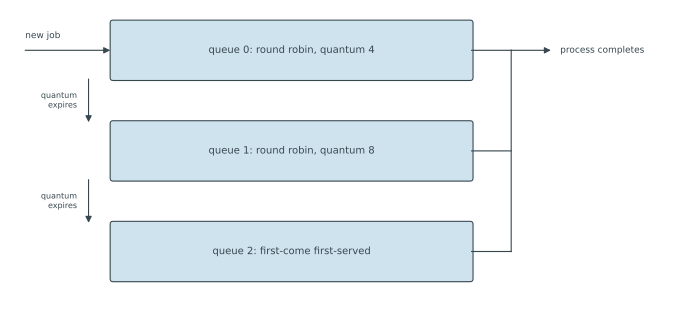

---
aliases:
  - MLFQ
  - MLFQ scheduling
  - Multilevel feedback queue
  - multilevel feedback queue scheduling
tags:
  - flashcard/active/special/academia/HKUST/COMP_3511/multilevel_feedback_queue
  - language/in/English
---

# multilevel feedback queue

A multilevel feedback queue (MLFQ) is a scheduling algorithm built from several ready queues of different priority, with a process moving between them as it runs. A process that uses little processor time stays near the top; one that uses a lot sinks toward the bottom. The scheduler learns what each process needs by watching it, never by being told. The policy belongs to the family surveyed in [scheduling (computing)](scheduling%20(computing).md#multilevel%20feedback%20queue%20scheduling), which also gives the criteria for judging a schedule.

Shortest remaining time first gives the best average waiting time, and it needs the length of the next central processing unit (CPU) burst before it can choose; nothing can supply that number. An MLFQ builds almost the same schedule from the processor time each process has already taken, which is why it only approximates the policy.

The guess uses the past for the future. A process that cannot finish inside the top quantum has proved it needs at least that much again, so it sinks; one that finishes sooner never leaves the top. An arrival takes the processor from whatever runs below, because the top queue outranks every other, and that is the shortest-remaining-time move of picking the shorter job. CPU-bound work drops fast, and short jobs that wait on I/O stay near the top.

A guess is not a measurement. Every process starts at the top, so a long job counts as short until its first quantum runs out. A job that finishes just after a demotion was judged on the time it had spent, not the time it still needed, and shortest remaining time first would have finished it sooner. The estimate holds where bursts repeat, as in interactive use, and fails for a lone job unlike any the scheduler has seen.

---

Flashcards for this section are as follows:

- what a multilevel feedback queue is ::@:: A scheduling algorithm with several ready queues of different priority that a process moves between. A process using little processor time stays near the top, and one using a lot sinks to the bottom.
- why a multilevel feedback queue is preferred to shortest remaining time first ::@:: Shortest remaining time first needs the length of the next central processing unit (CPU) burst in advance, and nothing supplies it. A multilevel feedback queue reaches a similar schedule from the processor time each process has already taken.
- how shortest remaining time first ranks on average waiting time ::@:: It reaches the best average waiting time of any scheduling algorithm.
- algorithm that a multilevel feedback queue approximates ::@:: Shortest remaining time first. The queue infers the remaining time from the processor time already taken.
- what evidence lets a multilevel feedback queue stand in for shortest remaining time first ::@:: A process that cannot finish inside the top quantum must need more, so it sinks; one that finishes early never leaves the top; and an arrival takes the processor from below, which prefers the shorter job.
- where the approximation to shortest remaining time first misjudges a process ::@:: Every process starts at the top, so a long job is treated as short until its first quantum expires, and a job finishing just after a demotion was judged on time already spent.

## queue structure and parameters

An MLFQ is fixed by five decisions: how many queues it has, which algorithm each queue runs, the rule that demotes a process, the rule that promotes it, and the queue a new process enters.

Queues are ordered by priority, and each runs only while every queue above it is empty. A new process enters the top queue, usually round-robin with a small quantum, so a short job finishes at once. A process that exhausts its quantum unfinished joins the tail of the next queue down, which has a larger quantum. Keep exhausting quanta and it reaches the bottom queue, which runs first-come, first-served to finish the long jobs off.

Only the top can preempt: an arrival there takes the processor from a lower queue, and the preempted process returns to the head of its own queue with the time it had left. Nothing enters a lower queue directly, so a process there never preempts one above it.

Nothing a process does earns promotion, because using a whole quantum proves only that it needs more time. Promotion belongs to the scheduler's aging policy, and that policy alone bounds how long a long job waits.

---

Flashcards for this section are as follows:

- five decisions that define a multilevel feedback queue ::@:: The number of queues, the algorithm each queue runs, the demotion rule, the promotion rule, and the queue a new process enters.
- order in which the queues are served ::@:: Strict priority: each queue is served only while every queue above it is empty.
- where a new process enters a multilevel feedback queue ::@:: At the top queue, which usually runs round-robin with a small quantum, so a short job finishes almost at once.
- demotion rule of a multilevel feedback queue ::@:: A process that exhausts its quantum without finishing goes to the tail of the next queue down, which usually has a larger quantum.
- what the bottom queue of a multilevel feedback queue runs ::@:: First-come, first-served, and it is meant to finish the long jobs that have sunk to it.
- source of preemption in a multilevel feedback queue ::@:: An arrival in the top queue, which preempts whatever runs in a lower queue. A process in a lower queue never preempts one above it.
- what happens to a process preempted out of a lower queue ::@:: It returns to the head of its own queue keeping the time it had left, so none of its grant is lost.
- why a promotion rule cannot depend on what a process does ::@:: Using a whole quantum proves only that the process needs more time, so promotion is the scheduler's own aging policy.
- the structure of a three-queue multilevel feedback queue: which way can a process move? ::@:: Down only. A quantum that expires demotes it to the next queue, and nothing returns it upward unless the scheduler adds an aging rule.
-  ::@:: A new job enters queue 0, which runs round robin with a quantum of 4 time units; a quantum that expires demotes the job to queue 1, which runs round robin with 8; another expiry demotes it to queue 2, which is first-come, first-served to completion.

## three-queue trace

Queue 0 runs round robin with a quantum of 4 time units, queue 1 with 8 more, and queue 2 first-come, first-served to completion. A process starts in queue 0, drops to queue 1 when its 4 units run out unfinished, and drops to queue 2 after $4 + 8 = 12$ units in all. A burst of 12 or less therefore never reaches the bottom queue.

Five processes of burst 10, 15, 2, 14 and 6 arrive at 0, 2, 5, 12 and 18.

| start | end | process | queue |
| --- | --- | --- | --- |
| 0 | 4 | P1 | 0 |
| 4 | 8 | P2 | 0 |
| 8 | 10 | P3 | 0 |
| 10 | 12 | P1 | 1 |
| 12 | 16 | P4 | 0 |
| 16 | 18 | P1 | 1 |
| 18 | 22 | P5 | 0 |
| 22 | 24 | P1 | 1 |
| 24 | 32 | P2 | 1 |
| 32 | 40 | P4 | 1 |
| 40 | 42 | P5 | 1 |
| 42 | 45 | P2 | 2 |
| 45 | 47 | P4 | 2 |

Turnaround is a process's whole life, arrival to completion. Waiting is turnaround minus burst: the part spent ready, not running. Response runs from arrival to the end of the first run, so that run counts in full.

| process | arrival | burst | completion | turnaround | waiting | response |
| --- | --- | --- | --- | --- | --- | --- |
| P1 | 0 | 10 | 24 | 24 | 14 | 4 |
| P2 | 2 | 15 | 45 | 43 | 28 | 6 |
| P3 | 5 | 2 | 10 | 5 | 3 | 5 |
| P4 | 12 | 14 | 47 | 35 | 21 | 4 |
| P5 | 18 | 6 | 42 | 24 | 18 | 4 |

The averages are $(24 + 43 + 5 + 35 + 24)/5 = 26.2$ for turnaround, $(14 + 28 + 3 + 21 + 18)/5 = 16.8$ for waiting, and $(4 + 6 + 5 + 4 + 4)/5 = 4.6$ for response. The trace runs from 0 to 47 with no gap, so the processor is busy throughout, utilisation is 100 per cent, and throughput is five processes per 47 time units.

Each measure constrains the others, so they double as checks on the trace. Turnaround must equal completion minus arrival in every row, and waiting must equal turnaround minus burst. Response equals turnaround for a process that finishes in its first run, and stays under waiting for one that runs again. The bursts must equal the last completion when the processor never idles, here $10 + 15 + 2 + 14 + 6 = 47$, and the waiting times must equal the total turnaround minus the total burst, $84 = 131 - 47$. Within one process the slices in the timeline add up to its burst, and no slice in a round-robin queue may exceed that queue's quantum.

Those identities make a hand trace worth trusting. Give each process a row, add its slices once, and compare the total against its burst instead of reading it back out of a bar. A remaining-time column starts at the burst and drops at every slice, so completion is the moment the column reaches zero. A second table lists each queue with its members' arrival times, so the next process is read off the table. Write down the event at each boundary before choosing, because whether it is an arrival, a quantum expiry or a completion decides who runs next. Settle the tie rule once and apply it everywhere; here a process arriving as another quantum expires enters queue 0 and preempts. A last pass through the identities then leaves the error in the one row that fails them.

---

Flashcards for this section are as follows:

- largest burst that never reaches queue 2 in a three-queue multilevel feedback queue with $4$ time units in queue 0 and $8$ more in queue 1 ::@:: $4 + 8 = 12$ time units. A process in queue 1 has used $4$ and may use $8$ more, so anything longer falls through.
- five processes of burst $10$, $15$, $2$, $14$ and $6$ arriving at $0$, $2$, $5$, $12$ and $18$, with $4$ time units in queue 0, $8$ more in queue 1 and first-come, first-served in queue 2: the average waiting time? ::@:: Completions at $24$, $45$, $10$, $47$ and $42$, so waiting times are $14$, $28$, $3$, $21$ and $18$, average $16.8$.
- a process of burst $10$ arriving at $0$ under queues giving $4$ and then $8$ time units: how much processor time does it take from each queue? ::@:: $4$ time units in queue $0$, then $6$ in queue $1$, where it finishes. It never reaches queue $2$.
- why a process of burst $2$ completes in its first pass in the three-queue example ::@:: Its whole burst fits inside the $4$ time units of queue $0$, so it never exhausts a quantum and never drops to a lower queue.
- where processes of burst $15$ and $14$ finish in a multilevel feedback queue with $4$ time units in queue $0$ and $8$ more in queue $1$ ::@:: In queue $2$, with the few time units left over after the two upper quanta: $3$ for the process of burst $15$ and $2$ for the process of burst $14$.
- what turnaround time measures about a process ::@:: Completion minus arrival, the whole time from arrival to completion.
- waiting time of a process, in terms of the other measures ::@:: Turnaround minus burst, the part of its life spent ready rather than running.
- how the response of a process relates to its first run ::@:: It ends where that run ends, so the run counts in full. A process that finishes in one run has response equal to turnaround.
- response times of the trace of processes arriving at $0$, $2$, $5$, $12$ and $18$ with bursts $10$, $15$, $2$, $14$ and $6$ ::@:: $4$, $6$, $5$, $4$ and $4$, averaging $(4 + 6 + 5 + 4 + 4)/5 = 4.6$. The clock stops when each process's first run ends, which for the process of burst $2$ is the moment it finishes.
- utilisation and throughput of the trace that runs from $0$ to $47$ ::@:: No gap appears, so the processor is busy throughout and the five processes pass at a rate of five per $47$ time units.
- identity that ties completion, arrival, burst and waiting together ::@:: Turnaround is completion minus arrival, and waiting is turnaround minus burst, so completion always equals arrival plus burst plus waiting.
- check on the bursts $10$, $15$, $2$, $14$ and $6$ against a last completion of $47$ ::@:: They add to it exactly when the processor never idles, so a gap in the timeline breaks the check first.
- check on the waiting times $14$, $28$, $3$, $21$ and $18$ against turnarounds totalling $131$ and bursts totalling $47$ ::@:: The waiting times add to the total turnaround minus the total burst.
- how the per-process slices are checked against the burst ::@:: The slices given to a process in the timeline sum to its burst, and no slice in a round-robin queue exceeds that queue's quantum.
- way to keep a hand trace of a multilevel feedback queue correct ::@:: Give each process its own timeline row, keep a remaining-time column that is decremented at each slice, and record each queue's members with their arrival times so the next process is read off rather than remembered.
- why the event at each boundary is written before the next process is chosen, with an arrival at the same instant as an expiry entering queue $0$ ::@:: The next process depends on whether the boundary is an arrival, a quantum expiry or a completion, so deciding the tie rule once keeps the trace consistent.

## starvation and aging

A long job can starve. Every new process starts at the top, and each queue below runs only when the queues above it are empty, so a steady stream of arrivals keeps a sunk job waiting for a gap that never opens. Waiting in its own queue never lifts a process.

The remedy is a periodic boost: after a fixed interval every process returns to the top queue, which gives a long job a share once per interval. The price is that the scheduler forgets what it learned: a sunk job counts as short again and takes a full quantum at the top before it sinks once more.

---

Flashcards for this section are as follows:

- why a long job starves in a multilevel feedback queue ::@:: Every new process enters the top queue, so a steady stream of arrivals keeps the lower queues waiting for a gap that never opens.
- why no rule inside a queue prevents starvation ::@:: Waiting in its own queue never raises a process's priority, and nothing below the top queue is served while a queue above it holds a process.
- periodic boost as a remedy for starvation ::@:: After a fixed interval every process returns to the top queue, so a long job gets a share once per interval and its wait is bounded.
- cost of the periodic boost ::@:: The scheduler forgets what it learned, since a job that had sunk is treated as short again and takes a full quantum at the top before it sinks once more.
