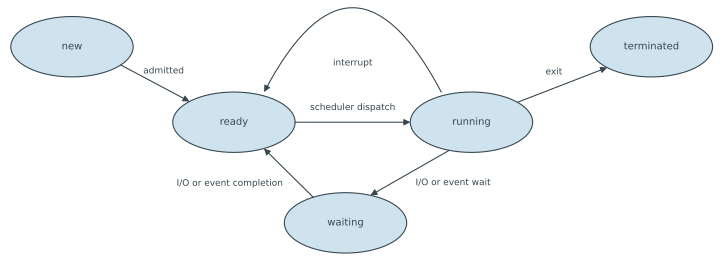

---
aliases:
  - COMP 3511 process
  - process
  - process (computing)
  - task
tags:
  - flashcard/active/special/academia/HKUST/COMP_3511/process_(computing)
  - language/in/English
---

# process (computing)

A process is a program in execution. The file on disk is passive. The process turns active when the kernel loads its code and data into main memory and a program counter points at the next instruction; it then has a state, resources and a lifetime. One executable can run as several processes at once, each with its own copy of the program and its own data.

A process holds one or more threads, each with a program counter, a register set and a stack, plus an address space with the code, data, heap and open files. That address space belongs to the process alone, keeping one program from writing into another's memory.

---

Flashcards for this section are as follows:

- what a process is ::@:: A program in execution: the file on disk is passive, while the running copy holds a program counter, a state and resources of its own.
- what two things a process holds ::@:: One or more threads, each with a program counter, a register set and a stack, and an address space holding the code, the data, the heap and the open files.
- one program, several processes ::@:: One executable file can run as several processes at once, each with its own copy of the program and its own data.
- why each process has an address space of its own ::@:: It keeps one program from writing into another's memory.

## process memory layout

A process's memory is laid out in four sections, from low addresses to high: text, data, heap and stack. The text section holds the program code. The data section holds global variables: initialized data carries its values in the executable, uninitialized data starts empty. The heap holds what the program allocates at run time with malloc() and returns with free(). The stack holds what a function call needs: its parameters, its return address and its local variables. The heap grows upward and the stack downward, so the two face each other across the free region between them. The arguments to main, argc and argv, sit in a section of their own above the stack.

Those addresses belong to the process, not to physical main memory, so the layout describes a logical address space that the hardware maps to real memory. Loading a program fills the sections from the executable and, on UNIX, opens three file descriptors: standard input, standard output and standard error.

---

Flashcards for this section are as follows:

- four sections of a process address space, low to high ::@:: Text, data, heap and stack, with argc and argv in a section of their own above the stack.
- text section ::@:: The program code, loaded from the executable file; it does not change while the process runs.
- data section ::@:: The global variables, split into initialized data, whose values are in the executable, and uninitialized data, which starts empty.
- heap ::@:: Memory a program requests at run time with a call such as malloc() and returns with free(); it grows upward toward the stack.
- stack contents ::@:: A function's parameters, its return address and its local variables; the stack grows downward from high addresses.
- why the heap and the stack grow toward each other ::@:: The heap grows upward and the stack downward, sharing the free region between them, so either uses what the other leaves.
- logical address space ::@:: The addresses a process uses are its own, not positions in physical main memory. The hardware translates them.
- file descriptors of a new process ::@:: On UNIX a new process starts with three open: standard input, standard output and standard error.

## process control block

The kernel keeps one data structure per process, the process control block (PCB), also called a task control block. It records the process state, the program counter and the processor registers: accumulators, index registers, stack pointers, general-purpose registers and condition codes. It also holds scheduling information, such as priority and queue pointers, and memory-management information, such as the page and segment tables. Accounting covers processor time used, clock time elapsed and any time limits. Input/output (I/O) status covers the devices allocated and the files left open.

The process identifier (PID) is a unique integer naming a process. On UNIX and Linux, process 1 is init or systemd, the root of the process tree. The kernel keeps every control block in the process table, indexed by identifier. Linux stores them as task_struct records in a circular doubly linked list, the task list, each holding the identifier, state, time slice, parent, children, open files and address space.

---

Flashcards for this section are as follows:

- process control block (PCB) ::@:: The kernel structure holding what the operating system knows about one process; also called a task control block.
- contents of a process control block ::@:: Process state, program counter, processor registers, scheduling information, memory-management information, accounting information and input/output (I/O) status.
- register state kept in a process control block ::@:: Accumulators, index registers, stack pointers, general-purpose registers and condition codes.
- memory-management information in a process control block ::@:: The memory allocated to the process, in structures such as page tables and segment tables.
- accounting information in a process control block ::@:: Processor time used, clock time since the process started, and any time limits.
- scheduling information in a process control block (PCB) ::@:: The priority of the process and its pointers into the scheduling queues.
- input/output (I/O) status in a process control block (PCB) ::@:: The devices allocated to the process and the files it has open.
- process identifier (PID) ::@:: A unique integer naming a process. On UNIX and Linux, process 1 is init or systemd, the root of the process tree.
- process table ::@:: The kernel structure holding every process control block, indexed by process identifier.
- Linux task list ::@:: The circular doubly linked list holding one task_struct per process: identifier, state, time slice, parent, children, open files and address space.

## process states and queues

A new process is being created, and its resources allocated. In the ready state it can run, but no core holds it. In the running state a core fetches and executes its instructions. In the waiting state it cannot run until an event happens, such as an input/output (I/O) operation completing. In the terminated state it has finished and its resources are released. At any instant, at most one process per core is running.

---

Flashcards for this section are as follows:

- five process states ::@:: New, ready, running, waiting and terminated.
- ready state ::@:: The process can run but holds no core. It waits in the ready queue.
- running state ::@:: A core is fetching and executing the process's instructions; at most one process per core is in this state.
- waiting state ::@:: The process cannot run until an event happens, such as an input/output (I/O) operation completing.
- new and terminated states ::@:: New is a process being created, its resources allocated. Terminated is one that has finished, its resources released.

### state transitions

A process moves between states along a few paths. Admission creates it in the ready state. The scheduler dispatches it to a core, and it runs. A wait for input/output (I/O) or for an event makes it waiting; when the event completes, it returns to ready. If the time slice runs out before it finishes, it drops from running back to ready and another process takes the core. On exit or a kill it becomes terminated.


---

Flashcards for this section are as follows:

- process transition on dispatch ::@:: Ready to running, when the scheduler gives the process a core.
- process transition on an input/output (I/O) request ::@:: Running to waiting, when the process asks for input/output (I/O) or waits on an event.
- process transition when an event completes ::@:: Waiting to ready, when the event releases the process.
- process transition on time slice expiry ::@:: Running to ready, when the scheduler takes the core away before the process finishes.
- process transition on exit ::@:: Running to terminated, when the process finishes or is killed.
- process transition on admission ::@:: New to ready, when the process is created and its resources are allocated.
- ways out of the running state in the five-state process model ::@:: Three: back to ready on an interrupt or an expired time slice, on to waiting for input/output (I/O) or an event, out to terminated on exit.
-  ::@:: The five states of a process and the six transitions between them: admitted, scheduler dispatch, interrupt, input/output or event wait, input/output or event completion, and exit.
- the five states of a process and the six transitions between them ::@:: 

### ready queue and device queues

The kernel keeps queues of processes; the ready queue holds those in main memory that are ready to run. Each device or event has a wait queue of its own, holding the processes waiting for it, and each queue may follow its own scheduling policy. A process moves among these queues for its whole life. The one running is the only process in no queue at all.

The number of processes resident in memory at once is the degree of multiprogramming. That count fixes the resource consumption of the whole resident set, and the [long-term scheduler](scheduling%20(computing).md#long-term,%20medium-term%20and%20short-term%20schedulers) decides it by admitting jobs and refusing others.

A queueing diagram draws these paths. A dispatched process leaves the ready queue for a core. A request for input/output (I/O) sends it to that device's queue; the completion, or an expiring time slice, sends it back to the ready queue. A parent waiting for a child joins the queue for child termination; a process waiting for an event joins that event's queue.

---

Flashcards for this section are as follows:

- ready queue ::@:: The processes in main memory that are ready and waiting for a core.
- device queue ::@:: The processes waiting for one device or event; each device has its own queue and scheduling policy.
- which process is in no queue ::@:: The one running on a core; every other process sits in the ready queue or a wait queue.
- movement between scheduling queues ::@:: A process leaves the ready queue when dispatched, joins a device queue when it waits for input/output (I/O), and rejoins the ready queue on completion.
- queue a parent process joins while it waits for a child to end ::@:: The queue for child termination, one of the wait queues.
- degree of multiprogramming ::@:: The number of processes resident in memory at one time.
- what sets the degree of multiprogramming ::@:: The long-term scheduler, by choosing which jobs are admitted to memory.

## context switch

A core runs one process at a time. Handing the core to another process is a context switch: save the state of the outgoing process, then load the saved state of the incoming one. The saved context is the registers, the program counter and the stack pointer, kept in the process control block. Nothing useful runs during a switch, so its time is overhead, made longer by a larger control block in a more complex kernel.

Cost depends on the hardware: memory speed, how many registers must be copied, and whether one instruction can load or store them all at once. Some processors provide several register sets, as Sun UltraSPARC did; a switch then only changes which set is active, so several contexts stay loaded at once.

---

Flashcards for this section are as follows:

- context switch ::@:: Saving the state of the process leaving a core and loading the state of the one that runs next.
- what a context switch saves ::@:: The registers, the program counter and the stack pointer of the outgoing process, kept in its process control block.
- why context switch time is overhead ::@:: No useful work runs during a switch, and the time grows with the complexity of the kernel and the process control block.
- hardware dependence of a context switch ::@:: Time depends on memory speed, how many registers are copied, and whether one instruction can load or store them all.
- multiple register sets and context switching ::@:: Some processors, such as Sun UltraSPARC, keep several register sets; a switch then changes which set is active and copies nothing.
- when a context switch happens ::@:: The running process blocks, or the scheduler picks another process to run.

## process creation

A parent process creates a child, and children create more children, so the processes of a system form a tree. A desktop or a shell is a common parent: opening a program by icon or by command starts a child of it.

Creating a process means allocating processor time, memory, files and devices. The parent may also pass initialization data, and the new process gets a process identifier of its own. Parent and child can share almost all resources, a subset, or none. Either they run concurrently, or the parent waits for the child. The child either copies the parent or gets a new program loaded into it.

---

Flashcards for this section are as follows:

- parent and child processes ::@:: A parent creates a child, and a child creates more children, so the processes of a system form a tree.
- resources a new process needs ::@:: Processor time, memory, files and devices, plus any initialization data the parent passes.
- resource sharing choices at creation ::@:: Almost all resources, a subset, or none.
- execution choices at creation ::@:: The parent runs alongside the child, or the parent waits until the child finishes.
- address space choices at creation ::@:: The child is a copy of the parent, same program and data, or a new program is loaded into it.

### fork() return values

fork() creates a new process holding a copy of the parent's whole address space. Both then continue at the same instruction, the one after the call, running the same code from there.

Each process receives exactly one return value from fork(), and that value says which process it is. Zero means the child. A positive value means the parent, and it is the process identifier of the new child, which the parent needs in order to wait for it. A negative value means the call failed and no child exists; the error number is left in `errno`, where each process records its last error.

Everything in the address space is copied: the program, the global and local variables, the working and root directories, the open files, the resource limits and the program counter. Four things differ: the process identifier, the return value, the running time and the running state. Linux avoids the copy with copy-on-write pages: parent and child share one copy until one of them writes, and only the written page is copied. A child that calls exec() at once never causes a copy. Linux implements fork() through clone(), a more general call whose flags choose which resources the child shares.

The declaration says all of it:

```c
#include <sys/types.h>
#include <unistd.h>

pid_t fork(void);    /* -1 on failure, 0 in the child, the child's pid in the parent */
```

---

Flashcards for this section are as follows:

- prototype of `fork()`, and the call the code makes ::@:: `pid_t fork(void)`, called as `fork()`: returns twice, `0` in the child and the child's identifier in the parent, or `-1` on failure.
- fork() ::@:: The UNIX and Linux system call that creates a child process holding a copy of the parent's entire address space. Both continue after the call.
- fork() return value in the child ::@:: Zero, which tells the new process that it is the child.
- fork() return value in the parent ::@:: The process identifier of the new child, a positive integer.
- fork() return value on failure ::@:: A negative value in the original process, with no child created and the error recorded in errno.
- why fork() returns two different values ::@:: The child copies the parent's address space and program counter, so both run the same code after the call; each gets one return value, which says which process it is.
- what a child duplicates at fork() ::@:: The program, the global and local variables, the working and root directories, the open files, the resource limits and the program counter.
- what differs between parent and child after fork() ::@:: Four things: the process identifier, the return value of fork(), the running time and the running state.
- copy-on-write after fork() ::@:: Parent and child share one copy of the address space until one of them writes to a page, and only that page is copied. A child that calls exec() at once copies nothing.
- clone() ::@:: The general Linux system call behind fork(); flags choose which resources the new process shares with its parent: address space, open files, signal handlers.

### exec() and the program image

exec() replaces the address space of the calling process with a new program read from an executable file. The process identifier stays, so the parent still knows which child this is. execlp() is one form of the call.

A successful exec() never returns, because the code that called it no longer exists. It returns only to report a failure. The usual pattern is fork() then exec() in the child, with the parent waiting, and a shell does exactly that for each command line it reads. Most systems load a new program into a fresh address space in one step instead.

```c
#include <unistd.h>

int execlp(const char *file, const char *arg0, ... /* (char *) NULL */);
int execvp(const char *file, char *const argv[]);
```

In its list form, `execlp` takes the arguments one after another and stops at the null pointer.

```c
#include <unistd.h>

int list_with_execlp(void)
{
    execlp("ls", "ls", "-l", (char *) NULL);  /* file, argv[0], the arguments, NULL */
    return -1;                               /* reached only when the call fails */
}
```

The array form of the same command, in the child of a fork, with the parent collecting the status:

```c
#include <stdlib.h>
#include <sys/types.h>
#include <sys/wait.h>
#include <unistd.h>

int main(void)
{
    pid_t child = fork();                        /* 0 in the child, its pid in the parent */
    if (child == -1)
        return 1;

    if (child == 0) {
        char *args[] = {"ls", "-l", (char *) NULL};   /* argv[0] first, then the arguments */
        execvp("ls", args);                      /* returns only if ls did not start */
        _exit(127);                              /* the parent reads 127 as a failed exec */
    }

    int status;
    if (waitpid(child, &status, 0) == -1)        /* options 0: block until this child ends */
        exit(1);                                 /* flush, then report the failure */
    exit(WIFEXITED(status) && WEXITSTATUS(status) == 127 ? 1 : 0);
}
```

Both search the directories named by the `PATH` environment variable. `execlp` takes the program name, its arguments and a null pointer terminator; `execvp` takes the same list as an array.

---

Flashcards for this section are as follows:

- exec() ::@:: The system call that replaces the calling process's address space with a new program from an executable file; the process identifier is unchanged.
- prototype of `execlp()`, and the call that runs `ls` ::@:: `int execlp(const char *file, const char *arg0, ...)`, called as `execlp("ls", "ls", "-l", (char *) NULL)`: searches `PATH` for `file`, then reads `argv[0]` = `"ls"`, the argument `"-l"`, and a null pointer that ends the list; it returns only `-1` when the search fails.
- prototype of `execvp()`, and the array the child passes ::@:: `int execvp(const char *file, char *const argv[])`, called as `execvp("ls", args)`: replaces the child with `ls` from the array `{"ls", "-l", NULL}`, program name first and `NULL` last.
- execlp() ::@:: A form of exec() that finds the program on the command search path and passes it the argument list.
- what exec() returns ::@:: Nothing on success, the calling program having been replaced. It returns only to report failure.
- why the process identifier survives exec() ::@:: The parent must still recognize the child it waits for, so exec() replaces the program and data but keeps the identity.
- the fork and exec pattern ::@:: The child calls exec() to run a different program, and the parent waits for it to finish.
- the shell loop for running one command line ::@:: Read a command line, fork, run the program in the child with exec(), then wait for it in the parent.
- why UNIX separates creating a process from loading its program ::@:: Most systems load a new program into a fresh address space in one step, so splitting fork() and exec() into two calls is unusual outside UNIX.

## process termination

A process ends by running its last statement and calling exit(), which hands a status value to the parent waiting for it. The kernel then reclaims text, data, heap and stack, along with the open files and the input/output (I/O) buffers. A normal return from main() reaches exit() as well, through the C runtime library.

A parent can end a child early, with abort() in UNIX and Linux or TerminateProcess() in Windows, using the process identifier fork() returned. It does so when the child has overspent its resources, when the child's task is no longer needed, or when the parent is exiting. Some systems never let a child outlive its parent and end every child in turn, which is cascading termination.

```c
#include <stdlib.h>

void exit(int status);    /* flushes the C library buffers, then ends the process */
void _exit(int status);   /* ends the process at once, without flushing */
```

---

Flashcards for this section are as follows:

- prototype of `exit()`, and the call that ends the parent ::@:: `void exit(int status)`, called as `exit(1)`: flushes the streams and ends the process with that status for the parent to collect. `0` or `EXIT_SUCCESS` reports success, any other value or `EXIT_FAILURE` reports failure, and only the low eight bits survive.
- prototype of `_exit()`, and the call the child makes when the exec fails ::@:: `void _exit(int status)`, called as `_exit(127)`: ends the process at once, skipping the flush, with `127` marking a failed exec.
- difference between `exit()` and `_exit()` ::@:: `exit()` flushes the C library buffers before ending the process; `_exit()` ends it at once without flushing.
- exit() ::@:: The call by which a process ends itself and hands a status value to the parent waiting for it; the C library version runs the flush and cleanup that `_exit()` skips.
- resources reclaimed at termination ::@:: Memory, meaning text, data, heap and stack, along with the open files and the input/output (I/O) buffers.
- how a return from main() ends a process ::@:: The C runtime library calls exit() when main() returns, so the process takes the ordinary exit path.
- how a parent ends a child ::@:: With abort() in UNIX and Linux, or TerminateProcess() in Windows. The parent knows the child's process identifier from fork().
- why a parent ends a child ::@:: The child exceeded its resource allocation, its task is no longer needed, or the parent is exiting.
- cascading termination ::@:: A system in which a child may not outlive its parent. When a process ends, the operating system ends all of its children.

### wait() and the exit status

wait() lets a parent collect a child's outcome: the caller passes a place for the exit status, and the call returns the process identifier of the child that ended, so a parent with several children learns which one it was.

```c
#include <sys/types.h>
#include <sys/wait.h>

pid_t wait(int *wstatus);                                   /* -1 when no child is left */
pid_t waitpid(pid_t pid, int *wstatus, int options);         /* waits for a chosen child */
```

`waitpid` picks the child with `pid`: a positive value names one child, `-1` any child, `0` any child in the caller's process group, and below `-1` any child in that group. `options` is `0` to block, `WNOHANG` to return at once with `0` when nothing has ended, or `WUNTRACED` to report a stopped child as well. A `NULL` status pointer discards the status, which suits a parent that only needs to reap the child.

---

Flashcards for this section are as follows:

- prototype of `wait()` ::@:: `pid_t wait(int *wstatus)`, called as `wait(&status)`: blocks until a child ends, returns its identifier, and stores the encoded status through the pointer.
- prototype of `waitpid()`, and the call that collects the child ::@:: `pid_t waitpid(pid_t pid, int *wstatus, int options)`, called as `waitpid(child, &status, 0)`: waits for that one child, stores the status, and takes no options beyond blocking.
- option value that makes `waitpid()` return at once instead of waiting ::@:: `WNOHANG`, which returns `0` rather than an identifier when no child has ended.
- what the pid argument of `waitpid()` selects ::@:: A positive value names one child, `-1` any child, `0` any child in the caller's process group, and below `-1` any child in that group.
- what `options=0` asks of `waitpid()` ::@:: To block until the chosen child changes state, as plain `wait()` does.
- what `WUNTRACED` adds to `waitpid()` ::@:: It reports a child that a signal stopped as well as one that ended.
- what a `NULL` status pointer does in `wait()` or `waitpid()` ::@:: Discards the status, which suits a parent that only needs to reap the child.
- wait() ::@:: The system call by which a parent waits for a child to finish; it returns that child's identifier and stores its exit status.
- why wait() returns a process identifier ::@:: A parent may have several children, and the returned identifier says which one has just finished.
- exit status ::@:: The integer a process passes to exit(), which its parent reads through the pointer given to wait().
- what wait() releases ::@:: The last record of the ended child: its process table entry, process identifier and process control block.

### decoding the exit status

`wait()` stores an encoded status, not the number `exit()` was given, and the macros in `<sys/wait.h>` take it apart:

```c
#include <sys/types.h>
#include <sys/wait.h>
#include <stdio.h>

void report_child_status(void)
{
    int status;
    pid_t pid = wait(&status);

    if (pid < 0)
        return;                        /* no child left to report on */
    if (WIFEXITED(status))             /* exited normally */
        printf("exit code %d\n", WEXITSTATUS(status));
    else if (WIFSIGNALED(status))      /* ended by a signal */
        printf("killed by %d\n", WTERMSIG(status));
}
```

`WIFEXITED()` reports a normal exit, and `WEXITSTATUS()` then gives the low eight bits of the value passed to `exit()`. `WIFSIGNALED()` reports that a signal ended the child, and `WTERMSIG()` names it. A parent tests which case holds before it reads either value, since one field carries both.

---

Flashcards for this section are as follows:

- what `wait()` stores through its pointer ::@:: An encoded status, not the number `exit()` received; macros take apart the exit code, the signal number, and whether the child was stopped or killed.
- what `WIFEXITED()` and `WEXITSTATUS()` do ::@:: `WIFEXITED(status)` reports whether the child exited normally, and `WEXITSTATUS(status)` gives the low eight bits it passed to `exit()`.
- what `WIFSIGNALED()` and `WTERMSIG()` do ::@:: `WIFSIGNALED(status)` reports whether a signal ended the child, and `WTERMSIG(status)` names that signal.

### zombie process

A zombie process has terminated while its parent has not yet called wait(). Its memory, files and other resources are released, so it cannot run. What remains is its entry in the process table, its process identifier and its process control block, since that entry holds the exit status the parent has not collected.

Every process passes through this state before it disappears, though normally only briefly. Once the parent calls wait(), the identifier, the table entry and the process control block are released.

---

Flashcards for this section are as follows:

- zombie process ::@:: A process that has terminated while its parent has not yet called wait(); its table entry, identifier and control block remain, but its memory and other resources are gone.
- can a zombie process run ::@:: No: its address space is gone, so it has no program or data to execute.
- what ends a zombie process ::@:: The parent calling wait(), which releases the process identifier, the process table entry and the process control block.
- why the zombie state exists ::@:: It keeps the exit status until the parent collects it, and tells the kernel that the cleanup is unfinished.

### orphan process

A child whose parent ends without calling wait() is an orphan process. It may still be running; where the system has no cascading termination, it runs on and becomes a zombie when it ends. Without an adopter it would stay a zombie forever and keep its place in the process table.

On UNIX and Linux, init or systemd takes that role: process 1 adopts orphans and calls wait() periodically, collecting their exit statuses and releasing their table entries.

---

Flashcards for this section are as follows:

- orphan process ::@:: A process whose parent ended without calling wait(); it may still run, and it becomes a zombie when it ends.
- who adopts orphans ::@:: On UNIX and Linux, init or systemd, process 1, which calls wait() periodically for the orphans it adopts.
- why orphans need an adoptive parent ::@:: Without one, a terminated orphan would stay a zombie forever and keep its entry in the process table.
