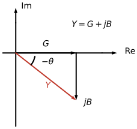

---
aliases:
  - ELEC 2400 admittance
  - ELEC2400 admittance
  - HKUST ELEC 2400 admittance
  - HKUST ELEC2400 admittance
  - admittance
  - immittance
  - susceptance
tags:
  - flashcard/active/special/academia/HKUST/ELEC_2400/admittance
  - language/in/English
---

# admittance

Admittance is how easily an element lets current through: it is the reciprocal of the impedance, $Y = \frac{\mathbf{I}}{\mathbf{V}} = \frac{1}{Z}$, measured in siemens (S). It is a complex number whose angle is the angle by which the current leads the voltage, the negative of the impedance's angle ([electrical impedance](electrical%20impedance.md)).

---

Flashcards for this section are as follows:

- what admittance is: how is the admittance of a two-terminal element defined, and in what unit is it measured? ::@:: $Y = \frac{\mathbf{I}}{\mathbf{V}} = \frac{1}{Z}$, the ratio of the current phasor to the voltage phasor; it is the reciprocal of the impedance, measured in siemens (S). <!-- check: ignore-line[two_sided_calc_warning]: conceptual -->
- the angle: how does an admittance's angle compare with the impedance's angle? ::@:: It is the negative of the impedance's angle: the admittance measures how far the current leads the voltage, and the impedance how far the voltage leads the current.

## admittance of the basic elements

A resistor has $Y_R = 1/R = G$, a conductance that no frequency touches. The storage elements invert their impedances, so $j\omega$ swaps between numerator and denominator: the capacitor has $Y_C = j\omega C$, and the inductor $Y_L = \frac{1}{j\omega L} = -j\frac{1}{\omega L}$.

As admittances the two storage elements pass more current exactly where their impedances pass less: a capacitor opens up as the frequency rises, an inductor as it falls.

---

Flashcards for this section are as follows:

- admittance of the basic elements / the resistor: what is the admittance of a resistance $R$? ::@:: $Y_R = 1/R = G$, a real conductance that does not depend on frequency.
- admittance of the basic elements / the capacitor: what is the admittance of a capacitance $C$ at angular frequency $\omega$? ::@:: $Y_C = j\omega C$, which grows with frequency.
- admittance of the basic elements / the inductor: what is the admittance of an inductance $L$ at angular frequency $\omega$? ::@:: $Y_L = \frac{1}{j\omega L} = -j\frac{1}{\omega L}$, which shrinks in magnitude as the frequency rises.
- admittance of the basic elements / the frequency trends: how do the two storage elements behave as admittances at the extremes of frequency? ::@:: The capacitor conducts better as the frequency rises and the inductor better as it falls, the opposite of how their impedances move.

## conductance and susceptance

The admittance splits into a real and an imaginary part, $Y = G + jB$, where $G$ is the conductance and $B$ the susceptance, both in siemens. A capacitor carries a positive susceptance, $B_C = \omega C$, and an inductor a negative one, $B_L = -\frac{1}{\omega L}$.

The sign runs opposite to the reactance sign, because the reciprocal flips the imaginary part: an inductive impedance $jX_L$ above the real axis becomes an admittance below it. The admittance diagram draws $G$ along the real axis and $B$ vertically from its tip, with $Y$ as the resultant. An inductor makes $B$ negative, so that resultant sits below the axis at the angle $-\theta$.

---

Flashcards for this section are as follows:

- conductance and susceptance / the two parts: how is an admittance split, and what does each part name? ::@:: $Y = G + jB$, with $G$ the conductance and $B$ the susceptance, both measured in siemens. <!-- check: ignore-line[two_sided_calc_warning]: conceptual -->
- conductance and susceptance / the signs: what susceptance does a capacitor carry, what susceptance does an inductor carry, and how does that compare with their reactances? ::@:: $B_C = \omega C$ is positive and $B_L = -\frac{1}{\omega L}$ negative, the opposite of the reactance signs, because the reciprocal flips the imaginary part. <!-- check: ignore-line[two_sided_calc_warning]: conceptual -->
- the admittance diagram: how are the conductance, the susceptance, and the admittance arranged? 
  ::@:: $G$ lies along the positive real axis, the susceptance of an inductor points downward from its tip, and $Y = G + jB$ is the resultant at the angle $-\theta$. <!-- check: ignore-line[two_sided_calc_warning]: conceptual -->
- draw the admittance of an inductive element: which way does the susceptance point, and at what angle does the resultant sit? ::@:: Downward from the tip of $G$, since $B$ is negative, with the resultant below the real axis at the angle $-\theta$. 
  <!-- check: ignore-line[two_sided_calc_warning]: conceptual -->

## combining admittances

Admittances in parallel add, $Y_\text{eq} = Y_1 + Y_2 + \dots$, because the elements share one voltage and their currents add. Series connections invert the rule, $\frac{1}{Y_\text{eq}} = \frac{1}{Y_1} + \frac{1}{Y_2} + \dots$, and the current divider reads $\mathbf{I}_1 = \frac{Y_1}{Y_1 + Y_2}\mathbf{I}_s$ for a pair splitting a source current.

A parallel network then costs one addition, with no reciprocal of a sum to compute, and that is why node equations are often written with admittances.

---

Flashcards for this section are as follows:

- combining admittances / parallel: how do admittances combine in parallel, and why? ::@:: They add, $Y_\text{eq} = Y_1 + Y_2 + \dots$, because the elements share one voltage and their currents add. <!-- check: ignore-line[two_sided_calc_warning]: conceptual -->
- combining admittances / series: how do admittances combine in series? ::@:: Their reciprocals add, $\frac{1}{Y_\text{eq}} = \frac{1}{Y_1} + \frac{1}{Y_2} + \dots$, mirroring the impedance rule for parallel. <!-- check: ignore-line[two_sided_calc_warning]: conceptual -->
- combining admittances / the divider: two admittances $Y_1$ and $Y_2$ share a source current $\mathbf{I}_s$; what current does $Y_1$ take? ::@:: $\mathbf{I}_1 = \frac{Y_1}{Y_1 + Y_2}\mathbf{I}_s$, the admittance-weighted share of the source current.
- combining admittances / why they are used: what makes admittances convenient in a parallel network? ::@:: The parallel combination is a plain sum, with no reciprocal of a sum to take, so node equations come out shorter.

## relating admittance to impedance

Neither part is the reciprocal of the matching impedance part. Multiplying $Y = \frac{1}{R + jX}$ above and below by the conjugate expands it into $G = \frac{R}{R^2 + X^2}$ and $B = -\frac{X}{R^2 + X^2}$, both scaled by $|Z|^2 = R^2 + X^2$.

Only a purely resistive element has $G = 1/R$ and $B = 0$. A $3 + j4\ \Omega$ impedance, whose magnitude is $5\ \Omega$, has $G = \frac{3}{25} = 0.12\text{ S}$ and $B = -\frac{4}{25} = -0.16\text{ S}$, not $1/3\text{ S}$ and $-1/4\text{ S}$ ([electrical impedance](electrical%20impedance.md)).

---

Flashcards for this section are as follows:

- relating admittance to impedance / conductance from resistance: how is the conductance $G$ computed from $R$ and $X$? ::@:: $G = \frac{R}{R^2 + X^2}$, the resistance divided by the squared magnitude of the impedance.
- relating admittance to impedance / susceptance from reactance: how is the susceptance $B$ computed from $R$ and $X$? ::@:: $B = -\frac{X}{R^2 + X^2}$, which carries the opposite sign to the reactance.
- relating admittance to impedance / the reciprocal trap: when are $G$ and $B$ the plain reciprocals of $R$ and $X$? ::@:: Only when the element is purely resistive, $X = 0$, which gives $G = 1/R$ and $B = 0$; otherwise both parts are scaled by $R^2 + X^2$.
- relating admittance to impedance / worked numbers: a $3 + j4\ \Omega$ impedance has magnitude $5\ \Omega$; what are its conductance and susceptance? ::@:: $G = \frac{3}{25} = 0.12\text{ S}$ and $B = -\frac{4}{25} = -0.16\text{ S}$.
