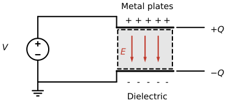

---
aliases:
  - ELEC 2400 capacitor
  - ELEC2400 capacitor
  - HKUST ELEC 2400 capacitor
  - HKUST ELEC2400 capacitor
  - capacitance
  - capacitor
  - parallel-plate capacitor
tags:
  - flashcard/active/special/academia/HKUST/ELEC_2400/capacitor
  - language/in/English
---

# capacitor

A capacitor is the circuit element that stores electric charge. Two metal plates separated by an insulating dielectric make one: the plate tied to the higher potential holds the charge $+Q$, the other holds $-Q$, and the amount stored is proportional to the voltage across the plates.

On a circuit diagram a capacitor is two parallel lines of equal length with a lead leaving each. The analysis marks one lead $+$ and the other $-$, draws the current arrow, and writes the voltage $v_c(t)$. Every two-terminal element gets the same reference directions.

---

Flashcards for this section are as follows:

- the parallel-plate capacitor: what does the drawing show, from one terminal to the other? 
  ::@:: A voltage source across two metal plates separated by a dielectric, with positive charge $+Q$ on the plate at the higher potential, negative charge $-Q$ on the other, and the electric field $E$ pointing from the positive plate to the negative one. <!-- check: ignore-line[two_sided_calc_warning]: conceptual -->
- sketch the parallel-plate capacitor: how are the charge signs, the dielectric, and the electric field arranged between the plates? ::@:: The plate at the higher potential carries $+Q$ and the other $-Q$, the dielectric fills the gap between them, and the electric field $E$ points from the positive plate to the negative one. 
  <!-- check: ignore-line[two_sided_calc_warning]: conceptual -->
- the capacitor symbol: which reference directions does the drawing fix? 
  ::@:: The current arrow $i_C(t)$ points into the plate marked $+$, and the marks fix the sign of the voltage $v_C(t)$ across the capacitor labelled $C$. <!-- check: ignore-line[two_sided_calc_warning]: conceptual -->
- draw a capacitor of capacitance C on a circuit diagram: what marks come with it? ::@:: Two parallel plates in the branch, labelled $C$, with the current arrow $i_C(t)$ into the plate marked $+$ and the voltage $v_C(t)$ written across the pair. 
  <!-- check: ignore-line[two_sided_calc_warning]: conceptual -->
- what a capacitor is: which circuit element stores electric charge, and what is a simple one made of? ::@:: A capacitor stores electric charge; a simple one is two metal plates separated by a dielectric, an insulator.
- charge placement: the voltage across a capacitor is $V$ and its capacitance is $C$; where does the stored charge sit, and how large is it? ::@:: A charge $+Q$ sits on the plate at the higher potential and $-Q$ on the other plate, with $Q = CV$.
- the defining relation: how are the stored charge and the terminal voltage of a capacitor related? ::@:: The charge is proportional to the voltage, $Q = CV$, with $C$ the capacitance in farads, and $1\text{ F} = 1\text{ C}/\text{V}$. <!-- check: ignore-line[two_sided_calc_warning]: conceptual -->
- the circuit symbol: how is a capacitor drawn on a circuit diagram? ::@:: Two parallel lines of equal length with a lead from each, plus the usual $+$ and $-$ marks and current arrow chosen as reference directions for the analysis. <!-- check: ignore-line[two_sided_calc_warning]: conceptual -->

## capacitance

The capacitance of a parallel-plate capacitor follows from its geometry, $C = \varepsilon A/d$, with $\varepsilon = k\varepsilon_0$. $\varepsilon_0 = 8.854\times10^{-12}\text{ F/m}$ is the permittivity of free space, and $k$ is the dielectric constant (relative permittivity) of the insulator between the plates. The plate area is $A$ and the separation $d$.

A larger plate area or a smaller separation stores more charge at the same voltage, and a dielectric of larger $k$ raises the capacitance in proportion.

A mica dielectric with $k = 5$ between plates of $0.5\text{ cm}\times0.5\text{ cm}$ separated by $d = 100\ \mu\text{m}$ gives $C = 5\times8.854\times10^{-12}\times0.005\times0.005/(100\times10^{-6})\approx11\text{ pF}$.

---

Flashcards for this section are as follows:

- capacitance / geometry: which quantities fix the capacitance of a parallel-plate capacitor, and how? ::@:: On the geometry alone: $C = \varepsilon A/d$ with $\varepsilon = k\varepsilon_0$, where $A$ is the plate area, $d$ the plate separation, and $k$ the dielectric constant of the insulator. <!-- check: ignore-line[two_sided_calc_warning]: conceptual -->
- capacitance / permittivity of free space: what is the value of $\varepsilon_0$, and in which units? ::@:: $\varepsilon_0 = 8.854\times10^{-12}\text{ F/m}$, the permittivity of free space.
- capacitance / changing the geometry: the plate area of a parallel-plate capacitor doubles while its plate separation stays fixed; what happens to $C$? ::@:: The capacitance doubles, since $C = \varepsilon A/d$ grows in proportion to $A$.
- capacitance / mica example: a mica capacitor has $k = 5$, plate area $0.5\text{ cm}\times0.5\text{ cm}$, and plate separation $100\ \mu\text{m}$; what capacitance does it have? ::@:: $C = 5\times8.854\times10^{-12}\times0.005\times0.005/(100\times10^{-6})\approx11\text{ pF}$.

## voltage, charge, and current

The terminal voltage fixes the charge, $v_c(t) = q(t)/C$. Differentiating that gives the current, $i_c(t) = C\,dv_c(t)/dt$. Read the other way, $v_c(t) = v_c(0) + \frac{1}{C}\int_0^t i_c(\tau)\,d\tau$.

A constant voltage gives no current, so a capacitor blocks direct current (DC) once it has charged. A steady ramp gives a constant current. The voltage cannot jump, because a jump would demand infinite current.

A capacitance of $C = 2\text{ F}$ carrying $v_c(t) = 2t\text{ V}$ draws the constant current $i(t) = C\,dv_c/dt = 2\times2 = 4\text{ A}$.

---

Flashcards for this section are as follows:

- voltage, charge, and current / defining relation: how does the current through a capacitor relate to the voltage across it? ::@:: $i_c(t) = C\,dv_c(t)/dt$: the current is the capacitance times the rate of change of the terminal voltage. <!-- check: ignore-line[two_sided_calc_warning]: conceptual -->
- voltage, charge, and current / integral form: the current into a capacitor is $i_c(t)$; how is the terminal voltage recovered from it? ::@:: $v_c(t) = v_c(0) + \frac{1}{C}\int_0^t i_c(\tau)\,d\tau$, fixed up to its initial voltage.
- voltage, charge, and current / direct current (DC) blocking: why does a capacitor pass no current under a constant applied voltage? ::@:: $i_c = C\,dv_c/dt$ vanishes once the voltage stops changing, so a charged capacitor blocks direct current (DC). <!-- check: ignore-line[two_sided_calc_warning]: conceptual -->
- voltage, charge, and current / ramp example: a $2\text{ F}$ capacitor carries $v_c(t) = 2t\text{ V}$; what current does it draw? ::@:: $i(t) = C\,dv_c/dt = 2\times2 = 4\text{ A}$, constant for as long as the ramp lasts.
- voltage, charge, and current / continuity: can the voltage across a capacitor jump discontinuously? ::@:: No: a jump would need $dv_c/dt$ to be infinite, and the current with it. <!-- check: ignore-line[two_sided_calc_warning]: conceptual -->

## stored energy

Charging a capacitor takes work, and that work stays in the electric field between the plates. The source pushes charge onto the plates against the voltage already there, so the power flowing in is $p = v_c i_c = C v_c\frac{dv_c}{dt}$, the derivative of $\frac{1}{2}Cv_c^2$. Integrating that power while the voltage climbs from zero to $V$ gives the work, $E_c = \int_0^V Cv\,dv = \frac{1}{2}CV^2$. Written with the stored charge in place of the voltage, the same energy is $\frac{1}{2}QV$ or $\frac{Q^2}{2C}$.

A $2\text{ F}$ capacitor charged to $V_c = 2\text{ V}$ holds $E_c = \frac{1}{2}\times2\times2^2 = 4\text{ J}$.

---

Flashcards for this section are as follows:

- stored energy / formula: what is the energy stored on a capacitor charged to the voltage $V$, and where does it sit? ::@:: $E_c = \frac{1}{2}CV^2$, stored in the electric field between the plates.
- stored energy / charged example: a $2\text{ F}$ capacitor is charged to $2\text{ V}$; what energy does it store? ::@:: $E_c = \frac{1}{2}CV^2 = \frac{1}{2}\times2\times2^2 = 4\text{ J}$.
- stored energy / in terms of charge: rewrite $\frac{1}{2}CV^2$ with the stored charge $Q$ in place of the voltage. ::@:: $E_c = \frac{1}{2}QV = \frac{Q^2}{2C}$.

## series and parallel connections

Capacitors in parallel sit between the same two nodes, so their charges add at each node and the capacitances add: $C_\text{eq} = C_1 + C_2 + \dots + C_N$.

Slide two parallel-plate capacitors sideways into each other and they become one capacitor: same gap, same dielectric, and a plate area that is now $A_1 + A_2$. Since $C = \varepsilon A/d$ grows in proportion to the area, the capacitances of a parallel pair add.

Capacitors in series share one current, and their voltages add, which inverts the rule: $\frac{1}{C_\text{eq}} = \frac{1}{C_1} + \frac{1}{C_2} + \dots + \frac{1}{C_N}$. Stack the two the other way instead, one above the other along the field, and the merged capacitor keeps the plate area while its gap becomes $d_1 + d_2$. Since $C$ shrinks as the gap grows, the reciprocals add, and a series equivalent is smaller than the smallest capacitance in the chain.

The shorthand $C_\text{eq} = C_1 \| C_2$ writes the two-capacitor case as $C_1\|C_2 = \frac{C_1C_2}{C_1+C_2}$, where $a\|b = \frac{ab}{a+b}$ is a symbol for that arithmetic rather than a circuit statement.

A network of $10\ \mu\text{F}$, $2\ \mu\text{F}$, $3\ \mu\text{F}$, $10\ \mu\text{F}$, and $15\ \mu\text{F}$ capacitors reduces as $(10\|5) + (10\|15) = 3.33 + 6 = 9.33\ \mu\text{F}$. The $2\ \mu\text{F}$ and $3\ \mu\text{F}$ capacitors are in series, and that pair sits in parallel with a $10\ \mu\text{F}$ capacitor. The $10\ \mu\text{F}$ and $15\ \mu\text{F}$ capacitors form a second parallel pair, and the two pairs are in series.

---

Flashcards for this section are as follows:

- series and parallel connections / parallel rule: how does the equivalent capacitance of capacitors connected in parallel relate to the individual capacitances? ::@:: The capacitances add, $C_\text{eq} = C_1 + C_2 + \dots + C_N$, because the charges add onto shared plates at the same voltage. <!-- check: ignore-line[two_sided_calc_warning]: conceptual -->
- series and parallel connections / the parallel merge: two parallel-plate capacitors with the same gap and dielectric slide together into one plate pair; which part of $C = \varepsilon A/d$ changes, and what follows? ::@:: The plate area, which becomes $A_1 + A_2$, while the gap and dielectric stay; $C$ grows with the area, so the capacitances add.
- series and parallel connections / series rule: how does the equivalent capacitance of capacitors connected in series relate to the individual capacitances? ::@:: The reciprocals add, $\frac{1}{C_\text{eq}} = \frac{1}{C_1} + \frac{1}{C_2} + \dots + \frac{1}{C_N}$, because the capacitors share one current and their voltages add. <!-- check: ignore-line[two_sided_calc_warning]: conceptual -->
- series and parallel connections / the series merge: the same two capacitors are stacked one above the other along the field; which part of $C = \varepsilon A/d$ changes, and what follows? ::@:: The gap, which becomes $d_1 + d_2$, while the plate area stays; $C$ falls as the gap grows, so the reciprocals add.
- series and parallel connections / two-capacitor shorthand: what does $C_1\|C_2$ evaluate to, and what does the bar notation mean? ::@:: $C_1\|C_2 = \frac{C_1C_2}{C_1+C_2}$; the notation $a\|b = \frac{ab}{a+b}$ abbreviates that arithmetic, not a parallel connection by itself.
- series and parallel connections / smaller than the smallest: why is the equivalent capacitance of a series chain smaller than every capacitance in it? ::@:: $\frac{1}{C_\text{eq}}$ is the sum of positive reciprocals, so $\frac{1}{C_\text{eq}} > \frac{1}{C_i}$ for each $C_i$, which puts $C_\text{eq}$ below the smallest of them. <!-- check: ignore-line[two_sided_calc_warning]: conceptual -->
- series and parallel connections / worked network: $10\ \mu\text{F}\|(2\ \mu\text{F}+3\ \mu\text{F})$ in series with the pair $10\ \mu\text{F}\|15\ \mu\text{F}$; what is the equivalent capacitance? ::@:: $(10\times5)/(10+5) + (10\times15)/(10+15) = 3.33 + 6 = 9.33\ \mu\text{F}$.

## response to a sinusoidal voltage

A capacitance $C$ driven by $v_c(t) = V_p\cos\omega t$ draws $i_c(t) = C\,dv_c/dt = -\omega C V_p\sin\omega t = \omega C V_p\cos(\omega t + \pi/2)$. The current is a sinusoid of the same frequency whose phase leads the voltage by $\pi/2$, a quarter cycle or $90^\circ$.

The current amplitude $\omega C V_p$ grows in proportion to the frequency. At a low frequency the current is negligible and the capacitor behaves as an open circuit; at a high frequency it is large and the capacitor behaves as a short circuit. A $10\ \mu\text{F}$ capacitor across a $10\text{ V}$ amplitude source draws $i_c(t) = -0.628\sin(2\pi\cdot1\text{k}t)\text{ A}$ at $1\text{ kHz}$, $-6.28\sin(2\pi\cdot10\text{k}t)\text{ A}$ at $10\text{ kHz}$, and $-62.8\sin(2\pi\cdot100\text{k}t)\text{ A}$ at $100\text{ kHz}$.

The current and the voltage are a quarter cycle out of step, so their product averages to zero over a cycle: a capacitor consumes no average power. What it stores over one half of the cycle comes back over the other half ([AC power](AC%20power.md)).

---

Flashcards for this section are as follows:

- response to a sinusoidal voltage / lead: a capacitor with $v_c(t) = V_p\cos\omega t$ across it; what does its current look like, and how does its phase compare with the voltage's? ::@:: $i_c(t) = \omega C V_p\cos(\omega t + \pi/2)$, a sinusoid of the same frequency leading the voltage by $90^\circ$.
- response to a sinusoidal voltage / direction of the lead: does the capacitor current lead or lag its voltage, and by how much? ::@:: It leads, by $\pi/2$ radians, that is $90^\circ$ or a quarter cycle. <!-- check: ignore-line[two_sided_calc_warning]: conceptual -->
- response to a sinusoidal voltage / frequency trend: the amplitude of the current into a capacitor under a fixed sinusoidal voltage grows with frequency; what does the capacitor look like at the two extremes? ::@:: An open circuit at low frequency and a short circuit at high frequency.
- response to a sinusoidal voltage / worked amplitudes: a $10\ \mu\text{ F}$ capacitor carries a $10\text{ V}$ amplitude sinusoid at $1\text{ kHz}$, $10\text{ kHz}$, and $100\text{ kHz}$; what current flows at each frequency? ::@:: $i_c(t) = -0.628\sin(2\pi\cdot1\text{k}t)\text{ A}$, $-6.28\sin(2\pi\cdot10\text{k}t)\text{ A}$, and $-62.8\sin(2\pi\cdot100\text{k}t)\text{ A}$ respectively.
- response to a sinusoidal voltage / average power: why does an ideal capacitor consume no average power under sinusoidal excitation? ::@:: Its current leads its voltage by $90^\circ$, so the product $v(t)i(t)$ averages to zero over a cycle: energy is stored in one half cycle and released in the other. <!-- check: ignore-line[two_sided_calc_warning]: conceptual -->

## why the frequency ends open and closed

The impedance of a capacitor is $Z_C = 1/(j\omega C)$, and its magnitude $|Z_C| = 1/(\omega C)$ gives both frequency extremes at once. As $\omega \to 0$ the magnitude rises without bound, so at any finite voltage the current $\mathbf{I}_C = \mathbf{V}_C/Z_C$ falls to zero: an open circuit. As $\omega \to \infty$ the magnitude falls to zero, so at any finite current the voltage across the capacitor falls to zero: a short circuit.

The time-domain amplitude says the same thing. A capacitor driven by $V_p\cos\omega t$ draws a current of amplitude $\omega C V_p$: a slowly varying voltage moves charge so gently that almost none flows, while a fast one moves charge every instant and joins the plates. An inductor's $Z_L = j\omega L$ runs the other way, so it opens where a capacitor closes ([Inductor](inductor.md)).

---

Flashcards for this section are as follows:

- why the frequency ends open and closed / low frequency: with $Z_C = 1/(j\omega C)$, what does a capacitor become as $\omega \to 0$? ::@:: An open circuit: $|Z_C| = 1/(\omega C)$ grows without bound, so the current falls to zero at a finite voltage.
- why the frequency ends open and closed / high frequency: with $Z_C = 1/(j\omega C)$, what does a capacitor become as $\omega \to \infty$? ::@:: A short circuit: $|Z_C| = 1/(\omega C)$ falls to zero, so the voltage across it falls to zero at a finite current.
- why the frequency ends open and closed / the time-domain cross-check: which amplitude in the time domain carries the same two limits, and how does it move? ::@:: The current amplitude $\omega C V_p$: it vanishes as $\omega \to 0$ and grows without bound as $\omega \to \infty$. <!-- check: ignore-line[two_sided_calc_warning]: conceptual -->
- why the frequency ends open and closed / the inductor contrast: how does an inductor's $Z_L = j\omega L$ differ at the two extremes? ::@:: It runs the other way: $|Z_L| = \omega L$ falls to zero at low frequency, so the inductor is a short there and an open at high frequency.
