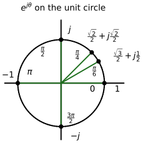

---
aliases:
  - ELEC 2400 complex number
  - ELEC2400 complex number
  - HKUST ELEC 2400 complex number
  - HKUST ELEC2400 complex number
  - complex number
  - complex plane
  - imaginary unit
tags:
  - flashcard/active/special/academia/HKUST/ELEC_2400/complex_number
  - language/in/English
---

# complex number

A complex number pairs two real numbers into one quantity, $z = a + jb$, with $a$ the real part and $b$ the imaginary part. The unit $j$ satisfies $j^2 = -1$; electrical engineering writes $j$ rather than $i$ so the symbol stays free for the current. Any polynomial that lacks real roots still has complex ones: $x^2 + x + 1 = 0$ has no real solution, while $x = -\frac{1}{2} \pm j\frac{\sqrt{3}}{2}$ solves it.

Plotted as the point $(a, b)$ on a plane whose horizontal axis is the real part and whose vertical axis the imaginary part, the number gains a geometry that its arithmetic obeys.

---

Flashcards for this section are as follows:

- a complex number on the plane: how do the rectangular parts and the polar parts appear in the drawing? 
  ::@:: The rectangular parts are the real part $a$ along the real axis and the imaginary part $j b$ along the imaginary axis; the polar parts are the magnitude $r=|z|$ from the origin to the point and the argument $\theta$ measured from the positive real axis. <!-- check: ignore-line[two_sided_calc_warning]: conceptual -->
- plot z equals a plus j b: where do a, b, r, and theta sit on the complex plane? ::@:: The point sits $a$ along the real axis and $b$ up the imaginary axis, $r$ is the line from the origin to the point, and $\theta$ is the angle from the positive real axis to that line. 
  <!-- check: ignore-line[two_sided_calc_warning]: conceptual -->
- the common exponentials: which values sit on the unit circle in the drawing? 
  ::@:: $e^{j0}=1$, $e^{j\pi/6}=\frac{\sqrt{3}}{2}+j\frac{1}{2}$, $e^{j\pi/4}=\frac{\sqrt{2}}{2}+j\frac{\sqrt{2}}{2}$, $e^{j\pi/2}=j$, $e^{j\pi}=-1$, and $e^{j3\pi/2}=-j$. <!-- check: ignore-line[two_sided_calc_warning]: conceptual -->
- draw the unit circle with the common exponentials on it: at which angles does $e^{j\theta}$ take a marked value? ::@:: A circle of radius one in the complex plane, with $e^{j\theta}$ marked at $\theta = 0$, $\frac{\pi}{6}$, $\frac{\pi}{4}$, $\frac{\pi}{2}$, $\pi$ and $\frac{3\pi}{2}$. 
 
- locate e to the j pi over four on the unit circle: at which point does it sit? 
  ::@:: At $\frac{\sqrt{2}}{2}+j\frac{\sqrt{2}}{2}$, halfway between $1$ and $j$ on the circle of radius one. <!-- check: ignore-line[two_sided_calc_warning]: conceptual -->
- rectangular form: what are the two parts of a complex number, and how is it written? ::@:: The real part $a$ and the imaginary part $b$, written $z = a + jb$. <!-- check: ignore-line[two_sided_calc_warning]: conceptual -->
- the unit $j$: what property defines the imaginary unit $j$, and why do electrical engineers write $j$ instead of $i$? ::@:: $j^2 = -1$; the letter $i$ is reserved for the electric current.
- a root without real solutions: what are the roots of $x^2 + x + 1 = 0$? ::@:: $x = -\frac{1}{2} \pm j\frac{\sqrt{3}}{2}$: the quadratic formula applies unchanged once square roots of negative numbers are allowed.
- the complex plane: how is a complex number $z = a + jb$ placed on a plane, and what do the two axes carry? 
  ::@:: As the point $(a, b)$, with the horizontal axis the real part and the vertical axis the imaginary part.

## addition, subtraction, and multiplication

Addition and subtraction run component by component: $(a + jb) + (c + jd) = (a + c) + j(b + d)$. With $z_1 = -3 + j7$ and $z_2 = -j12$, the sum is $-3 - j5$ and the difference $z_1 - z_2 = -3 + j19$.

Multiplication expands like any binomial product, then $j^2$ collapses to $-1$: $( -3 + j7)(8 + j4) = -24 - j12 + j56 - 28 = -52 + j44$.

The conjugate of $z = a + jb$ is $z^* = a - jb$, reflecting the number across the real axis. A number multiplied by its conjugate comes out real, $zz^* = a^2 + b^2$, and the modulus is its square root, $|z| = \sqrt{a^2 + b^2}$.

Division clears the imaginary part of the denominator by multiplying numerator and denominator by the denominator's conjugate: $\frac{-3 + j7}{8 + j4} = \frac{(-3 + j7)(8 - j4)}{8^2 + 4^2} = 0.05 + j0.85$.

---

Flashcards for this section are as follows:

- a complex number on the plane: how do the rectangular parts and the polar parts appear in the drawing? 
  ::@:: The rectangular parts are the real part $a$ along the real axis and the imaginary part $j b$ along the imaginary axis; the polar parts are the magnitude $r=|z|$ from the origin to the point and the argument $\theta$ measured from the positive real axis. <!-- check: ignore-line[two_sided_calc_warning]: conceptual -->
- plot z equals a plus j b: where do a, b, r, and theta sit on the complex plane? ::@:: The point sits $a$ along the real axis and $b$ up the imaginary axis, $r$ is the line from the origin to the point, and $\theta$ is the angle from the positive real axis to that line. 
  <!-- check: ignore-line[two_sided_calc_warning]: conceptual -->
- the common exponentials: which values sit on the unit circle in the drawing? 
  ::@:: $e^{j0}=1$, $e^{j\pi/6}=\frac{\sqrt{3}}{2}+j\frac{1}{2}$, $e^{j\pi/4}=\frac{\sqrt{2}}{2}+j\frac{\sqrt{2}}{2}$, $e^{j\pi/2}=j$, $e^{j\pi}=-1$, and $e^{j3\pi/2}=-j$. <!-- check: ignore-line[two_sided_calc_warning]: conceptual -->
- locate e to the j pi over four on the unit circle: at which point does it sit? 
  ::@:: At $\frac{\sqrt{2}}{2}+j\frac{\sqrt{2}}{2}$, halfway between $1$ and $j$ on the circle of radius one. <!-- check: ignore-line[two_sided_calc_warning]: conceptual -->
- addition, subtraction, and multiplication / component-wise sum: how do two complex numbers add, and what is $(-3 + j7) + (-j12)$? ::@:: Component by component: $(-3 + j7) + (-j12) = -3 - j5$.
- addition, subtraction, and multiplication / difference: with $z_1 = -3 + j7$ and $z_2 = -j12$, what is $z_1 - z_2$? ::@:: $z_1 - z_2 = -3 + j19$, subtracting the components one by one.
- addition, subtraction, and multiplication / product: expand $(-3 + j7)(8 + j4)$ and reduce it with $j^2 = -1$. ::@:: $-24 - j12 + j56 + j^2 28 = -52 + j44$.
- addition, subtraction, and multiplication / conjugate: what is the conjugate of $z = a + jb$, and what does it do geometrically? ::@:: $z^* = a - jb$, the reflection of $z$ across the real axis of the complex plane.
- addition, subtraction, and multiplication / modulus: how is the modulus $|z|$ of $z = a + jb$ computed, and what is $zz^*$? ::@:: $|z| = \sqrt{a^2 + b^2}$, and $zz^* = a^2 + b^2$, a purely real number.
- addition, subtraction, and multiplication / division: how is a quotient of complex numbers brought into rectangular form, and what is $\frac{-3 + j7}{8 + j4}$? ::@:: Multiply numerator and denominator by the denominator's conjugate: $\frac{(-3 + j7)(8 - j4)}{80} = \frac{4 + j68}{80} = 0.05 + j0.85$.

## polar form

The same number is written by its distance $r = |z| = \sqrt{a^2 + b^2}$ from the origin and its angle $\theta$ from the real axis, $z = re^{j\theta} = r\angle\theta$, where the exponential form follows from Euler's formula ([Euler's formula](Euler%27s%20formula.md)). The angle is read from the coordinates, $\theta = \tan^{-1}(b/a)$, but the quadrant of $(a, b)$ decides the answer: $-4 - j3$ lies in the third quadrant, so its angle is $\tan^{-1}(3/4) + 180^\circ = 216.87^\circ$, not $36.87^\circ$.

Polar form simplifies products and quotients: magnitudes multiply and angles add, $z_1z_2 = r_1r_2\angle(\theta_1 + \theta_2)$, and magnitudes divide and angles subtract, $z_1/z_2 = (r_1/r_2)\angle(\theta_1 - \theta_2)$.

For $z_1 = 2 + j6 = 6.325\angle71.57^\circ$ and $z_2 = -4 - j3 = 5\angle216.87^\circ$, the product is $z_1z_2 = 31.63\angle288.4^\circ$, which $31.6\angle{-71.6^\circ}$ restates within $\pm180^\circ$ and $9.98 - j30.0$ restates in rectangular form. The quotient is $z_1/z_2 = 1.265\angle{-145.3^\circ} = -1.04 - j0.72$.

Angles may be written in degrees or radians, whichever the problem states, and final results are quoted to three significant figures.

---

Flashcards for this section are as follows:

- a complex number on the plane: how do the rectangular parts and the polar parts appear in the drawing? 
  ::@:: The rectangular parts are the real part $a$ along the real axis and the imaginary part $j b$ along the imaginary axis; the polar parts are the magnitude $r=|z|$ from the origin to the point and the argument $\theta$ measured from the positive real axis. <!-- check: ignore-line[two_sided_calc_warning]: conceptual -->
- plot z equals a plus j b: where do a, b, r, and theta sit on the complex plane? ::@:: The point sits $a$ along the real axis and $b$ up the imaginary axis, $r$ is the line from the origin to the point, and $\theta$ is the angle from the positive real axis to that line. 
  <!-- check: ignore-line[two_sided_calc_warning]: conceptual -->
- the common exponentials: which values sit on the unit circle in the drawing? 
  ::@:: $e^{j0}=1$, $e^{j\pi/6}=\frac{\sqrt{3}}{2}+j\frac{1}{2}$, $e^{j\pi/4}=\frac{\sqrt{2}}{2}+j\frac{\sqrt{2}}{2}$, $e^{j\pi/2}=j$, $e^{j\pi}=-1$, and $e^{j3\pi/2}=-j$. <!-- check: ignore-line[two_sided_calc_warning]: conceptual -->
- locate e to the j pi over four on the unit circle: at which point does it sit? 
  ::@:: At $\frac{\sqrt{2}}{2}+j\frac{\sqrt{2}}{2}$, halfway between $1$ and $j$ on the circle of radius one. <!-- check: ignore-line[two_sided_calc_warning]: conceptual -->
- polar form / the two notations: how is a complex number written in polar form, and what do $r$ and $\theta$ measure? ::@:: $z = re^{j\theta} = r\angle\theta$, with $r = \sqrt{a^2 + b^2}$ the distance from the origin and $\theta$ the angle from the real axis.
- polar form / angle with its quadrant: what is the polar form of $-4 - j3$, and why is the quadrant needed? ::@:: $r = \sqrt{4^2 + 3^2} = 5$ and the point lies in the third quadrant, so $\theta = \tan^{-1}(3/4) + 180^\circ = 216.87^\circ$, giving $5\angle216.87^\circ$; $\tan^{-1}$ alone would return the first-quadrant angle $36.87^\circ$.
- polar form / product in polar form: with $z_1 = 6.325\angle71.57^\circ$ and $z_2 = 5\angle216.87^\circ$, what is $z_1z_2$? ::@:: Magnitudes multiply and angles add: $z_1z_2 = 31.63\angle288.4^\circ = 31.6\angle{-71.6^\circ} = 9.98 - j30.0$.
- polar form / quotient in polar form: with $z_1 = 6.325\angle71.57^\circ$ and $z_2 = 5\angle216.87^\circ$, what is $z_1/z_2$? ::@:: Magnitudes divide and angles subtract: $z_1/z_2 = 1.265\angle{-145.3^\circ} = -1.04 - j0.72$.
- polar form / rectangular to polar: what are the two steps that carry $z = a + jb$ into polar form? ::@:: The modulus $r = \sqrt{a^2 + b^2}$ and the angle $\theta = \tan^{-1}(b/a)$ chosen in the quadrant of the point $(a, b)$.
