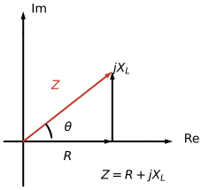

---
aliases:
  - ELEC 2400 electrical impedance
  - ELEC2400 electrical impedance
  - HKUST ELEC 2400 electrical impedance
  - HKUST ELEC2400 electrical impedance
  - electrical impedance
  - reactance
tags:
  - flashcard/active/special/academia/HKUST/ELEC_2400/electrical_impedance
  - language/in/English
---

# electrical impedance

Impedance takes resistance from direct current (DC) into alternating current (AC). The impedance $Z$ of a two-terminal element is the ratio of the voltage phasor across it to the current phasor through it, $Z = \mathbf{V}/\mathbf{I}$, a complex number in ohms ($\Omega$) with a magnitude and a phase. Its reciprocal is the admittance, $Y = 1/Z$, and the two together are sometimes called the immittance of the element ([Phasor](phasor.md), [admittance](admittance.md)).

---

Flashcards for this section are as follows:

- the impedance diagram: how are the resistance and the reactance arranged? 
  ::@:: The resistance $R$ lies along the positive real axis, the inductive reactance $jX_L$ points up from its tip, and the impedance $Z=R+jX_L$ is the resultant vector at the angle $\theta$. <!-- check: ignore-line[two_sided_calc_warning]: conceptual -->
- plot Z equals R plus j X L: which vector does the diagram end up drawing? ::@:: The vector from the origin to the corner reached by walking $R$ along the real axis and then $X_L$ upward, at the angle $\theta$ above the axis. 
  <!-- check: ignore-line[two_sided_calc_warning]: conceptual -->
- what impedance is: how is the impedance of a two-terminal element defined, and what does it extend? ::@:: $Z = \mathbf{V}/\mathbf{I}$, the ratio of the voltage phasor to the current phasor; it extends resistance from direct current (DC) to alternating current (AC) by adding a phase. <!-- check: ignore-line[two_sided_calc_warning]: conceptual -->
- admittance: what is the admittance of an element, and in what units is it measured? ::@:: $Y = 1/Z$, the reciprocal of the impedance, measured in siemens (S). <!-- check: ignore-line[two_sided_calc_warning]: conceptual -->

## impedance of the basic elements

A resistor keeps the same impedance at every frequency, $Z_R = R$. The storage elements acquire a factor of $j\omega$, because differentiation becomes multiplication by $j\omega$. The capacitor relation $i_C = C\,dv_C/dt$ turns into $\mathbf{I}_C = j\omega C\,\mathbf{V}_C$, so $Z_C = \frac{1}{j\omega C} = -j\frac{1}{\omega C}$ and $Y_C = j\omega C$; the inductor relation $v_\ell = L\,di_\ell/dt$ turns into $\mathbf{V}_\ell = j\omega L\,\mathbf{I}_\ell$, so $Z_L = j\omega L$ and $Y_L = \frac{1}{j\omega L} = -j\frac{1}{\omega L}$.

A capacitor's impedance is therefore purely imaginary and shrinks as the frequency rises; an inductor's is purely imaginary and grows. Neither has a real part except at the extremes of frequency: there a capacitor tends to an open circuit at low frequency and a short at high, and an inductor the other way round ([Capacitor](capacitor.md), [Inductor](inductor.md)).

---

Flashcards for this section are as follows:

- impedance of the basic elements / the resistor: what is the impedance of a resistor, and does it depend on frequency? ::@:: $Z_R = R$, a purely real impedance, the same at every frequency. <!-- check: ignore-line[two_sided_calc_warning]: conceptual -->
- impedance of the basic elements / the capacitor: what are the impedance and the admittance of a capacitance $C$ at angular frequency $\omega$? ::@:: $Z_C = 1/(j\omega C) = -j/(\omega C)$ and $Y_C = j\omega C$.
- impedance of the basic elements / the inductor: what are the impedance and the admittance of an inductance $L$ at angular frequency $\omega$? ::@:: $Z_L = j\omega L$ and $Y_L = 1/(j\omega L) = -j/(\omega L)$.
- impedance of the basic elements / where the $j\omega$ comes from: why do the storage elements acquire a factor of $j\omega$ while the resistor does not? ::@:: Their defining relations differentiate or integrate, and $\frac{d}{dt}$ becomes multiplication by $j\omega$ on a sinusoid; the resistor's Ohm's law involves no time derivative.
- impedance of the basic elements / frequency trends: how do $|Z_C|$ and $|Z_L|$ move as the frequency rises? ::@:: $|Z_C| = 1/(\omega C)$ falls and $|Z_L| = \omega L$ rises, so a capacitor tends to a short and an inductor to an open at high frequency.

## resistance and reactance

Split into real and imaginary parts, the impedance reads $Z = R + jX$, where $R$ is the resistance and $X$ the reactance. Every element in the phasor circuit takes this form, and the admittance of the same element splits as $Y = G + jB$, a conductance and a susceptance ([admittance](admittance.md)).

The reactance identifies the element and its phase at once. A capacitor has $X_C = -1/(\omega C)$, negative at every frequency, and an inductor $X_L = +\omega L$, positive at every frequency. A positive reactance makes the voltage lead the current; a negative one makes it lag.

---

Flashcards for this section are as follows:

- resistance and reactance / the two parts: how is an impedance split, and what does each part name? ::@:: $Z = R + jX$, with $R$ the resistance, the real part, and $X$ the reactance, the imaginary part; the admittance of the same element splits as $Y = G + jB$. <!-- check: ignore-line[two_sided_calc_warning]: conceptual -->
- resistance and reactance / signs: what reactance does a capacitor carry, what reactance does an inductor carry, and what does the sign tell? ::@:: $X_C = -1/(\omega C)$ is negative and $X_L = +\omega L$ positive at every frequency; a positive reactance means the voltage leads the current, a negative one that it lags. <!-- check: ignore-line[two_sided_calc_warning]: conceptual -->
- resistance and reactance / purely imaginary: a capacitor's impedance has no real part; what does that say about the phase between its voltage and current? ::@:: The two sit exactly a quarter cycle apart, the current leading the voltage by $90^\circ$. <!-- check: ignore-line[two_sided_calc_warning]: conceptual -->

## magnitude and phase

The magnitude of an impedance follows from its parts, $|Z| = \sqrt{R^2 + X^2}$, and its phase is the angle of the complex number, $\tan^{-1}(X/R)$ taken in its quadrant. The magnitude sets how large the current phasor is for a given voltage phasor, and the phase is the angle by which the voltage leads the current.

---

Flashcards for this section are as follows:

- magnitude and phase / magnitude: how is the magnitude $|Z|$ of an impedance $Z = R + jX$ computed? ::@:: $|Z| = \sqrt{R^2 + X^2}$, the distance from the origin to the point $(R, X)$ in the $z$-plane.
- magnitude and phase / phase: what phase angle does the impedance $Z = R + jX$ carry? ::@:: The angle of the complex number, $\tan^{-1}(X/R)$ chosen in the quadrant of the point $(R, X)$; it is the angle by which the voltage leads the current.

## combining impedances and dividers

Impedances combine by the series and parallel rules, with complex arithmetic in place of real arithmetic: impedances in series add, $Z_\text{eq} = Z_1 + Z_2 + \dots$, and impedances in parallel invert and add, $\frac{1}{Z_\text{eq}} = \frac{1}{Z_1} + \frac{1}{Z_2} + \dots$, with the shorthand $Z_1\|Z_2 = \frac{Z_1Z_2}{Z_1 + Z_2}$.

The voltage divider keeps its shape: two impedances $Z_1$ and $Z_2$ in series across $\mathbf{V}_s$ put $\mathbf{V}_o = \frac{Z_2}{Z_1 + Z_2}\mathbf{V}_s$ across $Z_2$. Across a resistor $R$ and a capacitor $C$ in series, with the output over the capacitor, the ratio is $\frac{\mathbf{V}_o}{\mathbf{V}_s} = \frac{1}{1 + j\omega CR} = \frac{1}{\sqrt{1 + \omega^2C^2R^2}}\angle{-\phi}$ with $\phi = \tan^{-1}(\omega CR)$, so the output is always smaller than the input and always lags it. Both effects grow as the frequency rises.

With $R = 1\text{ k}\Omega$, $C = 1\ \mu\text{F}$, and $v_s(t) = 10\cos(2\pi\cdot1\text{k}t + 25^\circ)\text{ V}$, the ratio at $1\text{ kHz}$ is $\frac{1}{1 + j6.283} = 0.157\angle{-81^\circ}$, and the $10\angle{25^\circ}$-V source scales it to $1.57\angle{-56^\circ}\text{ V}$, that is $v_o(t) = 1.57\cos(2\pi\cdot1\text{k}t - 56^\circ)\text{ V}$.

---

Flashcards for this section are as follows:

- combining impedances and dividers / series and parallel: how do impedances combine in series and in parallel? ::@:: In series they add, $Z_\text{eq} = Z_1 + Z_2 + \dots$; in parallel their inverses add, $\frac{1}{Z_\text{eq}} = \frac{1}{Z_1} + \frac{1}{Z_2} + \dots$, with $Z_1\|Z_2 = \frac{Z_1Z_2}{Z_1 + Z_2}$. <!-- check: ignore-line[two_sided_calc_warning]: conceptual -->
- combining impedances and dividers / the divider ratio: two impedances $Z_1$ and $Z_2$ stand in series across $\mathbf{V}_s$ with the output taken over $Z_2$; what is the output phasor? ::@:: $\mathbf{V}_o = \frac{Z_2}{Z_1 + Z_2}\mathbf{V}_s$, the resistive divider ratio with complex arithmetic in place of real arithmetic.
- combining impedances and dividers / RC divider ratio: what output-over-input ratio does a resistor $R$ in series with a capacitor $C$ give when the output is taken across the capacitor? ::@:: $\frac{\mathbf{V}_o}{\mathbf{V}_s} = \frac{1}{1 + j\omega CR}$, of magnitude $\frac{1}{\sqrt{1 + \omega^2C^2R^2}}$ and phase $-\tan^{-1}(\omega CR)$, so the output is smaller than the input and lags it.
- combining impedances and dividers / RC divider example: with $R = 1\text{ k}\Omega$, $C = 1\ \mu\text{F}$, and $v_s(t) = 10\cos(2\pi\cdot1\text{k}t + 25^\circ)\text{ V}$, what is the output across the capacitor? ::@:: The ratio at $1\text{ kHz}$ is $\frac{1}{1 + j6.283} = 0.157\angle{-81^\circ}$, so the $10\angle{25^\circ}$-V source gives $1.57\angle{-56^\circ}\text{ V}$, that is $v_o(t) = 1.57\cos(2\pi\cdot1\text{k}t - 56^\circ)\text{ V}$: the $25^\circ$ source phase minus the $81^\circ$ lag.

## analysis methods in the phasor domain

Every direct current (DC) method carries into the phasor domain unchanged. Nodal analysis, mesh analysis, superposition, source transformation, Thévenin and Norton equivalents, and dependent sources all operate on the phasor circuit with complex arithmetic, at the one frequency the circuit carries ([phasor](phasor.md)).

Two consequences follow. An equivalent circuit built this way holds at that frequency alone, since the impedances inside it move with $\omega$. Storage elements can also cancel exactly at one frequency: a capacitor and an inductor in parallel present an infinite impedance when $j\omega C$ and $1/(j\omega L)$ sum to zero, so the pair draws no current there.

---

Flashcards for this section are as follows:

- analysis methods in the phasor domain / what carries over: which analysis methods survive the move into the phasor domain? ::@:: All of them: nodal and mesh analysis, superposition, source transformation, Thévenin and Norton equivalents, and dependent sources, applied to the phasor circuit with complex algebra.
- analysis methods in the phasor domain / frequency bound: at how many frequencies is one phasor equivalent circuit valid? ::@:: One: the impedances $1/(j\omega C)$ and $j\omega L$ carry $\omega$, so an equivalent built at one frequency fails at any other. <!-- check: ignore-line[two_sided_calc_warning]: conceptual -->
- analysis methods in the phasor domain / cancellation: a capacitor and an inductor sit in parallel at the frequency where $j\omega C + 1/(j\omega L) = 0$; what impedance does the pair present? ::@:: The two admittances cancel, so the total admittance is zero; the pair then presents an infinite impedance and draws no current at that frequency.
