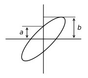

---
aliases:
  - ELEC 2400 week 4 lab 1 lab
  - ELEC2400 week 4 lab 1 lab
  - HKUST ELEC 2400 week 4 lab 1 lab
  - HKUST ELEC2400 week 4 lab 1 lab
tags:
  - flashcard/active/special/academia/HKUST/ELEC_2400/labs/week_4_lab_1/lab
  - language/in/English
---

# lab

- HKUST ELEC 2400 week 4 lab 1
- parent: [week 4 lab 1](index.md)

## bench instruments

Three instruments carry every experiment of the session. A universal serial bus (USB) oscilloscope, the LOTO Instruments OSC 482S, captures voltage waveforms against time and reaches high frequencies, but voltage is the only quantity it reads directly. A digital multimeter (VICTOR VC890C) reads voltage, current, and resistance as single numbers, and its readings stay reliable only at direct current (DC) and low-frequency alternating current (AC). A synthesized function generator supplies the sine, triangle, and square waves under test. The [oscilloscope](../../oscilloscope.md) and the [multimeter](../../multimeter.md) notes carry the operating detail behind each instrument.

A digital multimeter (DMM) turns every quantity into a voltage before displaying it: a voltage is scaled and digitised, a resistance is read by injecting a known constant current and measuring the voltage across the device, and a current is read as the voltage across a small fixed internal resistance. The oscilloscope needs that conversion beforehand: any other quantity must become a voltage before the instrument can display it.

Both instruments have a frequency limit, and each reading outside it is attenuated rather than merely noisy. A multimeter's bandwidth sits around 10 kHz, so a signal of a few hundred hertz and above is measured by the oscilloscope instead.

---

Flashcards for this section are as follows:

- measuring a resistance: a digital multimeter (VICTOR VC890C) measures a resistance; how does it produce the number? ::@:: It injects a known constant current into the device and measures the voltage across the device, then converts that voltage into the displayed number.
- voltage-only instrument: a current in the circuit under test is to be displayed on the oscilloscope; what must happen first? ::@:: The current must be converted into a voltage, because voltage is the only quantity the oscilloscope reads directly.
- bandwidth choice: a digital multimeter (DMM) has a bandwidth of about 10 kHz and the signal under test is a few hundred hertz; which instrument measures it? ::@:: The oscilloscope: the multimeter reading is unreliable once the signal approaches the multimeter's bandwidth, while the oscilloscope reaches far higher frequencies.
- waveform versus number: which instrument shows how a voltage behaves between two instants in time? ::@:: The oscilloscope, which displays the voltage waveform against time; the digital multimeter (DMM) reports a single number per reading.

## phase difference from two waveforms

A series resistor-capacitor (RC) circuit connects a sine wave from the function generator to the oscilloscope: $V_1(t)$ drives node B, the capacitor $C = 1\ \mu\text{F}$ sits between node B and node A, and the resistor $R = 330\ \Omega$ runs from node A to ground. The generator is set to a 1000 Hz sine wave of 2 V peak-to-peak, $\pm 1\text{ V}$, and the oscilloscope confirms the frequency before the measurement starts. 
 

Channel A of the oscilloscope probes node A and channel B probes node B, so the two voltages $V_A(t)$ and $V_1(t)$ appear against one shared time axis. The series capacitor shifts the phase between the two node voltages, so $V_A(t)$ and $V_1(t)$ are offset in time and the oscilloscope displays the offset directly.

The phase difference $\theta$ follows from two readings off the shared display: the time shift $t$ between corresponding points of the two waves and the period $T$ of one full cycle. Each cycle is $360^{\circ}$ of phase, so $\theta = t \times 360^{\circ} / T$.

A labelled sketch of $V_A(t)$ and $V_1(t)$, naming which trace came from which channel, is the record of the measurement; a screen capture cannot serve, because it never identifies the channels.

---

Flashcards for this section are as follows:

- phase from a time shift: two sinusoids of period $T$ cross zero with the same slope at points separated by $t$, with each full cycle worth $360^{\circ}$ of phase; what is their phase difference? ::@:: $\theta = t \times 360^{\circ} / T$.
- channel assignment: the series chain of $C = 1\ \mu\text{F}$ and $R = 330\ \Omega$ has node B between the generator and the capacitor and node A between the capacitor and the resistor; which oscilloscope channel probes which node? ::@:: Channel A probes node A and channel B probes node B, so the display compares $V_A(t)$ with $V_1(t)$.
- why a sketch instead of a screen capture: the record of the phase measurement must show both traces; what does a screen capture fail to show? ::@:: It fails to identify which trace came from channel A and which from channel B, so the record is a labelled sketch.
- what sets the phase difference: the driving frequency and the values of $C$ and $R$ fix the shift between $V_A(t)$ and $V_1(t)$; which values apply in this circuit? ::@:: A 1000 Hz sine of 2 V peak-to-peak drives $C = 1\ \mu\text{F}$ and $R = 330\ \Omega$ in series.
- source settings: which function generator settings drive the phase-measurement circuit? ::@:: A 1000 Hz sine wave at 2 V peak-to-peak, that is $\pm 1\text{ V}$, confirmed on the oscilloscope before measuring. <!-- check: ignore-line[two_sided_calc_warning]: conceptual -->

## phase difference from a Lissajous plot

The oscilloscope's `(A_B) X_Y` display turns each acquired sample into one dot: channel A's voltage sets the dot's horizontal coordinate and channel B's voltage its vertical coordinate. Two sinusoids of equal frequency separated by a phase offset trace an ellipse as the dot travels. 
 

Two distances off that ellipse give the offset directly. The height $a$ is where the ellipse crosses the vertical axis, the height $b$ its greatest distance above the horizontal axis, and the phase difference follows from $\sin\theta = a/b$.

The same phase difference that the time shift gave therefore comes back from the shape of the plot, and the waveforms of $V_A(t)$ and $V_1(t)$ are sketched again with their channel labels.

---

Flashcards for this section are as follows:

- coordinate assignment in the X_Y display: which channel sets which coordinate of the dot? ::@:: Channel A's voltage sets the horizontal coordinate and channel B's voltage the vertical coordinate.
- what the dot draws: channel A drives the horizontal coordinate and channel B the vertical one, both from sinusoids of equal frequency; what shape does the X_Y display trace? ::@:: An ellipse, traced dot by dot as each sample arrives.
- reading the phase from the ellipse: a Lissajous ellipse crosses the vertical axis at height $a$ and reaches its greatest height $b$ above the horizontal axis; what is the phase difference? ::@:: $\sin\theta = a/b$, so $\theta$ is the arcsine of that ratio.
- same offset, two methods: the phase difference was read from a time shift and from a Lissajous ellipse; what makes the two readings one quantity? ::@:: Both describe the offset between the same two sinusoids, so the time-shift value and the ellipse value agree.

## predicting the capacitor voltage

The same circuit predicts $V_A(t)$ before the oscilloscope confirms it. With $V_1(t) = 2\sin(2\pi \cdot 1000\, t)\ \text{V}$ applied, the capacitor presents the reactance $X_C = 1/(2\pi f C)$ at the driving frequency: about $159\ \Omega$ for $C = 1\ \mu\text{F}$ at $f = 1000\ \text{Hz}$, in series with $R = 330\ \Omega$.

The two impedances divide the source between them. The resistor takes the share $R / \sqrt{R^2 + X_C^2}$ of the amplitude, and the reactive part of the capacitor's impedance tilts the phase, so $V_A$ leads $V_1$ by $\arctan(X_C / R)$. Both numbers put the prediction at $V_A(t) \approx 1.80\sin(2\pi \cdot 1000\, t + 25.8^{\circ})\ \text{V}$, which the oscilloscope trace at node A is compared against.

---

Flashcards for this section are as follows:

- capacitive reactance: what does a capacitance $C$ present at the frequency $f$? For $C = 1\ \mu\text{F}$ at $f = 1000\ \text{Hz}$, what is that reactance worth? ::@:: The reactance $X_C = 1/(2\pi f C)$, about $159\ \Omega$ for those values.
- amplitude share: the capacitor's reactance $X_C$ and the resistance $R$ sit in series across the source; how large is the resistor voltage against the source voltage? ::@:: The resistor takes the share $R/\sqrt{R^2 + X_C^2}$ of the source amplitude.
- phase lead: the capacitor's reactance $X_C$ sits in series with $R$; by how much does the resistor voltage lead the source? ::@:: By $\arctan(X_C/R)$, about $25.8^{\circ}$ for $X_C \approx 159\ \Omega$ and $R = 330\ \Omega$.
- full prediction: with $V_1(t) = 2\sin(2\pi \cdot 1000\, t)\ \text{V}$, $C = 1\ \mu\text{F}$, and $R = 330\ \Omega$ in series, what is $V_A(t)$? 
  ::@:: $V_A(t) \approx 1.80\sin(2\pi \cdot 1000\, t + 25.8^{\circ})\ \text{V}$.
