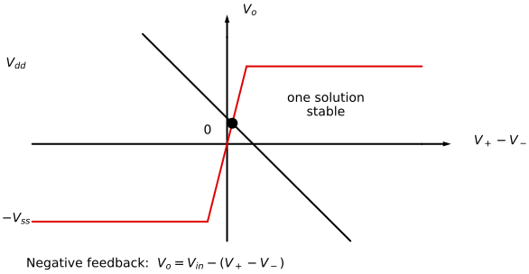
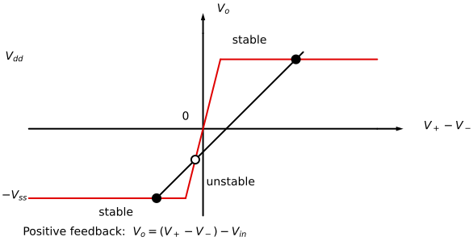

---
aliases:
  - ELEC 2400 negative feedback
  - ELEC2400 negative feedback
  - HKUST ELEC 2400 negative feedback
  - HKUST ELEC2400 negative feedback
  - feedback
  - negative feedback
  - negative-feedback amplifier
tags:
  - flashcard/active/special/academia/HKUST/ELEC_2400/negative_feedback
  - language/in/English
---

# negative feedback

An amplifier's output can be returned to its input in two signs. Negative feedback subtracts that returned share and settles the output toward what the input asks for, while positive feedback adds it and lets any deviation grow until the supply stops it.

---

Flashcards for this section are as follows:

- what does the sign of the feedback decide about how the loop answers a disturbance? ::@:: Negative feedback subtracts a share of the output from the input and brings the output back to what the input sets; positive feedback adds that share and drives the output further out until it pins at a supply rail.

## positive and negative feedback

Feedback routes some of the output back to be combined with the input. The loop has three parts: a summing point where the returned signal joins the input, a forward gain, and a feedback gain that sets how much of the output comes back.

A circuit without feedback runs open-loop; with feedback it runs closed-loop. Either sign closes the same loop, and only the sign at the summing point changes.

Very high gain answers a manufacturing limit. Integrated-circuit technology offers no precision resistance, capacitance or gain values, and what it does make drifts with temperature and varies from batch to batch, though two devices on one chip match each other well. A precise fixed gain is difficult and costly on a chip, and a fixed gain is inflexible anyway. So the chip carries a very high but inaccurate gain, and feedback sets the gain that matters. The resistors and capacitors stay outside the chip, where they can be made as accurate as needed.

---

Flashcards for this section are in the following format:

- the feedback loop: how does the drawing route the output back? 
  ::@:: The output is tapped and returned through the feedback gain block into the summing junction, where it combines with the input before the forward gain block.
- draw an amplifier under feedback: which blocks and which junction carry the signal? ::@:: A summing junction feeds the forward gain block, whose output is tapped and returned through the feedback gain block into the junction. 
 
- feedback: in a circuit holding a forward gain and a feedback gain, what does feedback mean? ::@:: Some of the output is routed back to and combined with the input.
- negative and positive feedback: how do negative feedback and positive feedback differ in their effect on the output? ::@:: Negative feedback tends to stabilize the output toward a target goal, while positive feedback tends to reinforce the output until it grows to a maximum.
- open-loop and closed-loop: what does it mean for a circuit to run open-loop, and what does closed-loop mean? ::@:: Open-loop means no feedback is present, and closed-loop means feedback is present.
- why the gain is very high: why do operational amplifier circuits use a very high but inaccurate gain with feedback instead of a precise fixed gain on the chip? ::@:: Integrated circuit (IC) technology lacks precision resistance, capacitance and gain and suffers huge temperature coefficients and batch-to-batch variation, so on-chip precision is difficult and costly; a very high inaccurate gain plus feedback overcomes the shortfall, and external resistors and capacitors can be made accurate.

## feedback stability under disturbance

Break the loop at the output and raise $V_o$ a little. Under positive feedback the amplifier amplifies the raised value, so $V_o$ rises again and again until it pins at the highest or lowest voltage the supplies allow, $V_{dd}$ or $-V_{ss}$. Under negative feedback the raised value comes back decreased, and $V_o$ falls back to the value $V_{\text{in}}$ sets.

One sign grows a deviation from the operating point and the other kills it, which is the difference between instability and stability. Both signs seemed to give a [unity-gain buffer](buffer%20amplifier.md), because the derivation behind it never used the complete input-output characteristic. With the full characteristic, negative feedback has one solution and it is stable, while positive feedback has three solutions, two stable and one unstable.

Those solutions are the crossings on a graph of the amplifier's own characteristic. Plotted against the differential input $V_+ - V_-$, the characteristic runs steeply through the origin with slope $A$ and lies flat at $V_{dd}$ and at $-V_{ss}$ beyond a narrow span. Both drawings below widen that span so the crossings stay visible; in a real amplifier it covers tens of microvolts.

Feedback draws a straight line on the same axes. Negative feedback returns the output to the inverting terminal, so $V_+ - V_- = V_{\text{in}} - V_o$: a line of slope $-1$ through $V_{\text{in}}$ on the input axis, running down and to the right. It climbs through the steep middle and crosses it once. Raise $V_o$ from that crossing and $V_{\text{in}} - V_o$ falls, the amplifier drives the output back down, and the output settles there again, so the single solution is stable.

Positive feedback returns the output to the non-inverting terminal instead, so $V_+ - V_- = V_{\text{in}} + V_o$ and the line runs up and to the right with slope $+1$. It crosses the steep middle once as well, but a raised $V_o$ now raises $V_+ - V_-$, the steep middle turns that into a larger output, and the output leaves: that crossing is unstable. The other two crossings sit on the flat rails, where a raised $V_+ - V_-$ changes nothing, so the output stays and those two solutions are stable.

The sign of the feedback is the sign of the line's slope, and one crossing against three is the whole difference between the two cases.

---

Flashcards for this section are in the following format:

- positive feedback and a disturbance: a small disturbance raises the output $V_o$ of an operational amplifier under positive feedback; how does the amplifier react, and where does $V_o$ end up? ::@:: The amplifier amplifies the raised value, so $V_o$ keeps rising until it pins at $V_{dd}$, or keeps falling until it pins at $-V_{ss}$: positive feedback amplifies any small disturbance and is unstable.
- negative feedback and a disturbance: a small disturbance raises the output $V_o$ of an operational amplifier under negative feedback; how does the amplifier react, and where does $V_o$ return? ::@:: The raised value comes back decreased, so $V_o$ falls back toward the value $V_{\text{in}}$ sets: negative feedback repairs any small disturbance and is stable.
- solution counts: the unity-gain buffer built from an operational amplifier gave $V_o \approx V_{\text{in}}$ under both the negative and the positive feedback connection; why is that apparently contradictory, and how many solutions does each connection admit once the complete input-output characteristic is used? ::@:: The first derivation did not use the complete input-output characteristic; with it, negative feedback admits one solution, stable, while positive feedback admits three solutions, two stable and one unstable.
- the line negative feedback draws: negative feedback returns the output to the inverting terminal, so $V_+ - V_- = V_{\text{in}} - V_o$; what line does that draw on the characteristic's axes, and why does its crossing hold? 
  ::@:: A line of slope $-1$ through $V_{\text{in}}$ on the input axis; a raised $V_o$ lowers $V_+ - V_-$, the amplifier drives the output back down, and the output settles at that crossing again.
- why positive feedback's middle crossing leaves: positive feedback gives $V_+ - V_- = V_{\text{in}} + V_o$; why does the crossing on the steep middle run away while the two rail crossings stay? 
  ::@:: A raised $V_o$ raises $V_+ - V_-$, the steep middle turns that into a larger output, and the output runs to a rail; on a flat rail a raised $V_+ - V_-$ changes nothing, so the output stays.
- draw the two feedback pictures on the shared $V_o$-against-$V_+ - V_-$ characteristic: what differs between the two lines, and which crossings take a filled marker, which a hollow one? ::@:: Both share flat rails at $V_{dd}$ and $-V_{ss}$ with a steep middle. Negative feedback draws the slope $-1$ line $V_+ - V_- = V_{in} - V_o$, cutting the middle once at a filled marker. Positive feedback draws the slope $+1$ line $V_+ - V_- = V_{in} + V_o$, leaving both rail crossings filled and the middle one hollow. 
  
