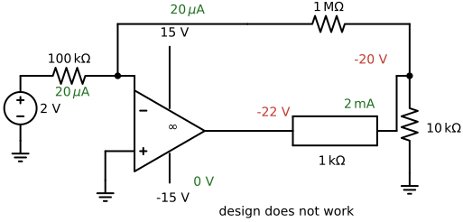
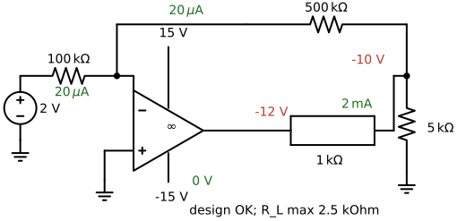

---
aliases:
  - ELEC 2400 operational amplifier
  - ELEC2400 operational amplifier
  - HKUST ELEC 2400 operational amplifier
  - HKUST ELEC2400 operational amplifier
  - op amp
  - operational amplifier
tags:
  - flashcard/active/special/academia/HKUST/ELEC_2400/operational_amplifier
  - language/in/English
---

# operational amplifier

An operational amplifier is a voltage amplifier with two input terminals and one output terminal. It amplifies the difference between its two input voltages.

The name comes from the mathematical operations it can be configured to perform: addition, subtraction, multiplication, division, integration, differentiation, logarithm and exponentiation. It also handles signal-processing functions such as amplification, filtering, and analog-to-digital and digital-to-analog conversion.

---

Flashcards for this section are in the following format:

- the operational amplifier symbol: which terminals does the drawing fix? ::@:: The inverting input marked $-$, the non-inverting input marked $+$, the supply rails $V_{dd}$ and $-V_{ss}$, and the output carrying $V_o = A(V_+ - V_-)$. <!-- check: ignore-line[two_sided_calc_warning]: conceptual -->
- draw an operational amplifier: where do the supply rails attach, and what does the output label say? ::@:: The rails $V_{dd}$ and $-V_{ss}$ attach at the top and bottom of the triangle, and the output carries the open-loop gain relation $V_o = A(V_+ - V_-)$. 
  <!-- check: ignore-line[two_sided_calc_warning]: conceptual -->
- the device: what is an operational amplifier, and what quantity does it amplify? ::@:: An operational amplifier is a voltage amplifier with two input terminals and one output terminal, and it amplifies the difference between its two input voltages, $V_+ - V_-$. <!-- check: ignore-line[two_sided_calc_warning]: conceptual -->
- the name: which mathematical operations give the operational amplifier its name, and what other functions does it perform? ::@:: Addition, subtraction, multiplication, division, integration, differentiation, logarithm and exponentiation give it the name; it also performs signal processing such as amplification, filtering, and analog-to-digital and digital-to-analog conversion.
- early devices: which was the first monolithic integrated-circuit operational amplifier, and which device became the most successful? ::@:: The µA702, designed by Bob Widlar of Fairchild Semiconductor in 1963, was the first; the µA741, designed by Dave Fullagar of Fairchild Semiconductor in 1968, became the most successful.

## amplifier background

### amplifier types

An ideal voltage amplifier multiplies its input voltage by a voltage gain: $V_{\text{out}} = A_v V_{\text{in}}$. A voltage-controlled voltage source models it. Its ideal input resistance is infinite and its ideal output resistance is zero.

A current amplifier multiplies its input current by a current gain: $I_{\text{out}} = A_i I_{\text{in}}$. A current-controlled current source models it. Its ideal input resistance is zero and its ideal output resistance is infinite, in parallel with the dependent source. A current source and a high-fidelity power amplifier driving a speaker are examples.

A transimpedance amplifier, also called a transresistance amplifier, converts an input current into an output voltage: $V_{\text{out}} = R_m I_{\text{in}}$. Its gain $R_m$ has the dimension of resistance. A current-controlled voltage source models it, and its ideal input and output resistances are both zero. A photodiode amplifier is an example.

A transconductance amplifier converts an input voltage into an output current: $I_{\text{out}} = G_m V_{\text{in}}$. Its gain $G_m$ has the dimension of conductance. A voltage-controlled current source models it, and its ideal input and output resistances are both infinite.

---

Flashcards for this section are in the following format:

- voltage amplifier: what relation does an ideal voltage amplifier satisfy between $V_{\text{out}}$ and $V_{\text{in}}$, and what input resistance $R_i$ and output resistance $R_o$ does it present? ::@:: $V_{\text{out}} = A_v V_{\text{in}}$ from a voltage-controlled voltage source, with ideal $R_i = \infty$ and $R_o = 0$.
- current amplifier: what relation does an ideal current amplifier satisfy between $I_{\text{out}}$ and $I_{\text{in}}$, and what input resistance $R_i$ and output resistance $R_o$ does it present? ::@:: $I_{\text{out}} = A_i I_{\text{in}}$ from a current-controlled current source, with ideal $R_i = 0$ and $R_o = \infty$ in parallel with the dependent source.
- transimpedance amplifier: an input current $I_{\text{in}}$ enters a transimpedance (transresistance) amplifier of gain $R_m$; what output does it produce, and what ideal input resistance $R_i$ and output resistance $R_o$? ::@:: It produces $V_{\text{out}} = R_m I_{\text{in}}$ from a current-controlled voltage source, $R_m$ carrying the dimension of resistance, with ideal $R_i = 0$ and $R_o = 0$.
- transconductance amplifier: an input voltage $V_{\text{in}}$ drives a transconductance amplifier of gain $G_m$; what output does it produce, and what ideal input resistance $R_i$ and output resistance $R_o$? ::@:: It produces $I_{\text{out}} = G_m V_{\text{in}}$ from a voltage-controlled current source, $G_m$ carrying the dimension of conductance, with ideal $R_i = \infty$ and $R_o = \infty$.
- dependent sources and amplifier types: which dependent source models each of the four amplifier types? ::@:: A voltage-controlled voltage source models the voltage amplifier, a current-controlled current source the current amplifier, a current-controlled voltage source the transimpedance amplifier, and a voltage-controlled current source the transconductance amplifier.
- power amplifier: a high-fidelity power amplifier drives a speaker; which amplifier type takes that pairing as an example? ::@:: The current amplifier: the high-fidelity power amplifier and speaker pair as an example of $I_{\text{out}} = A_i I_{\text{in}}$ with $R_i = 0$ and $R_o = \infty$. <!-- check: ignore-line[two_sided_calc_warning]: conceptual -->

### loading chain of a practical voltage amplifier

A practical voltage amplifier replaces the ideal limits with real ones: its input resistance $R_i$ is finite and its output resistance $R_o$ is non-zero. The source carries a source resistance $R_s$, and the load is a load resistor $R_L$.

The chain divides twice. The source delivers $V_{\text{in}} = \frac{R_i}{R_s + R_i} V_s$ into the input, and the dependent source $A_v V_{\text{in}}$ delivers $V_{\text{out}} = \frac{R_L}{R_o + R_L} A_v V_{\text{in}}$ into the load, so the effective voltage gain from source to load is $A_v \frac{R_i}{R_s + R_i} \frac{R_L}{R_o + R_L}$.

A temperature sensor reads $0\text{ V}$ at $0\ {}^\circ\text{C}$ and rises by $+1\text{ mV}/{}^\circ\text{C}$, so at $100\ {}^\circ\text{C}$ it delivers $V_s = 100\text{ mV}$ behind $R_s = 300\ \Omega$. The amplifier has $R_i = 2\text{ k}\Omega$ and $R_o = 400\ \Omega$, the meter presents $R_L = 10\text{ k}\Omega$, and the meter must read $V_{\text{out}} = 1\text{ V}$. Inverting the two dividers gives the required gain: $A_v = \frac{1\text{ V}}{100\text{ mV}} \times \frac{300\ \Omega + 2\text{ k}\Omega}{2\text{ k}\Omega} \times \frac{400\ \Omega + 10\text{ k}\Omega}{10\text{ k}\Omega} = 11.96\text{ V/V}$. A [buffer amplifier](buffer%20amplifier.md) removes both dividers: its input draws no current, and its output holds its voltage under load. That gain reads $21.6\text{ dB}$ in [decibels](decibel.md). The same division decides how far a meter's reading falls below the value it should show, which is the [loading effect](loading%20effect.md).

---

Flashcards for this section are in the following format:

- the loading chain: how does the drawing divide the practical amplifier's surroundings? ::@:: The source stage carries $V_s$ behind $R_s$, the amplifier stage carries $R_i$ across its input and the controlled source $A_vV_i$ behind $R_o$, and the load stage carries $R_L$, all on one continuous return wire. <!-- check: ignore-line[two_sided_calc_warning]: conceptual -->
- sketch a practical voltage amplifier between its source and its load: what resistance belongs to each stage? ::@:: The source contributes $R_s$, the amplifier contributes the input resistance $R_i$ and the output resistance $R_o$, and the load contributes $R_L$. 
  <!-- check: ignore-line[two_sided_calc_warning]: conceptual -->
- the loading chain: a source $V_s$ behind $R_s$ drives the input resistance $R_i$ of a practical voltage amplifier, and its dependent source $A_v V_{\text{in}}$ sits behind $R_o$ driving a load $R_L$; what are the input voltage $V_{\text{in}}$ and the load voltage $V_{\text{out}}$? ::@:: $V_{\text{in}} = \frac{R_i}{R_s + R_i} V_s$ and $V_{\text{out}} = \frac{R_L}{R_o + R_L} A_v V_{\text{in}}$.
- effective voltage gain: a source $V_s$ behind $R_s$ drives a practical voltage amplifier with input resistance $R_i$, voltage gain $A_v$ and output resistance $R_o$ into a load $R_L$; what is the gain from $V_s$ to $V_{\text{out}}$? ::@:: $\frac{V_{\text{out}}}{V_s} = A_v \frac{R_i}{R_s + R_i} \frac{R_L}{R_o + R_L}$, which falls short of $A_v$ because the $R_s$-$R_i$ divider and the $R_o$-$R_L$ divider reduce the signal twice.
- temperature-sensor amplifier: a temperature sensor gives $V_s = 100\text{ mV}$ at $100\ {}^\circ\text{C}$ behind $R_s = 300\ \Omega$, and an amplifier with $R_i = 2\text{ k}\Omega$ and $R_o = 400\ \Omega$ must drive $R_L = 10\text{ k}\Omega$ to $V_{\text{out}} = 1\text{ V}$; what voltage gain $A_v$ is needed? ::@:: $A_v = \frac{1\text{ V}}{100\text{ mV}} \times \frac{300\ \Omega + 2\text{ k}\Omega}{2\text{ k}\Omega} \times \frac{400\ \Omega + 10\text{ k}\Omega}{10\text{ k}\Omega} = 11.96\text{ V/V}$.

## device model

### circuit model of an operational amplifier

An operational amplifier is drawn as a triangle carrying two input terminals $V_+$ and $V_-$, one output $V_o$, and two supply connections. Inside the triangle the model holds an input resistance $R_i$ across the two input terminals, a dependent voltage source $A V_{\text{in}}$ whose controlling signal is the difference between those terminals, and an output resistance $R_o$ between that source and the output.

---

Flashcards for this section are in the following format:

- the circuit model: what sits inside the operational amplifier triangle in the drawing? 
  ::@:: The input resistance $R_i$ across the inputs, the controlled source $A(V_+ - V_-)$ referenced to ground, and the output resistance $R_o$ between that source and the output, with the supply rails $V_{dd}$ and $-V_{ss}$. <!-- check: ignore-line[two_sided_calc_warning]: conceptual -->
- draw the circuit model of a practical operational amplifier: where do $R_i$, the controlled source and $R_o$ sit? ::@:: $R_i$ across the input terminals, the controlled source $A(V_+ - V_-)$ referenced to ground, and $R_o$ between it and the output, with the supply rails. 
 
- open the practical operational amplifier model: how are the input resistance, the controlled source, and the output resistance arranged? 
  ::@:: $R_i$ sits across the inputs, the controlled source $A(V_+ - V_-)$ follows it, and $R_o$ sits between the source and the output terminal. <!-- check: ignore-line[two_sided_calc_warning]: conceptual -->
- model contents: what does the circuit model of an operational amplifier place between the input terminals $V_+$ and $V_-$, and between its internal dependent source and the output $V_o$? 
  ::@:: An input resistance $R_i$ across the input terminals, a dependent voltage source $A V_{\text{in}}$ controlled by their difference, and an output resistance $R_o$ toward the output.
- the controlling signal: in the circuit model of an operational amplifier, what is $V_{\text{in}}$, where is it measured, and what does it control? ::@:: $V_{\text{in}} = V_+ - V_-$ is measured between the two input terminals, and it controls the dependent voltage source $A V_{\text{in}}$ that reaches the output through $R_o$.

### differential voltage amplifier

The operational amplifier is a voltage amplifier of extremely high gain: $V_{\text{out}} = A(V_+ - V_-)$. Its voltage gain runs, for example, above $10000\text{ V/V}$, or $80\text{ dB}$, while the ideal operational amplifier has infinite gain.

It is a differential input single-ended output device: the output answers the difference $V_+ - V_-$ between its two inputs, and one output terminal carries the signal against ground.

Power once came from two supplies such as $\pm15\text{ V}$ or $\pm5\text{ V}$. Nowadays the negative supply is often just $0\text{ V}$ (ground, GND), and the zero output can be defined anywhere between ground and the positive supply. Four resistors around the same device make the [differential amplifier](differential%20amplifier.md), which amplifies a difference instead of a single input.

---

Flashcards for this section are in the following format:

- output relation: what relation gives the output voltage $V_{\text{out}}$ of an operational amplifier from its two input voltages $V_+$ and $V_-$ and its gain $A$, and how large is that gain? ::@:: $V_{\text{out}} = A(V_+ - V_-)$; the ideal gain is $A = \infty$, and a real device runs above $10000\text{ V/V}$, or $80\text{ dB}$.
- differential input, single-ended output: what does it mean to describe an operational amplifier as a differential input single-ended output device? ::@:: The output responds to the difference $V_+ - V_-$ between the two input terminals, and the single output terminal carries that signal against ground rather than a pair of output terminals. <!-- check: ignore-line[two_sided_calc_warning]: conceptual -->
- single-supply operation: how is an operational amplifier powered nowadays compared with the past? ::@:: It once ran from two supplies such as $\pm15\text{ V}$ or $\pm5\text{ V}$; nowadays the negative supply is often $0\text{ V}$ (ground, GND), and the zero output can be defined anywhere between ground and the positive supply. <!-- check: ignore-line[two_sided_calc_warning]: conceptual -->

### input and output resistance

The input resistance decides how much of the source voltage reaches the amplifier. A source $V_s$ behind $R_s$ delivers $V_{\text{in}} = \frac{R_i}{R_s + R_i} V_s$, so a large $R_i$ leaves the input close to $V_s$.

The output resistance decides how much of the internal source reaches the load. The load sees $V_{\text{out}} = \frac{R_L}{R_o + R_L} A V_{\text{in}}$, so a small $R_o$ leaves the load close to the internal source voltage. A practical operational amplifier presents $R_i = 10\text{ M}\Omega$ and $R_o = 100\ \Omega$.

---

Flashcards for this section are in the following format:

- input resistance and loading: a source $V_s$ behind $R_s$ drives the input resistance $R_i$ of an amplifier; how does $R_i$ set the input voltage, and what does a large $R_i$ achieve? ::@:: $V_{\text{in}} = \frac{R_i}{R_s + R_i} V_s$, so a large $R_i$ keeps $V_{\text{in}}$ close to $V_s$ and leaves the preceding circuit unloaded.
- output resistance and loading: the internal source $A V_{\text{in}}$ drives the output resistance $R_o$ and a load $R_L$; how does $R_o$ set the load voltage, and what does a small $R_o$ achieve? ::@:: $V_{\text{out}} = \frac{R_L}{R_o + R_L} A V_{\text{in}}$, so a small $R_o$ keeps $V_{\text{out}}$ close to the internal source voltage under load.
- practical resistances: what input resistance $R_i$ and output resistance $R_o$ does a practical operational amplifier present? ::@:: $R_i = 10\text{ M}\Omega$ and $R_o = 100\ \Omega$.

### ideal operational amplifier characteristics

The ideal operational amplifier pushes three quantities to their limits: voltage gain $A \to \infty$, input resistance $R_i \to \infty$, and output resistance $R_o \to 0$.

Two working rules follow. $R_i \to \infty$ blocks current from the input terminals, so $I_i \approx 0$. $R_o \to 0$ leaves $V_{\text{out}} = A V_{\text{in}}$ with $V_{\text{in}} = V_+ - V_-$, so $V_+ - V_- = \frac{V_{\text{out}}}{A}$; as $A \to \infty$ that difference is driven to nothing and $V_+ \approx V_-$. The two terminals then hold one voltage while carrying no current.

A practical device falls short of the ideal: gain $10^5\text{ V/V}$ ($100\text{ dB}$) instead of $\infty$, input offset voltage $V_{\text{os}} = \pm2\text{ mV}$ instead of $0\text{ V}$, input offset current $I_+ - I_- = \pm5\text{ nA}$ instead of $0\text{ nA}$, and bandwidth (BW) $100\text{ MHz}$ using feedback instead of $\infty$. Those two rules are applied as the [virtual short and zero-input-current assumptions](virtual%20ground.md), and each one carries a condition on when it holds.

---

Flashcards for this section are in the following format:

- the three limits: which three limits define an ideal operational amplifier? ::@:: Voltage gain $A \to \infty$, input resistance $R_i \to \infty$, and output resistance $R_o \to 0$. <!-- check: ignore-line[two_sided_calc_warning]: conceptual -->
- no input current: why does an ideal operational amplifier draw no current into its input terminals? ::@:: The input resistance $R_i \to \infty$ sits between the input terminals, so $I_i \approx 0$: no current enters either terminal. <!-- check: ignore-line[two_sided_calc_warning]: conceptual -->
- shared input voltage: starting from $V_{\text{out}} = A(V_+ - V_-)$ with $R_o \to 0$ and $A \to \infty$, why do the input terminals of an ideal operational amplifier sit at one voltage? ::@:: $R_o \to 0$ gives $V_+ - V_- = \frac{V_{\text{out}}}{A}$, and $A \to \infty$ drives that difference to nothing, so $V_+ \approx V_-$ while $I_i \approx 0$ keeps both terminals current-free.
- practical departures: what practical values stand in for the ideal gain, input offset voltage $V_{\text{os}}$, input offset current $I_+ - I_-$ and bandwidth (BW) of an operational amplifier? ::@:: Gain $10^5\text{ V/V}$ ($100\text{ dB}$) instead of $\infty$, $V_{\text{os}} = \pm2\text{ mV}$ instead of $0\text{ V}$, $I_+ - I_- = \pm5\text{ nA}$ instead of $0\text{ nA}$, and bandwidth $100\text{ MHz}$ using feedback instead of $\infty$.

## open loop

### open-loop behavior and saturation

With no feedback the operational amplifier runs open-loop, and its output follows $V_{\text{out}} = A(V_+ - V_-)$ directly. Take $A = 10000$ with power supplies at $+15\text{ V}$ and $-15\text{ V}$: the input difference $V_+ - V_-$ stays linear only between $-1.5\text{ mV}$ and $+1.5\text{ mV}$.

A difference beyond that band drives the output into saturation: too positive a difference pins it at the positive rail, too negative a difference pins it at the negative rail. The supply sets the ceiling, so a $10\text{ mV}$ difference calling for $100\text{ V}$ at $A = 10000$ saturates just below $+15\text{ V}$. The linear band is too narrow to be practical, so operational amplifiers are often used in a feedback configuration.

The high gain also turns the operational amplifier into a comparator: the output sits at $V_{dd}$ when $V_{\text{in}}$ is higher than the reference $V_{\text{ref}}$, and at $-V_{ss}$ when $V_{\text{in}}$ is lower than $V_{\text{ref}}$. The comparison works, but an operational amplifier is not an economical comparator. Closing the loop with [negative feedback](negative%20feedback.md) trades the huge open-loop gain for a precise closed-loop gain, which is why most operational amplifier circuits run closed-loop.

---

Flashcards for this section are in the following format:

- the transfer characteristic: what three regions does the drawing name? 
  ::@:: A linear region of slope $A$ between the knees at $\pm V_{dd}/A$, a positive saturation region at the rail $V_{dd}$, and a negative saturation region at the rail $-V_{ss}$. <!-- check: ignore-line[two_sided_calc_warning]: conceptual -->
- draw the operational amplifier's transfer characteristic: where do the knees at $\pm V_{dd}/A$ sit, and what is the slope between them? ::@:: $V_o$ against $V_+ - V_-$, a straight line of slope $A$ through the origin, kneeing at $V_{dd}/A$ and $-V_{ss}/A$ and flat at the two rails beyond them. 
 
- read the saturation knees off the transfer characteristic: at which input difference does the output leave the straight line? 
  ::@:: At the difference $V_{dd}/A$ in either sign, one rail divided by the open-loop gain. <!-- check: ignore-line[two_sided_calc_warning]: conceptual -->
- open-loop linear range: an operational amplifier runs open-loop with gain $A = 10000$ and power supplies at $\pm15\text{ V}$; over what input difference $V_+ - V_-$ does it stay linear, and why is that range impractical? ::@:: It stays linear from $-1.5\text{ mV}$ to $+1.5\text{ mV}$, since $V_{\text{out}} = 10000(V_+ - V_-)$ reaches the rails at those ends, and the range is too narrow to be practical.
- saturation: at open-loop gain $A = 10000$ with a $+15\text{ V}$ supply, an input difference of $10\text{ mV}$ demands $100\text{ V}$; what does the output do instead, and where does it pin for too positive and too negative a difference? ::@:: It cannot reach $100\text{ V}$: it saturates just below $+15\text{ V}$ for too positive a difference, while too negative a difference pins it at the negative rail.
- comparator: with $V_{\text{in}}$ at one input of a high-gain operational amplifier and a reference $V_{\text{ref}}$ at the other, what is the output for $V_{\text{in}} > V_{\text{ref}}$ and for $V_{\text{in}} < V_{\text{ref}}$? ::@:: For $V_{\text{in}} > V_{\text{ref}}$ the output sits at $V_{dd}$, and for $V_{\text{in}} < V_{\text{ref}}$ it sits at $-V_{ss}$.

### follower or inverter selected by a switch

A source $V_s$ reaches the non-inverting terminal of an ideal operational amplifier through a resistor, with a switch from that terminal to ground; another resistor ties the inverting terminal to $V_s$, a third returns from the output $V_o$ to it, and all three resistances equal $R$.

With the switch open, $I_+ = 0$ leaves no drop across the resistor at the non-inverting terminal, so $V_+ = V_s$, and the virtual short gives $V_- = V_s$. Then $I_- = 0$ makes the two resistances carry equal currents, $\frac{V_o - V_-}{R} = \frac{V_- - V_s}{R}$, so $V_o = 2V_- - V_s = V_s$: a voltage follower circuit.

With the switch closed, $V_+$ is shorted to ground, so $V_+ = 0$ and the virtual short gives $V_- = 0$; the same current relation then gives $V_o = -V_s$: a voltage inverter circuit.

---

Flashcards for this section are in the following format:

- switch open: a source $V_s$ feeds an ideal operational amplifier's non-inverting terminal through a resistor with a switch to ground from that terminal, while the inverting terminal connects to $V_s$ through $R$ and to the output $V_o$ through another $R$, switch open; what is $V_o$ and which circuit? ::@:: With the switch open, $I_+ = 0$ gives $V_+ = V_s$ and the virtual short gives $V_- = V_s$; then $\frac{V_o - V_-}{R} = \frac{V_- - V_s}{R}$ gives $V_o = 2V_s - V_s = V_s$, a voltage follower.
- switch closed: a source $V_s$ feeds an ideal operational amplifier's non-inverting terminal through a resistor with a switch to ground from that terminal, while the inverting terminal connects to $V_s$ through $R$ and to the output $V_o$ through another $R$, switch closed; what is $V_o$ and which circuit? ::@:: With the switch closed, $V_+ = 0$ and the virtual short give $V_- = 0$; then $\frac{V_o - V_-}{R} = \frac{V_- - V_s}{R}$ gives $V_o = -V_s$, a voltage inverter circuit.

## closed-loop behaviour

### open-loop and closed-loop gain

Two voltage gains must be distinguished. The open-loop gain $A$ is the gain of the operational amplifier itself, measured with no feedback path, and it equals $\infty$ for the ideal device. The closed-loop gain $A_{cl} = \frac{V_{\text{out}}}{V_{\text{in}}}$ is the gain from input to output of the feedback circuit; the non-inverting amplifier has $A_{cl} = 1 + \frac{R_2}{R_1}$. Each circuit gets its own treatment: the [non-inverting amplifier](non-inverting%20amplifier.md) and the [inverting amplifier](inverting%20amplifier.md).

The transfer characteristic plots $V_{\text{out}}$ against $V_{\text{in}}$: a line through the origin of slope $A_{cl}$ in the linear region, held at $V_{dd}$ in positive saturation and at $-V_{ss}$ in negative saturation.

---

Flashcards for this section are in the following format:

- the two gains: what distinguishes the open-loop gain $A$ of an operational amplifier from the closed-loop gain $A_{cl}$ of its feedback circuit? ::@:: The open-loop gain $A$ is the device's own gain with no feedback path, $\infty$ for the ideal device, while the closed-loop gain $A_{cl} = \frac{V_{\text{out}}}{V_{\text{in}}}$ is the gain of the feedback circuit, which is $1 + \frac{R_2}{R_1}$ for the non-inverting amplifier.
- transfer characteristic: what does the $V_{\text{out}}$-against-$V_{\text{in}}$ characteristic of an operational amplifier under negative feedback of closed-loop gain $A_{cl}$ look like? ::@:: It is a line through the origin of slope $A_{cl}$ in the linear region, held at $V_{dd}$ once the amplifier enters positive saturation and at $-V_{ss}$ once it enters negative saturation.

### operational amplifier current source

An operational amplifier with $R_1$, $R_2$ and $R_3$ drives a load current $I_L$ that does not depend on the load resistance $R_L$, and the load does not connect to ground. The current divides as $I_L = I_1 - I_2$, and $I_L = \frac{V_s}{R_3}\left(1+\frac{R_2}{R_1}\right)$ depends only on $V_s$ and on accurate $R_1$, $R_2$ and $R_3$.

The circuit reads best as an inverting amplifier that happens to carry a fixed current. Its non-inverting terminal is grounded, so the inverting terminal sits at $0\text{ V}$ and $R_3$ takes the whole of $V_s$ across itself. That fixes the current at $\frac{V_s}{R_3}$ before the load enters the picture, and everything after the node only decides where that current goes.

With $V_s = 2\text{ V}$, $R_1 = 10\text{ k}\Omega$, $R_2 = 1\text{ M}\Omega$ and $R_3 = 100\text{ k}\Omega$, $I_L = \frac{2}{100\text{ k}\Omega}\left(1+\frac{1\text{ M}\Omega}{10\text{ k}\Omega}\right) = 2.02\text{ mA}$, while $I_3 = \frac{V_s}{R_3} = \frac{2}{100\text{ k}\Omega} = 20\ \mu\text{A}$ is negligibly small.

Checking the design with the actual voltages shows that it fails. The $20\ \mu\text{A}$ through $R_2 = 1\text{ M}\Omega$ puts a node at $-20\text{ V}$ whatever the load, and $2\text{ mA}$ through a $1\text{ k}\Omega$ load reaches $-22\text{ V}$: outside the $\pm15\text{ V}$ supply range even for $R_L = 0$. The operational amplifier should have saturated, so $V_+ = V_-$ does not hold. An improved design with $R_2 = 500\text{ k}\Omega$ and $R_1 = 5\text{ k}\Omega$ keeps $2.02\text{ mA}$ and brings the nodes to $-10\text{ V}$ and $-12\text{ V}$, but $R_L$ is still limited to $2.5\text{ k}\Omega$ maximum. Design iterations, optimizations and tradeoffs are routine work for a circuit designer. A grounded load needs the other route, built on the [negative impedance converter](negative%20impedance%20converter.md).

Of $R_1$ and $R_2$, only one has to be there. $R_2$ is the path from the node back to the inverting terminal, so without it the amplifier runs open loop and nothing pins the node. $R_1$ can go. Open it and the fixed $\frac{V_s}{R_3}$ still flows, because every bit of $R_2$'s current then carries on into the load, so the circuit is still a current source. What $R_1$ adds is the multiple $1+\frac{R_2}{R_1}$, the step that turns a small accurate reference current into milliamps.

---

Flashcards for this section are in the following format:

- the op-amp current source: where does the load sit, and why does its resistance not matter? ::@:: The load sits between the op-amp output and the node $V_1$; the op-amp drives whatever voltage the node needs, so the current set by $R_3$, $R_2$, and $R_1$ flows regardless of the load resistance. <!-- check: ignore-line[two_sided_calc_warning]: conceptual -->
- read the current source as an inverting amplifier: why is the current through $R_3$ already fixed? ::@:: The non-inverting terminal is grounded, so the inverting terminal sits at $0\text{ V}$ and $R_3$ takes the whole $V_s$, giving $\frac{V_s}{R_3}$ whatever the load does.
- which of $R_1$ and $R_2$ in the current source is essential, and what does the other buy? ::@:: $R_2$ is essential: it is the feedback path that makes the virtual ground real, so without it the amplifier runs open loop. $R_1$ only sets the multiple $1+\frac{R_2}{R_1}$; open it and the load still gets the fixed $\frac{V_s}{R_3}$.
- why must the load $R_L$ of the op-amp current source float? ::@:: It carries the feedback current from the output back to the node $V_1$, so grounding one of its ends would break the loop that sets the current.
- draw a load-independent current source: which three resistors set the current, and where is the load connected? ::@:: $R_3$, $R_2$, and $R_1$ set it, and the load sits between the op-amp output and the node above $R_1$. 
  <!-- check: ignore-line[two_sided_calc_warning]: conceptual -->
- the failing current-source design: what breaks in the drawing marked design does not work? 
  ::@:: The node sits at $-20\,\mathrm{V}$ and the op-amp output at $-22\,\mathrm{V}$, beyond the $-15\,\mathrm{V}$ rail, so the op-amp saturates and $V_+=V_-$ no longer holds. <!-- check: ignore-line[two_sided_calc_warning]: conceptual -->
- draw the current-source design with $2\text{ V}$ across $100\text{ k}\Omega$ and $1\text{ M}\Omega$ of feedback: where do the node and the output sit, and why does that break it? ::@:: $2\text{ V}$ across $100\text{ k}\Omega$ with $1\text{ M}\Omega$ of feedback drives the node to $-20\text{ V}$ and the output to $-22\text{ V}$, past the $-15\text{ V}$ rail, so the amplifier saturates and the virtual ground fails. 
 
- check an op-amp current source against its rails: which two voltages does the drawing ask you to compare with the supply range? ::@:: The voltage at the node above the shunt resistor and the voltage at the op-amp output, here $-20\,\mathrm{V}$ and $-22\,\mathrm{V}$ against a $\pm15\,\mathrm{V}$ supply. <!-- check: ignore-line[two_sided_calc_warning]: conceptual -->
- the improved current-source design: what does the drawing beside it show, and what limit remains? ::@:: $500\,\mathrm{k}\Omega$ of feedback and a $5\,\mathrm{k}\Omega$ shunt hold the node at $-10\,\mathrm{V}$ and the output at $-12\,\mathrm{V}$ inside the rails, and the load resistance is still limited to $2.5\,\mathrm{k}\Omega$. <!-- check: ignore-line[two_sided_calc_warning]: conceptual -->
- bring an op-amp current source inside its rails: what does the improved drawing change, and what still bounds the load? ::@:: The feedback resistor drops to $500\,\mathrm{k}\Omega$ and the shunt to $5\,\mathrm{k}\Omega$, keeping both voltages inside $\pm15\,\mathrm{V}$, while the load resistance stays capped at $2.5\,\mathrm{k}\Omega$. <!-- check: ignore-line[two_sided_calc_warning]: conceptual -->
- load-independent current source: an operational amplifier circuit with $V_s$, $R_1$, $R_2$ and $R_3$ drives a load current $I_L$ through a load $R_L$ that does not reach ground; what is $I_L$, and on what does it not depend? ::@:: $I_L = \frac{V_s}{R_3}\left(1+\frac{R_2}{R_1}\right)$, independent of the load resistance $R_L$; it rests on $V_s$ and accurate $R_1$, $R_2$, $R_3$ alone.
- current-source numbers: an operational amplifier current source runs from $V_s = 2\text{ V}$ with $R_1 = 10\text{ k}\Omega$, $R_2 = 1\text{ M}\Omega$ and $R_3 = 100\text{ k}\Omega$; what load current $I_L$ results, and how large is $I_3 = \frac{V_s}{R_3}$? ::@:: $I_L = \frac{2}{100\text{ k}\Omega}\left(1+\frac{1\text{ M}\Omega}{10\text{ k}\Omega}\right) = 2.02\text{ mA}$, and $I_3 = \frac{2}{100\text{ k}\Omega} = 20\ \mu\text{A}$ is negligibly small.
- design check: why does the $2.02\text{ mA}$ operational amplifier current source with $R_2 = 1\text{ M}\Omega$ fail against $\pm15\text{ V}$ supplies, and what does the improved design with $R_2 = 500\text{ k}\Omega$ and $R_1 = 5\text{ k}\Omega$ still limit? 
  ::@:: $20\ \mu\text{A}$ through $1\text{ M}\Omega$ puts a node at $-20\text{ V}$ and $2\text{ mA}$ through a $1\text{ k}\Omega$ load reaches $-22\text{ V}$, outside the rails even for $R_L = 0$, so the operational amplifier saturates and $V_+ = V_-$ fails; the improved design holds $-10\text{ V}$ and $-12\text{ V}$ but still limits $R_L$ to $2.5\text{ k}\Omega$ maximum.
- draw the corrected current-source design with $500\text{ k}\Omega$ of feedback and a $5\text{ k}\Omega$ shunt: where do the node and the output now sit? ::@:: $500\text{ k}\Omega$ of feedback against a $5\text{ k}\Omega$ shunt, keeping the node at $-10\text{ V}$ and the output at $-12\text{ V}$ inside the rails, with the load resistance still limited. 
 

### entry-point circuit analysis

A circuit of two operational amplifiers, $1\text{ k}\Omega$ resistors and a $5\text{ V}$ source solves from one entry point. Every input voltage to both operational amplifiers is $5\text{ V}$ and every input current is zero, so $5\text{ V}$ across a $1\text{ k}\Omega$ resistor gives $5\text{ mA}$, and that current settles the rest: every $1\text{ k}\Omega$ resistor carries $5\text{ mA}$, one node sits at $0\text{ V}$, $V_o = 10\text{ V}$, and the source delivers $I_s = 5\text{ mA}$.

The method is to find an entry point and solve the remaining circuit from there, then close with a final check that all the voltages seem reasonable.

---

Flashcards for this section are in the following format:

- the entry point: where does the marked-up circuit start its solution, and what makes that a legal first step? 
  ::@:: It starts at the $1\,\mathrm{k}\Omega$ resistor under the $5\,\mathrm{V}$ source, legal because all four op-amp inputs sit at $5\,\mathrm{V}$ and draw no current, so the resistor's current is known at once. <!-- check: ignore-line[two_sided_calc_warning]: conceptual -->
- draw the two-op-amp circuit with its values marked: which of the $1\text{ k}\Omega$ resistors carries which current, and what voltage lands on each node? ::@:: All four op-amp inputs at $5\text{ V}$ drawing no current, the $1\text{ k}\Omega$ under the $5\text{ V}$ source carrying $5\text{ mA}$ into the $0\text{ V}$ node, $5\text{ mA}$ in each mid $1\text{ k}\Omega$, and $10\text{ V}$ at the output. 
 
- solve the two-op-amp circuit from its entry point: which values does the drawing mark once the first current is known? 
  ::@:: The $5\,\mathrm{mA}$ through the first resistor, the $0\,\mathrm{V}$ node, the $5\,\mathrm{mA}$ in each mid resistor, the $10\,\mathrm{V}$ node at the output, and the $5\,\mathrm{mA}$ through the final resistor to ground. <!-- check: ignore-line[two_sided_calc_warning]: conceptual -->
- input observations: in a circuit of two operational amplifiers, $1\text{ k}\Omega$ resistors and a $5\text{ V}$ source, what do all the input voltages to the two operational amplifiers equal, and what are all the input currents? ::@:: Every input voltage to both operational amplifiers is $5\text{ V}$, and every input current is zero.
- entry-point solve: a circuit of two operational amplifiers, $1\text{ k}\Omega$ resistors and a $5\text{ V}$ source has every operational amplifier input at $5\text{ V}$ with zero input current; what do $V_o$ and $I_s$ become? ::@:: $5\text{ V}$ across $1\text{ k}\Omega$ gives the $5\text{ mA}$ entry point, which settles every $1\text{ k}\Omega$ resistor at $5\text{ mA}$ and yields $V_o = 10\text{ V}$ and $I_s = 5\text{ mA}$.
- analysis method: how does one solve a circuit built from several operational amplifiers, and what check closes the analysis? ::@:: Find an entry point and solve the remaining circuit from there, then check as a final step that all the voltages seem reasonable.

### finite open-loop gain

A practical operational amplifier's open-loop gain $A$ is not infinite: $10^4\text{ V/V}$ ($80\text{ dB}$) and $1000\text{ V/V}$ ($60\text{ dB}$) are typical values. The [inverting amplifier](inverting%20amplifier.md) is then modeled with its dependent source $A(V_+ - V_-)$, and the finite $A$ leaves its gain slightly below the ideal $-\frac{R_2}{R_1}$.

---

Flashcards for this section are in the following format:

- practical open-loop gain: what open-loop gain $A$ does a practical operational amplifier show instead of infinity, and how do those values read in decibels (dB)? ::@:: $A = 10^4\text{ V/V}$ ($80\text{ dB}$) and $A = 1000\text{ V/V}$ ($60\text{ dB}$), in place of $\infty$.
- finite-gain effect: how does the finite open-loop gain $A$ of a practical operational amplifier leave an inverting amplifier's gain compared with the ideal $-\frac{R_2}{R_1}$? ::@:: The dependent source is $A(V_+ - V_-)$ rather than the infinite-gain limit, and the finite $A$ leaves the gain slightly below the ideal $-\frac{R_2}{R_1}$.

### gain error at finite open-loop gain

A worked case puts numbers on that shortfall. An inverting amplifier takes $R_1 = 1\text{ k}\Omega$ and $R_2 = 10\text{ k}\Omega$, whose ideal gain is $-\frac{R_2}{R_1} = -10$, and at open-loop gain $A$ its closed-loop gain is $A_{cl} = -\frac{10}{1 + \frac{11}{A}}$: $A = 100$ gives $-\frac{10}{1.11} = -9.01\text{ V/V}$, $A = 1000$ gives $-\frac{10}{1.011} = -9.89\text{ V/V}$, $A = 10^4$ gives $-\frac{10}{1.0011} = -9.99\text{ V/V}$, and $A = 10^5$ gives $-\frac{10}{1.00011} = -10.0\text{ V/V}$. The gain closes on the ideal value as $A$ grows, and $A = 10^5$ already matches it to the printed precision.

---

Flashcards for this section are in the following format:

- finite-gain example: an inverting amplifier built from an operational amplifier takes $R_1 = 1\text{ k}\Omega$ and $R_2 = 10\text{ k}\Omega$ at open-loop gain $A = 100$; what closed-loop gain $A_{cl}$ results? ::@:: $A_{cl} = -\frac{10}{1 + \frac{11}{100}} = -\frac{10}{1.11} = -9.01\text{ V/V}$, short of the ideal $-\frac{R_2}{R_1} = -10$.
- the same inverting amplifier with $R_1 = 1\text{ k}\Omega$ and $R_2 = 10\text{ k}\Omega$ runs at open-loop gains $A = 1000$, $10^4$ and $10^5$; what closed-loop gain $A_{cl}$ does each give? ::@:: $A_{cl} = -\frac{10}{1.011} = -9.89\text{ V/V}$, $-\frac{10}{1.0011} = -9.99\text{ V/V}$ and $-\frac{10}{1.00011} = -10.0\text{ V/V}$: the gain closes on the ideal $-10$ as $A$ grows.
- an inverting amplifier built from an operational amplifier with $R_1 = 1\text{ k}\Omega$ and $R_2 = 10\text{ k}\Omega$ has closed-loop gain $A_{cl} = -\frac{10}{1 + \frac{11}{A}}$ at open-loop gain $A$; where does the expression lead as $A \to \infty$? ::@:: The $\frac{11}{A}$ term vanishes, so $A_{cl} \to -10 = -\frac{R_2}{R_1}$, the ideal inverting-amplifier gain.
