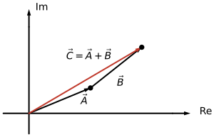

---
aliases:
  - ELEC 2400 phasor
  - ELEC2400 phasor
  - HKUST ELEC 2400 phasor
  - HKUST ELEC2400 phasor
  - phasor
  - phasor analysis
  - phasor diagram
tags:
  - flashcard/active/special/academia/HKUST/ELEC_2400/phasor
  - language/in/English
---

# phasor

A phasor is a complex number that stands for a sinusoid. The sinusoid $A\cos(\omega t + \theta)$ is the real part of $Ae^{j\theta}e^{j\omega t}$: a vector of length $A$ that starts at the angle $\theta$ and turns about the origin once per cycle at the angular speed $\omega$. Its projection on the real axis traces the sinusoid. The fixed length and starting angle carry everything that separates one sinusoid from another at the same frequency ([Euler's formula](Euler%27s%20formula.md)).

Drop that common rotating factor $e^{j\omega t}$ and what remains is the phasor, $\mathbf{A} = A\angle\theta$. The magnitude quoted is the peak value of the sinusoid, not its root-mean-square (RMS) value ([AC power](AC%20power.md)).

---

Flashcards for this section are as follows:

- a phasor: what does the rotating-vector drawing show? 
  ::@:: The vector at angle $\theta$ on the unit circle rotates at angular frequency $\omega$, and its projection $x$ on the real axis is the sinusoid the phasor stands for, with $y$ the projection on the imaginary axis. <!-- check: ignore-line[two_sided_calc_warning]: conceptual -->
- draw a phasor on the complex plane: what stays fixed as $z$ turns at $\omega$, and where do the dashed lines fall? ::@:: $z$ keeps its length as it turns anticlockwise, and $\theta$ is measured from the positive real axis. Dashed lines run from its tip to the real axis for $x$ and to the vertical axis for $y$, with $\omega$ beside the circle. 
 
- read a sinusoid off its phasor: what does the projection of the rotating vector give? 
  ::@:: The projection $x$ on the real axis, the value of the sinusoid at the instant the vector sits at angle $\theta$. <!-- check: ignore-line[two_sided_calc_warning]: conceptual -->
- phasor addition: how is the sum drawn from its two terms? ::@:: The second phasor $\vec{B}$ is placed head to tail on the first phasor $\vec{A}$, and the resultant $\vec{C}=\vec{A}+\vec{B}$ runs from the origin to the head of $\vec{B}$. <!-- check: ignore-line[two_sided_calc_warning]: conceptual -->
- draw the sum of two phasors A and B: where does the resultant start and end? ::@:: It starts at the origin and ends at the head of $\vec{B}$, which has been placed with its tail on the head of $\vec{A}$. 
  <!-- check: ignore-line[two_sided_calc_warning]: conceptual -->
- what a phasor is: what complex object does a phasor stand for, and what does it fix? ::@:: It stands for a sinusoid at one fixed frequency, fixing the sinusoid's peak value and phase while the common rotation factor $e^{j\omega t}$ is dropped. <!-- check: ignore-line[two_sided_calc_warning]: conceptual -->
- the rotating vector: how is the sinusoid $A\cos(\omega t + \theta)$ pictured in the complex plane? 
  ::@:: As the real part of $Ae^{j\theta}e^{j\omega t}$: a vector of length $A$ at angle $\theta$ sweeping around the origin once per cycle, whose projection on the real axis traces the sinusoid.
- the peak-value convention: what magnitude does a phasor carry, the peak value or the root-mean-square (RMS) value? ::@:: The peak value: $\mathbf{A} = A\angle\theta$ represents $A\cos(\omega t + \theta)$, whose amplitude is $A$. <!-- check: ignore-line[two_sided_calc_warning]: conceptual -->

## phasor arithmetic

Sinusoids of a common frequency add as their phasors do. For $a(t) = 10\cos(30t + 50^\circ)$ and $b(t) = 5\cos(30t + 125^\circ)$, the phasors $\mathbf{A} = 10\angle50^\circ = 6.428 + j7.660$ and $\mathbf{B} = 5\angle125^\circ = -2.868 + j4.096$ sum to $\mathbf{C} = 3.560 + j11.756 = 12.28\angle73.15^\circ$, so $c(t) = a(t) + b(t) = 12.28\cos(30t + 73.15^\circ)$. At $t = 0.1\text{ s}$ the sum reads $c(0.1) = 12.28\cos(3\text{ rad} + 73.15^\circ) = 12.28\cos(4.277\text{ rad}) = -5.18$, the argument mixing radians and degrees, as printed.

A sine joins the sum only once it is converted to the cosine reference, since $\sin\theta = \cos(\theta - 90^\circ)$: $5\sin(30t + 125^\circ) = 5\cos(30t + 35^\circ)$, whose phasor $5\angle35^\circ$ adds to $10\angle50^\circ$ to give $14.9\angle45.0^\circ$ ([Sine wave](sine%20wave.md)).

Two sinusoids of different frequencies share no rotation factor, so no single phasor sum describes them: $\cos 2t$ and $\cos 3t$ keep their own frequencies however they are combined.

---

Flashcards for this section are as follows:

- phasor arithmetic / adding sinusoids: $a(t) = 10\cos(30t + 50^\circ)$ and $b(t) = 5\cos(30t + 125^\circ)$ are added through their phasors $\mathbf{A} = 10\angle50^\circ$ and $\mathbf{B} = 5\angle125^\circ$; what is the sum $c(t) = a(t) + b(t)$? ::@:: $\mathbf{C} = \mathbf{A} + \mathbf{B} = 3.560 + j11.756 = 12.28\angle73.15^\circ$, so $c(t) = 12.28\cos(30t + 73.15^\circ)$.
- phasor arithmetic / evaluating the sum: the sum is $c(t) = 12.28\cos(30t + 73.15^\circ)$ with $t$ in seconds; what is $c(0.1)$? ::@:: $c(0.1) = 12.28\cos(3\text{ rad} + 73.15^\circ) = 12.28\cos(4.277\text{ rad}) = -5.18$, the argument converted to radians.
- phasor arithmetic / sine against cosine: how is $5\sin(30t + 125^\circ)$ prepared for addition to a cosine-based phasor? ::@:: $\sin\theta = \cos(\theta - 90^\circ)$ turns it into $5\cos(30t + 35^\circ)$, whose phasor $5\angle35^\circ$ sits on the same reference.
- phasor arithmetic / different frequencies: why can $\cos 2t$ and $\cos 3t$ not be added by phasor arithmetic? ::@:: They rotate at different angular frequencies, so they share no common factor $e^{j\omega t}$ and no single phasor diagram holds them.
- phasor arithmetic / reading a phasor back: what time function does the phasor $12.28\angle73.15^\circ$ at $\omega = 30\text{ rad/s}$ represent? ::@:: $12.28\cos(30t + 73.15^\circ)$, the magnitude as the peak value and the angle as the phase.

## multiplication and the rotating frame

Multiplying one phasor by another multiplies their lengths and adds their angles: $A\angle\theta$ times $B\angle\varphi$ gives $AB\angle(\theta + \varphi)$, and division subtracts the angles. Impedance arithmetic rests on that rule. In $\mathbf{V} = \mathbf{I}\mathbf{Z}$ the impedance scales the current's length by $|Z|$ and turns it by its own angle, so the angle of $\mathbf{Z}$ is the phase difference between the voltage and the current.

Every phasor in a diagram turns at the same $\omega$, so the diagram can be read from a frame that turns at $\omega$ as well. In that frame the vectors hold still and only their relative angles remain. The drawing is the state at $t = 0$: the complex amplitude $\mathbf{A} = A\angle\theta$, from which $A\cos(\omega t + \theta)$ comes back by turning it through $\omega t$ and taking the real part.

Multiplying two phasors is not the same as multiplying the two sinusoids. The product $Ae^{j(\omega t + \theta)}Be^{j(\omega t + \varphi)}$ turns at $2\omega$, and no factor $e^{j\omega t}$ is left to drop. A phasor describes one sinusoid at one frequency; a product of two sinusoids belongs with the power expressions instead ([AC power](AC%20power.md)).

---

Flashcards for this section are as follows:

- multiplication and the rotating frame / multiplication: what happens to the two lengths and the two angles when one phasor multiplies another, and what does division do? ::@:: The lengths multiply and the angles add, while division divides the lengths and subtracts the angles.
- multiplication and the rotating frame / impedance: how does $\mathbf{V} = \mathbf{I}\mathbf{Z}$ read in terms of length and angle? ::@:: The impedance scales the length of the current by $|Z|$ and turns it by its own angle, so the angle of $\mathbf{Z}$ is the phase difference between the voltage and the current.
- multiplication and the rotating frame / the frame: why may a phasor diagram be drawn with the vectors standing still? ::@:: Because every phasor turns at the same $\omega$: read from a frame turning at $\omega$, the vectors stand still and only their relative angles remain. <!-- check: ignore-line[two_sided_calc_warning]: conceptual -->
- multiplication and the rotating frame / the snapshot: what does a phasor give at $t = 0$, and how does the waveform follow from it? ::@:: The complex amplitude $\mathbf{A} = A\angle\theta$; turning it through $\omega t$ and taking the real part gives $A\cos(\omega t + \theta)$.
- multiplication and the rotating frame / the product of two phasors: why is the product of two phasors not the phasor of the product of the two sinusoids? ::@:: The product turns at $2\omega$ with the two angles added, and no factor $e^{j\omega t}$ remains to drop, so no single frequency describes it. <!-- check: ignore-line[two_sided_calc_warning]: conceptual -->

## differentiation and integration

On a sinusoid, differentiation and integration become multiplication. With $x(t) = A\cos(\omega t)$ represented by the rotating vector $Ae^{j\omega t}$, $\frac{d}{dt}$ multiplies that vector by $j\omega$, raising the angle by $90^\circ$, and $\int dt$ multiplies by $1/j\omega$, lowering it by $90^\circ$. A differential equation in sinusoids becomes an algebraic equation in phasors.

---

Flashcards for this section are as follows:

- differentiation and integration / the operators: what do $\frac{d}{dt}$ and $\int dt$ become when they act on a sinusoid of angular frequency $\omega$? ::@:: $\frac{d}{dt}$ becomes multiplication by $j\omega$ and $\int dt$ becomes multiplication by $1/j\omega$.
- differentiation and integration / the phase shift: why does differentiation by $j\omega$ shift a sinusoid's phase by $90^\circ$? ::@:: The factor $j = e^{j\pi/2}$ adds $\pi/2$ to the angle of the rotating vector, advancing the phase by a quarter cycle.
- differentiation and integration / the payoff: what becomes of a linear differential equation with sinusoidal driving once differentiation is multiplication? ::@:: It becomes an algebraic equation in phasors, solvable by complex arithmetic instead of integration.

## phasor analysis

Phasor analysis solves the sinusoidal steady state in four steps:

1. Express every time-dependent term as a cosine, then convert it to its phasor, $V_s\cos(\omega t + \theta) \to \mathbf{V}_s = V_s\angle\theta$. The source may be drawn with a direct current (DC) source symbol, since the phasor carries no time dependence.
2. Replace each capacitor by the impedance $1/j\omega C$ and each inductor by $j\omega L$, leaving resistors unchanged; the result is a phasor circuit.
3. Treat the phasor circuit as a resistive circuit and apply the usual direct current (DC) methods, Kirchhoff's laws, superposition, nodal analysis, and the like, solving with complex algebra.
4. Convert the phasor answer back to the time domain when a time-domain solution is wanted.

All signals in one phasor circuit must share one frequency: the impedances and any equivalent circuit built from them hold at that frequency alone ([Electrical impedance](electrical%20impedance.md)).

---

Flashcards for this section are as follows:

- phasor analysis / first step: what happens to the time-dependent terms at the start of a phasor analysis? ::@:: Each is written as a cosine and converted to its phasor, $V_s\cos(\omega t + \theta) \to V_s\angle\theta$, so voltages and currents become complex numbers rather than functions of time. <!-- check: ignore-line[two_sided_calc_warning]: conceptual -->
- phasor analysis / second step: what replaces the capacitor and the inductor when the phasor circuit is drawn? ::@:: The capacitor becomes the impedance $1/j\omega C$ and the inductor $j\omega L$, while the resistor is unchanged. <!-- check: ignore-line[two_sided_calc_warning]: conceptual -->
- phasor analysis / third step: how is the phasor circuit solved? ::@:: As a resistive circuit: Kirchhoff's laws, superposition, nodal or mesh analysis and the rest apply unchanged, with complex algebra in place of real arithmetic.
- phasor analysis / fourth step: how does a phasor answer return to the time domain? ::@:: The phasor $V_s\angle\theta$ at angular frequency $\omega$ writes back as $v(t) = V_s\cos(\omega t + \theta)$. <!-- check: ignore-line[two_sided_calc_warning]: conceptual -->
- phasor analysis / one frequency per circuit: why is a phasor equivalent circuit tied to a single frequency? ::@:: The impedances $1/j\omega C$ and $j\omega L$ carry $\omega$ inside them, so an equivalent built at one frequency does not hold at another. <!-- check: ignore-line[two_sided_calc_warning]: conceptual -->

<!-- check: ignore-next-line[header_style]: Kirchhoff is a proper noun -->
## Kirchhoff's laws in the phasor domain

Kirchhoff's laws hold at every instant, and a phasor carries every instant at once. So the laws hold on the phasors themselves: the currents into a node sum to zero, $\sum\mathbf{I} = 0$, and the voltages around a loop sum to zero, $\sum\mathbf{V} = 0$, both as complex sums.

Only the arithmetic changes. Magnitudes no longer add, because two voltages a quarter cycle apart can partly cancel. A capacitor and an inductor in series can cancel exactly at one frequency. At $\omega = 1/\sqrt{LC}$ their reactances are equal and opposite, the loop sum of the storage voltages is zero, and the impedance is the resistance alone. That frequency is the resonance of the circuit, and it exists only because the cancellation happens in the complex plane ([Kirchhoff's circuit laws](Kirchhoff%27s%20circuit%20laws.md)).

---

Flashcards for this section are as follows:

- Kirchhoff's laws in the phasor domain / the two laws: how do Kirchhoff's current and voltage laws read on phasors? ::@:: As complex sums that vanish: $\sum\mathbf{I} = 0$ at a node and $\sum\mathbf{V} = 0$ around a loop, since both laws hold at every instant and a phasor holds the whole sinusoid. <!-- check: ignore-line[two_sided_calc_warning]: conceptual -->
- Kirchhoff's laws in the phasor domain / magnitudes: why do the magnitudes of the voltages around a phasor loop not add up to the source magnitude? ::@:: Because the sum is complex: voltages a quarter cycle apart partly cancel, so $|\mathbf{V}_1| + |\mathbf{V}_2|$ can exceed the source while $\mathbf{V}_1 + \mathbf{V}_2$ equals it. <!-- check: ignore-line[two_sided_calc_warning]: conceptual -->
- Kirchhoff's laws in the phasor domain / resonance: at which frequency do a series capacitor and inductor cancel, and what is left? ::@:: At $\omega = 1/\sqrt{LC}$, where their reactances are equal and opposite, so the storage voltages sum to zero and the impedance is the resistance alone. <!-- check: ignore-line[two_sided_calc_warning]: conceptual -->
- Kirchhoff's laws in the phasor domain / why the cancellation works: what makes an exact cancellation possible at one frequency? ::@:: The reactances are $j\omega L$ and $1/(j\omega C) = -j/(\omega C)$, opposite signs on the imaginary axis, so one frequency makes them equal in magnitude as well. <!-- check: ignore-line[two_sided_calc_warning]: conceptual -->

## superposition in the phasor domain

Independent sources are handled as before: kill every other source, solve the phasor circuit with the impedances in place, and add the phasor contributions with their signs. Dependent sources stay operative in each partial circuit ([superposition principle](superposition%20principle.md)).

One restriction comes with the phasors. A phasor carries the angular frequency inside the impedance that produced it, so contributions at different frequencies cannot be added as phasors. Two sources of different frequencies are solved in two phasor circuits, and the two steady-state waveforms are added in the time domain, not as complex numbers. At one frequency the rule is unchanged.

---

Flashcards for this section are as follows:

- superposition in the phasor domain / the rule: how is superposition applied to a phasor circuit? ::@:: Each independent source is taken alone with the others killed, the circuit is solved with impedances, and the phasor contributions are added with their signs.
- superposition in the phasor domain / different frequencies: what must be done when two sources run at different frequencies? ::@:: Solve each frequency in its own phasor circuit and add the two waveforms in the time domain, because phasors at different frequencies share no common factor to add.
- superposition in the phasor domain / the dependent sources: how are dependent sources treated in each partial phasor circuit? ::@:: They stay operative, with their controlling quantity recomputed for that circuit, exactly as in the resistive case.

## equivalents of Thévenin and Norton in the phasor domain

The open-circuit voltage phasor plays the part of $V_{th}$, and the impedance seen looking into the port with every source deactivated plays the part of $R_{th}$. That pair $(\mathbf{V}_{th}, \mathbf{Z}_{th})$ replaces any linear one-port at the one frequency it was computed for. The Norton form is its dual, with the short-circuit current phasor $\mathbf{I}_N = \mathbf{V}_{th}/\mathbf{Z}_{th}$ in parallel with the same impedance ([Thévenin's theorem](Th%C3%A9venin%27s%20theorem.md), [Norton's theorem](Norton%27s%20theorem.md)).

Watch the frequency bound. The impedances inside the equivalent carry $\omega$, so a Thévenin circuit built at one frequency is a different circuit at any other. A load built from storage elements changes it in the same way.

---

Flashcards for this section are as follows:

- Thévenin and Norton equivalents in the phasor domain / the Thévenin pair: what two quantities make up a Thévenin equivalent in the phasor domain? ::@:: The open-circuit voltage phasor $\mathbf{V}_{th}$ and the impedance $\mathbf{Z}_{th}$ seen looking in with the sources deactivated, both at the one frequency of the circuit. <!-- check: ignore-line[two_sided_calc_warning]: conceptual -->
- Thévenin and Norton equivalents in the phasor domain / the Norton form: how is a Norton equivalent obtained from a Thévenin one? ::@:: The short-circuit current phasor $\mathbf{I}_N = \mathbf{V}_{th}/\mathbf{Z}_{th}$ in parallel with the same $\mathbf{Z}_{th}$. <!-- check: ignore-line[two_sided_calc_warning]: conceptual -->
- Thévenin and Norton equivalents in the phasor domain / the frequency bound: why does a phasor equivalent hold at one frequency only? ::@:: Its impedances contain $\omega$, so they change with the frequency, and the equivalent describes a different circuit at any other. <!-- check: ignore-line[two_sided_calc_warning]: conceptual -->

## a worked phasor analysis

A source $v_s(t) = 10\cos(1000t)\text{ V}$ drives $R = 1\text{ k}\Omega$ in series with $C = 1\ \mu\text{F}$. At $\omega = 1000\text{ rad/s}$ the capacitor is $Z_C = \frac{1}{j\omega C} = -j1000\ \Omega$, so the series impedance is $1000 - j1000 = 1000\sqrt{2}\angle{-45^\circ}\ \Omega$ and the current is $\mathbf{I} = \frac{10\angle0^\circ}{1000\sqrt{2}\angle{-45^\circ}} = 7.07\angle{45^\circ}\text{ mA}$.

The element voltages follow from that one current: $\mathbf{V}_R = \mathbf{I}R = 7.07\angle{45^\circ}\text{ V}$ and $\mathbf{V}_C = \mathbf{I}Z_C = 7.07\angle{-45^\circ}\text{ V}$. Their sum is $7.07\angle{45^\circ} + 7.07\angle{-45^\circ} = 10\angle0^\circ\text{ V}$, the source, so Kirchhoff's voltage law closes. Their magnitudes add to $18.1\text{ V}$, which is not the source: magnitudes alone say nothing useful here.

A Thévenin equivalent across the capacitor checks the same answer. With the source deactivated the resistance is what remains, so $\mathbf{V}_{th} = 10\angle0^\circ\text{ V}$ and $\mathbf{Z}_{th} = 1000\ \Omega$. The divider $\frac{\mathbf{Z}_C}{\mathbf{Z}_{th} + \mathbf{Z}_C} = 0.707\angle{-45^\circ}$ then returns $7.07\angle{-45^\circ}\text{ V}$.

---

Flashcards for this section are as follows:

- a worked phasor analysis / the current: a $10\cos(1000t)\text{ V}$ source drives $1\text{ k}\Omega$ in series with $1\ \mu\text{F}$; what current phasor flows? ::@:: $\mathbf{I} = \frac{10\angle0^\circ}{1000 - j1000} = 7.07\angle{45^\circ}\text{ mA}$, the impedance's angle adding to the current's phase.
- a worked phasor analysis / the element voltages: what voltage phasors appear across the resistor and the capacitor? ::@:: $\mathbf{V}_R = \mathbf{I}R = 7.07\angle{45^\circ}\text{ V}$ and $\mathbf{V}_C = \mathbf{I}Z_C = 7.07\angle{-45^\circ}\text{ V}$. <!-- check: ignore-line[two_sided_calc_warning]: conceptual -->
- a worked phasor analysis / the KVL check: how do the two element voltages add, and what does the result show? ::@:: $7.07\angle{45^\circ} + 7.07\angle{-45^\circ} = 10\angle0^\circ\text{ V}$, the source, while the magnitudes add to $18.1\text{ V}$: a phasor sum is not a sum of magnitudes. <!-- check: ignore-line[two_sided_calc_warning]: conceptual -->
- a worked phasor analysis / the Thévenin check: what Thévenin equivalent across the capacitor, and what output does its divider give? ::@:: $\mathbf{V}_{th} = 10\angle0^\circ\text{ V}$ with $\mathbf{Z}_{th} = 1000\ \Omega$, whose divider $\frac{\mathbf{Z}_C}{\mathbf{Z}_{th} + \mathbf{Z}_C} = 0.707\angle{-45^\circ}$ gives $7.07\angle{-45^\circ}\text{ V}$. <!-- check: ignore-line[two_sided_calc_warning]: conceptual -->

## the phasor as a Fourier coefficient

A periodic signal of angular frequency $\omega$ is a sum of rotating exponentials, $x(t) = \sum_n c_n e^{jn\omega t}$, its Fourier series, and the coefficient of each term comes from $c_n = \frac{1}{T}\int_T x(t)e^{-jn\omega t}\,dt$. A phasor is the first of those coefficients, rescaled: the sinusoid $A\cos(\omega t + \theta)$ has $c_1 = \frac{A}{2}e^{j\theta}$ and $c_{-1} = \frac{A}{2}e^{-j\theta}$, so the phasor $\mathbf{A} = A\angle\theta$ is $2c_1$, and its conjugate sits at the negative frequency. A real signal always arrives in such a conjugate pair, which is why one complex number describes it completely.

The Fourier view explains where $j\omega$ and $1/(j\omega)$ come from. Each exponential is an eigenfunction of the derivative, $\frac{d}{dt}e^{j\omega t} = j\omega e^{j\omega t}$. So a differential equation applied to a signal at one frequency acts on its coefficient by a complex factor and leaves the frequency alone. An impedance is a ratio of two coefficients. For a capacitor it is $Z_C = 1/(j\omega C)$: the current coefficient is the voltage coefficient times $j\omega C$, so a slow voltage produces little current and a fast one produces a lot.

---

Flashcards for this section are as follows:

- the phasor as a Fourier coefficient / the coefficient: which Fourier coefficient does a phasor stand for, and how is it scaled? ::@:: The first one: $A\cos(\omega t + \theta)$ has $c_1 = \frac{A}{2}e^{j\theta}$, so the phasor $\mathbf{A} = A\angle\theta$ is $2c_1$, with its conjugate at the negative frequency. <!-- check: ignore-line[two_sided_calc_warning]: conceptual -->
- the phasor as a Fourier coefficient / the conjugate pair: why does one complex number describe a real sinusoid completely? ::@:: Because a real signal carries a conjugate pair of coefficients, $c_1$ and $c_{-1}$, and the phasor fixes both; the pair is what makes the sum real. <!-- check: ignore-line[two_sided_calc_warning]: conceptual -->
- the phasor as a Fourier coefficient / the eigenfunction: why does the derivative act on a phasor as multiplication by $j\omega$? ::@:: Because $e^{j\omega t}$ is an eigenfunction of $\frac{d}{dt}$ with eigenvalue $j\omega$: the derivative returns the same exponential times $j\omega$, so on one frequency it acts on the coefficient alone.
- the phasor as a Fourier coefficient / the impedance ratio: how does the Fourier reading explain $Z_C = 1/(j\omega C)$? ::@:: The current coefficient is the voltage coefficient times $j\omega C$, so a slow voltage yields little current and a fast one yields a lot, which is what a large impedance at low frequency means.

## why the real part carries the signal

A rotating complex number holds the signal twice over. Write the phasor as $a + jb$ with real $a$ and $b$; the rotating vector $(a + jb)e^{j\omega t}$ has the real part $a\cos\omega t - b\sin\omega t$. The first term is the cosine that the phasor's real part names. The second term is the same cosine shifted by a quarter cycle, since $-\sin\omega t = \cos(\omega t + \pi/2)$. The imaginary part of the phasor is the real signal advanced by a quarter period, $\pi/(2\omega)$ seconds, in a form that survives algebra.

So the pair is not two signals. It is one real signal represented twice, once where it stands and once a quarter cycle ahead. That second copy is what gives multiplication by $j$ a meaning: a quarter-turn moves every component forward by $\pi/2$, which is exactly the phase a differentiated sinusoid gains. The factor $\omega$ beside it comes from the chain rule, because the argument advances at that rate. Integration runs both steps backwards: divide by $\omega$ and turn the phase back a quarter. That is why $1/(j\omega)$ is the integrating operator ([Euler's formula](Euler%27s%20formula.md)).

---

Flashcards for this section are as follows:

- why the real part carries the signal / the second term: what does the imaginary part of the phasor contribute to the real signal? ::@:: The same cosine advanced by a quarter cycle: $-\sin\omega t = \cos(\omega t + \pi/2)$, so the imaginary coefficient carries a copy of the signal a quarter period ahead. <!-- check: ignore-line[two_sided_calc_warning]: conceptual -->
- why the real part carries the signal / one signal twice: in what sense does a phasor hold the signal twice? ::@:: Once as the cosine itself and once advanced by $\pi/2$, the two coefficients being the real and imaginary parts; the rotating vector's real part adds the second copy to the first. <!-- check: ignore-line[two_sided_calc_warning]: conceptual -->
- why the real part carries the signal / the quarter turn: why does multiplying by $j$ differentiate a sinusoid? ::@:: A quarter-turn adds $\pi/2$ to the phase of every component, which is the shift a derivative produces; the factor $\omega$ beside it comes from the chain rule, since the argument advances at rate $\omega$.
- why the real part carries the signal / integration: why is dividing by $j\omega$ the same as integrating? ::@:: It divides the amplitude by $\omega$ and turns the phase back a quarter cycle, undoing both parts of what differentiation did.

## returning to the time domain

Converting a phasor back to a signal restores what the phasor dropped. The magnitude is the peak value and the angle is the phase against a cosine, so $\mathbf{A} = A\angle\theta$ writes back as $a(t) = A\cos(\omega t + \theta)$. The angular frequency has to come from the problem, since every phasor in one circuit shares it and the symbol no longer carries it.

Three conventions decide the rest. A negative magnitude is a half turn, $-A\angle\theta = A\angle(\theta + 180^\circ)$, so it folds into the angle. A phasor built on root-mean-square (RMS) values writes back with the RMS value in place of the peak, and the two conventions never mix inside one calculation ([AC power](AC%20power.md)). The answer is the steady state alone. The rotating frame has no room for a decaying transient, so the waveform describes the circuit only after those transients have died out.

---

Flashcards for this section are as follows:

- returning to the time domain / the conversion: what time function does the phasor $\mathbf{A} = A\angle\theta$ at angular frequency $\omega$ represent? ::@:: $a(t) = A\cos(\omega t + \theta)$: the magnitude as the peak value and the angle as the phase of a cosine.
- returning to the time domain / the frequency: why must the angular frequency be supplied from outside the phasor? ::@:: The phasor drops the common factor $e^{j\omega t}$, so $\omega$ no longer appears in it; all phasors in one circuit share the value, and the problem supplies it. <!-- check: ignore-line[two_sided_calc_warning]: conceptual -->
- returning to the time domain / a negative magnitude: how is a phasor with a negative magnitude written as one with a positive magnitude? ::@:: $-A\angle\theta = A\angle(\theta + 180^\circ)$: the minus sign is a half turn, which folds into the angle. <!-- check: ignore-line[two_sided_calc_warning]: conceptual -->
- returning to the time domain / peak against RMS: what does the magnitude of a phasor mean when the answer is wanted as a waveform? ::@:: It is the peak value under the convention these notes use; a phasor built on root-mean-square (RMS) values writes back with that value in place of the peak, and the two never mix in one calculation.
- returning to the time domain / steady state: which part of the response does a phasor leave out? ::@:: The transient: the rotating frame holds only the steady-state sinusoid, so the answer describes the circuit after its transients have died out.
