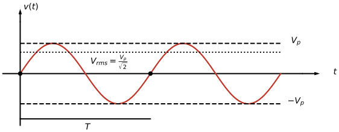

---
aliases:
  - ELEC 2400 sine wave
  - ELEC2400 sine wave
  - HKUST ELEC 2400 sine wave
  - HKUST ELEC2400 sine wave
  - phase
  - sine wave
  - sinusoid
tags:
  - flashcard/active/special/academia/HKUST/ELEC_2400/sine_wave
  - language/in/English
---

# sine wave

A sine wave, also called a sinusoid, repeats its shape forever: $v_s(t) = A\sin(\omega t)$ swings between $+A$ and $-A$, completing one swing per period $T$. Three quantities characterize it, its frequency, its magnitude, and its phase, and a general sinusoid carries all three, $v_s(t) = B\sin(\omega t + \theta)$.

The sinusoid is the standard waveform of alternating current (AC) power, and the wall socket supply is one. Driving a circuit with a sinusoid drives it into the sinusoidal steady state, the state the circuit settles into a long time after the source is applied ([electric current](electric%20current.md)).

---

Flashcards for this section are as follows:

- the peak and the root-mean-square level: what does the waveform drawing mark, and how are the two levels related? 
  ::@:: The drawing marks the peak $V_p$, the root-mean-square level $V_{rms}=V_p/\sqrt{2}$ as a line between the peak and the axis, and one period $T$ between consecutive rising zero crossings. <!-- check: ignore-line[two_sided_calc_warning]: conceptual -->
- draw one sinusoid on axes and mark $V_p$, $V_{rms}$ and $T$: where does each sit on the wave? ::@:: Two periods of a wave, $V_p$ at the crest, $V_{rms} = V_p/\sqrt{2}$ as a lower level between crest and axis, and $T$ spanning consecutive rising zero crossings. 
 
- find the root-mean-square level on a sinusoid: where is it drawn relative to the peak and the axis? 
  ::@:: At the height $V_{rms}=V_p/\sqrt{2}$, between the peak $V_p$ and the horizontal axis, the same fraction of the peak on both sides. <!-- check: ignore-line[two_sided_calc_warning]: conceptual -->
- the alternating-voltage source symbol: what does the drawing carry? 
  ::@:: A circle with one cycle of a sinusoid inside, two terminals with the marks fixing the sign of $v_s(t)$. <!-- check: ignore-line[two_sided_calc_warning]: conceptual -->
- draw an alternating voltage source v s of t: what does the circle and its contents stand for? ::@:: A circle carrying one cycle of a sinusoid, whose terminals carry the $+$ and $-$ marks that fix the sign of $v_s(t)$. 
  <!-- check: ignore-line[two_sided_calc_warning]: conceptual -->
- what characterizes a sinusoid: which three quantities fix a sinusoidal waveform? ::@:: Its oscillation frequency, its magnitude, and its phase.
- the general form: what does the general expression of a sinusoid look like, and what does each symbol stand for? ::@:: $v_s(t) = B\sin(\omega t + \theta)$, with $B$ the amplitude, $\omega$ the angular frequency, and $\theta$ the phase. <!-- check: ignore-line[two_sided_calc_warning]: conceptual -->
- the sinusoid in power: which waveform does the alternating current (AC) mains supply follow? ::@:: A sinusoid, so mains voltage and current are sinusoids of the mains frequency.
- steady state: what is the sinusoidal steady state of a circuit? ::@:: The state the circuit settles into a long time after a sinusoidal source is applied, once earlier transients have died away.

## period, frequency, and angular frequency

One full cycle takes the period $T$, measured in seconds, and repeats $f$ times per second, so $T = 1/f$ with $f$ in hertz (Hz). The angular frequency counts the same repetition in radians, $\omega = 2\pi f$, measured in radians per second, since one cycle is $2\pi$ radians.

---

Flashcards for this section are as follows:

- the peak and the root-mean-square level: what does the waveform drawing mark, and how are the two levels related? 
  ::@:: The drawing marks the peak $V_p$, the root-mean-square level $V_{rms}=V_p/\sqrt{2}$ as a line between the peak and the axis, and one period $T$ between consecutive rising zero crossings. <!-- check: ignore-line[two_sided_calc_warning]: conceptual -->
- find the root-mean-square level on a sinusoid: where is it drawn relative to the peak and the axis? 
  ::@:: At the height $V_{rms}=V_p/\sqrt{2}$, between the peak $V_p$ and the horizontal axis, the same fraction of the peak on both sides. <!-- check: ignore-line[two_sided_calc_warning]: conceptual -->
- the alternating-voltage source symbol: what does the drawing carry? 
  ::@:: A circle with one cycle of a sinusoid inside, two terminals with the marks fixing the sign of $v_s(t)$. <!-- check: ignore-line[two_sided_calc_warning]: conceptual -->
- draw an alternating voltage source v s of t: what does the circle and its contents stand for? ::@:: A circle carrying one cycle of a sinusoid, whose terminals carry the $+$ and $-$ marks that fix the sign of $v_s(t)$. 
  <!-- check: ignore-line[two_sided_calc_warning]: conceptual -->
- period, frequency, and angular frequency / the three relations: how do the period $T$, the frequency $f$, and the angular frequency $\omega$ relate? ::@:: $T = 1/f$ and $\omega = 2\pi f$: one cycle lasts $T$ seconds, repeats $f$ times per second, and spans $2\pi$ radians.
- period, frequency, and angular frequency / units: in which units are $T$, $f$, and $\omega$ measured? ::@:: $T$ in seconds, $f$ in hertz (Hz), that is cycles per second, and $\omega$ in radians per second.
- period, frequency, and angular frequency / from angular to ordinary frequency: the argument of a sinusoid advances as $30t$; what are the angular frequency and the ordinary frequency? ::@:: $\omega = 30\text{ rad/s}$, so $f = \omega/2\pi = 30/2\pi \approx 4.77\text{ Hz}$ and $T = 1/f \approx 0.21\text{ s}$.

## phase, lead, and lag

The phase $\theta$ shifts the waveform in time without changing its shape: $\sin(\omega t + \theta)$ reaches each value $\theta/\omega$ seconds earlier than $\sin\omega t$. Two sinusoids of the same frequency are compared by their phases, the one with the larger phase leading the other.

Sine and cosine are a quarter cycle apart, since $\sin\theta = \cos(\theta - 90^\circ)$: the sine lags the cosine by $90^\circ$, and converting every sine to a cosine (or the reverse) puts several sinusoids on one common reference before they are added.

Two sinusoids of the same frequency add to a sinusoid of that frequency. Sinusoids of different frequencies share no common phase reference, and no single sinusoid describes their sum.

---

Flashcards for this section are as follows:

- the peak and the root-mean-square level: what does the waveform drawing mark, and how are the two levels related? 
  ::@:: The drawing marks the peak $V_p$, the root-mean-square level $V_{rms}=V_p/\sqrt{2}$ as a line between the peak and the axis, and one period $T$ between consecutive rising zero crossings. <!-- check: ignore-line[two_sided_calc_warning]: conceptual -->
- find the root-mean-square level on a sinusoid: where is it drawn relative to the peak and the axis? 
  ::@:: At the height $V_{rms}=V_p/\sqrt{2}$, between the peak $V_p$ and the horizontal axis, the same fraction of the peak on both sides. <!-- check: ignore-line[two_sided_calc_warning]: conceptual -->
- the alternating-voltage source symbol: what does the drawing carry? 
  ::@:: A circle with one cycle of a sinusoid inside, two terminals with the marks fixing the sign of $v_s(t)$. <!-- check: ignore-line[two_sided_calc_warning]: conceptual -->
- draw an alternating voltage source v s of t: what does the circle and its contents stand for? ::@:: A circle carrying one cycle of a sinusoid, whose terminals carry the $+$ and $-$ marks that fix the sign of $v_s(t)$. 
  <!-- check: ignore-line[two_sided_calc_warning]: conceptual -->
- phase, lead, and lag / what the phase does: two sinusoids share the same amplitude and frequency and differ only in phase; how do their waveforms compare in time? ::@:: One is shifted against the other by $\theta/\omega$ seconds, with no change of shape. <!-- check: ignore-line[two_sided_calc_warning]: conceptual -->
- phase, lead, and lag / comparing two sinusoids: two sinusoids of the same frequency; which one leads? ::@:: The one with the larger phase: it reaches each value of the cycle earlier.
- phase, lead, and lag / sine against cosine: how do $\sin\theta$ and $\cos\theta$ differ in phase, and what identity carries one into the other? ::@:: The sine lags the cosine by $90^\circ$: $\sin\theta = \cos(\theta - 90^\circ)$.
- phase, lead, and lag / adding sinusoids: when does the sum of two sinusoids remain a sinusoid of the same frequency? ::@:: Whenever the two share that frequency; their sum is then one sinusoid of that frequency with its own amplitude and phase. Different frequencies give no such sum.
- phase, lead, and lag / a common reference: $10\cos(30t + 50^\circ)$ and $5\sin(30t + 125^\circ)$ are to be added; what makes the pair ready for addition? ::@:: Rewriting the sine as $5\cos(30t + 125^\circ - 90^\circ) = 5\cos(30t + 35^\circ)$ puts both on the cosine reference, with a common frequency and phase-comparable arguments.
