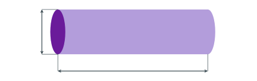

---
aliases:
  - ELEC 3120 network delay
  - ELEC3120 network delay
  - HKUST ELEC 3120 network delay
  - HKUST ELEC3120 network delay
  - latency
  - network delay
  - packet delay
tags:
  - flashcard/active/special/academia/HKUST/ELEC_3120/network_delay
  - language/in/English
---

# network delay

Delay is how long data take to cross a link, and it has two parts. One is pushing the data into the link, which the bandwidth sets. The other is a bit travelling along it, which the link's length sets. The two are independent, so a short link can be slow to load and a long one fast. A busy link adds a third delay, the wait in the queue, which no property of the link itself sets.

---

Flashcards for this section are as follows:

- which two parts does link delay have, and what sets each? ::@:: The transmission delay, set by the bandwidth and the amount of data, and the propagation delay, set by the link's length.
- third delay: which delay does a busy link add, and what sets it? ::@:: The wait in the queue, which no property of the link itself sets.

## pipe model

A link is pictured as a pipe. Its width is the bandwidth, the bits per second the link carries. Its length is the propagation delay, the time a bit takes to cross it. That is why a link comes quoted as a pair of numbers, `1 Gbps x 10 ms`, since one says nothing about the other. 
 

---

Flashcards for this section are as follows:

- pipe model: in the pipe picture of a link, what are the pipe's width and its length? 
  ::@:: The width is the bandwidth and the length is the propagation delay.
- draw the pipe model: how is a link drawn, and what does each direction stand for? ::@:: A pipe, wider for more bandwidth and longer for more propagation delay. 
 
- describe a link: how is a link of 1 Gbps with 10 ms of propagation delay written? ::@:: `1 Gbps x 10 ms`, one number for each direction of the pipe.
- bandwidth: what does a link's bandwidth count? ::@:: The bits per second the link carries.
- why quoted as a pair: why does one number of a link say nothing about the other? ::@:: Bandwidth and propagation delay are independent, so a fast link can be short or long.

## transmission delay

Transmission delay is how long the link spends putting the data in: the amount of data divided by the bandwidth. It falls as the link gets faster and rises with the size of the packet, and it does not depend on distance, so a large file takes as long to push onto a fast link whether that link is one metre away or an ocean away. Two pictures fit it: filling a tube with marbles, and a Morse operator typing a word out. A 1500-byte segment is 12,000 bits, which takes 12 ms to push onto a 1 Mbps link, 0.12 ms onto a 100 Mbps link, and 12 microseconds onto a 1 Gbps link. Over a link with 10 ms of propagation delay, that last figure is a thousandth of the crossing time. A small packet makes the same point from the other side: a 64-byte packet is 512 bits, which takes 0.512 ms on a 1 Mbps link and half a microsecond on a 1 Gbps link.

---

Flashcards for this section are as follows:

- transmission delay: for a packet of $N$ bits on a link of rate $R$, what is it? ::@:: $N/R$ seconds, the amount of data divided by the bandwidth.
- what does transmission delay not depend on? ::@:: Distance; the link's length sets the propagation delay instead.
- one bit on a 1 Mbps link: on a link of $1\text{ Mbit/s}$, how long does one bit take to transmit? ::@:: $1\text{ bit} / 10^{6}\text{ bit/s} = 10^{-6}\text{ s}$, a millionth of a second.
- segment on a fast link: how long does a $1500$-byte segment take to push onto a $1\text{ Gbps}$ link? ::@:: $12\,\mu\text{s}$, since $12000$ bits at $1\text{ Gbit/s}$ take $12\,\mu\text{s}$.
- a small packet: how long does a $64$-byte packet take to push onto a $1\text{ Gbps}$ link? ::@:: $0.512\,\mu\text{s}$, since $512$ bits at $1\text{ Gbit/s}$ take half a microsecond.
- segment on a slow link: how long does a $1500$-byte segment take to push onto a $1\text{ Mbps}$ link? ::@:: $12\text{ ms}$, since $12000$ bits at $1\text{ Mbit/s}$ take $12\text{ ms}$.
- pushing against crossing: for a $1500$-byte segment on a $1\text{ Gbps}$ link with $10\text{ ms}$ of propagation delay, how does the push time compare with the crossing time? ::@:: $12\,\mu\text{s} / 10\text{ ms} = 0.0012$, so the push is a thousandth of the crossing.

## propagation delay

Propagation delay is how long a bit takes to cross the link, and in a vacuum it is the distance travelled divided by the speed of light. Real media run below that speed: each has a velocity factor, its slowdown relative to light, so electricity travels slower through copper than light travels through outer space. Pushing marbles into the tube faster does not make one roll to the far end any quicker. Light in fiber travels at about two thirds of the speed of light in a vacuum, so 3,000 km of fiber takes about 15 ms in one direction, and 10,000 km takes about 50 ms. A geostationary satellite sits about 35,786 km above the equator, and light covers that distance in about 120 ms, so a round trip through it takes about 240 ms. The International Telecommunication Union (ITU) Recommendation G.114 (2003) uses 150 ms of one-way delay as its figure for general network planning, and the satellite path at about 120 ms each way comes close to that figure.

---

Flashcards for this section are as follows:

- propagation delay: for a link of length $d$ over a medium where signals travel at $v$, what is it? ::@:: $d/v$ seconds, which in a vacuum is the distance divided by the speed of light.
- velocity factor: what does a medium's velocity factor state? ::@:: How much slower than the speed of light signals travel through it.
- what does propagation delay not depend on? ::@:: The amount of data; it is the time for one bit to cross.
- fiber propagation: how long does a signal take to cross $3000$ km of fiber where light travels at two thirds of its speed in a vacuum? ::@:: 15 ms, since $3000$ km at $200000$ km/s is $0.015$ s.
- a longer fiber run: how long does a signal take to cross $10000$ km of fiber where light travels at two thirds of its speed in a vacuum? ::@:: 50 ms, since $10000$ km at $200000$ km/s is $0.05$ s.
- marbles against rate: does pushing the data in faster shorten the crossing? ::@:: No: pushing marbles into the tube faster does not make one roll to the far end any quicker, since the crossing time depends on the medium and the length.
- geostationary height: how far above the equator does a geostationary satellite sit? ::@:: About 35,786 km.
- satellite round trip: light covers the $35786$ km to a geostationary satellite in about $120\text{ ms}$ each way, so what does a round trip cost? ::@:: About $240\text{ ms}$, since each way costs about $120\text{ ms}$.
- planning figure: which one-way delay does International Telecommunication Union (ITU) Recommendation G.114 (2003) use for general network planning, against the roughly $120\text{ ms}$ each way of a satellite path? ::@:: $150\text{ ms}$.

## queueing delay

A switch sends one packet at a time, so packets that arrive together wait their turn. A packet that finds $B$ bits queued ahead of it on a link of rate $R$ waits $B/R$ seconds, the transmission time of everything in front of it.

Bursts are what cost. Traffic spread evenly waits for nothing, while the same traffic arriving at one moment queues behind itself. The wait grows as load rises, since less idle time is left to absorb each burst, and it ends when the queue is full and arriving packets are dropped instead. A queue holding 1000 full-size packets on a 1 Gbps link holds 12,000,000 bits, which is 12 ms of transmission for everything waiting behind, and the same burst on a 1 Mbps link costs 12 s. The wait adds to the crossing in each direction. A path with 20 ms of propagation each way and a 12 ms queueing wait each way takes 64 ms for a round trip.

---

Flashcards for this section are as follows:

- queueing delay formula: for a packet arriving behind $B$ bits of queued traffic on a link of rate $R$, what is its queueing delay? ::@:: $B/R$ seconds.
- why bursts cost: how can a queue build on a link that is on average underused? ::@:: Packets arriving at the same moment must be sent one after another, so a burst queues behind itself.
- as load rises: what happens to queueing delay as the arrival rate approaches the link's capacity? ::@:: It climbs, since less idle time is left to absorb each burst.
- where it ends: what happens once the queue is full? ::@:: Arriving packets are dropped instead of waiting.
- queueing behind a burst: what does a packet behind $1000$ packets of $1500$ bytes wait on a $1\text{ Gbps}$ link? ::@:: $1000 \times 1500 \times 8 = 12000000$ bits, which the link sends at $1\text{ Gbit/s}$ in $12\text{ ms}$.
- round trip with queueing: a path with $20\text{ ms}$ of propagation delay each way and a $12\text{ ms}$ queueing wait in each way, what is its round-trip time? ::@:: $64\text{ ms}$, since each direction costs $20 + 12 = 32\text{ ms}$.
- the same burst on a slow link: how long does a burst of $1000$ full-size packets wait behind itself on a $1\text{ Mbps}$ link? ::@:: $12\text{ s}$, since the queue holds $12000000$ bits and the link sends them at $1\text{ Mbit/s}$.

## packet delay

Packet delay is the time a packet takes to cross a link: the transmission delay plus the propagation delay, and the queueing delay too if it waits behind other traffic. On an empty queue, a packet of $N$ bits on a link of rate $R$ and latency $L$ takes $(N/R) + L$, where the latency is the propagation delay. A packet of 800 B on a 1 Mbps link with 100 ms of latency takes 6.4 ms to push in, and its last bit then needs the full latency to cross, so it reaches the far end 106.4 ms after the first bit started. A 1500-byte segment on a 1 Gbps link with 2 ms of latency takes 12 microseconds to push in and 2 ms to cross, so 2.012 ms in all. A 1460-byte segment, a 20-byte Transmission Control Protocol (TCP) header, and a 20-byte Internet Protocol version 4 header fill a 1500-byte Ethernet frame exactly.

---

Flashcards for this section are as follows:

- packet delay: for a packet of $N$ bits, a link of rate $R$, and a link latency $L$, with no queue in the way, what is the packet delay? ::@:: $(N/R) + L$: the transmission delay plus the propagation delay.
- link latency: which part of a link's delay does the latency alone name? ::@:: The propagation delay.
- the first bit against the last: why does a packet's last bit arrive more than one propagation delay after its first bit? ::@:: The last bit leaves the sender one transmission delay after the first, and both then need the same propagation delay.
- worked case: a 6400-bit packet on a 1 Mbps link with 100 ms of latency, how long does the packet take? ::@:: 6.4 ms to push the bits in plus 100 ms to cross, so 106.4 ms.
- packet size: which term of the packet delay does the packet size affect? ::@:: The transmission delay only.
- with a queue in the way: while the link is idle the packet delay is $(N/R) + L$; which term joins that sum once the packet waits behind other traffic? ::@:: The queueing delay, so the packet delay becomes $(N/R) + L$ plus the wait behind the queued traffic.
- a segment on a fast link: a $1500$-byte segment on a $1\text{ Gbps}$ link with $2\text{ ms}$ of latency, how long does the packet take? ::@:: $12\,\mu\text{s}$ to push the bits in plus $2\text{ ms}$ to cross, so $2.012\text{ ms}$.
- filling the frame: which parts fill a $1500$-byte Ethernet frame exactly? ::@:: A $1460$-byte segment, a $20$-byte Transmission Control Protocol (TCP) header and a $20$-byte Internet Protocol version 4 header.

### transmission against propagation

Which of the two terms dominates varies from link to link.

Sending 1500 B over a datacenter link of 40 Gbps with 10 microseconds of latency costs 0.3 microseconds of transmission and 10.3 microseconds in all, so the latency dominates. The same 1500 B over a satellite link of 32 kbps with 8 s of latency costs 0.375 s of transmission and 8.375 s in all, so the transmission time is a rounding error beside the latency. A 1460-byte segment on a 10 Mbps link with 50 ms of latency takes 1.168 ms to push in and 50 ms to cross, so 51.168 ms in all, and the latency dominates there too.

---

Flashcards for this section are as follows:

- datacenter case: 1500 B on a 40 Gbps link with 10 microseconds of latency, how long does the packet take? ::@:: 12000 bits at 40 Gbps is 0.3 microseconds, plus 10 microseconds, so 10.3 microseconds.
- satellite case: 1500 B on a 32 kbps link with 8 s of latency, how long does the packet take? ::@:: 12000 bits at 32 kbps is 0.375 s, plus 8 s, so 8.375 s.

## throughput and latency

Which of the two numbers matters more depends on the link. Links of every kind carry both:

- a fiber between two servers in a datacenter
- a fiber across the Pacific
- a manual telegraph from Hong Kong to Beijing
- a radio link to a satellite far out in the solar system

These differ in width and length, not in kind.

Choosing between a network that sends a lot of data slowly and one that sends a little data quickly is the choice between throughput and latency. The same choice appears between two machines: a supercomputer with no network connection, against a simple cell phone with one. On a large transfer the two numbers pull apart: a file of 1 MB takes 8 s to push onto a 1 Mbps link and 8 ms onto a 1 Gbps link, and the same file over the 32 kbps satellite link takes 250 s.

---

Flashcards for this section are as follows:

- throughput and latency: what choice does the pair pose? ::@:: Between a network that sends a lot of data slowly and one that sends a little data quickly.
- throughput and latency: to which links do both numbers apply? ::@:: To links of every kind, from a datacenter fiber to a manual telegraph or a radio link to a distant satellite.
- throughput and latency: how does the same choice look between two machines? ::@:: A supercomputer without a network connection against a simple cell phone with one.
- a large transfer: how long does a $1\text{ MB}$ file take to push onto a $1\text{ Mbps}$ link? ::@:: 8 s, since $8000000$ bits at $1\text{ Mbit/s}$ take 8 s.
- the same file on a slow link: how long does a $1\text{ MB}$ file take to push onto a $32\text{ kbps}$ link? ::@:: 250 s, since $8000000$ bits at $32\text{ kbit/s}$ take 250 s.
- the same file on a fast link: how long does a $1\text{ MB}$ file take to push onto a $1\text{ Gbps}$ link? ::@:: $8\text{ ms}$, since $8000000$ bits at $1\text{ Gbit/s}$ take $8\text{ ms}$.
- how those links differ: how do a datacenter fiber, a Pacific fiber, a manual telegraph and a distant satellite radio link differ? ::@:: In width and length, meaning bandwidth and propagation delay, and not in kind.
