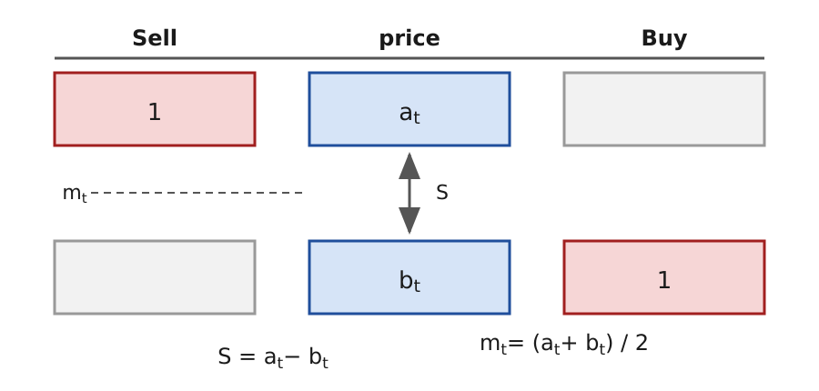

---
aliases:
  - Roll (1984) model
  - Roll model
  - Roll's model
  - Roll's spread estimator
  - bid-ask bounce
tags:
  - flashcard/active/special/academia/HKUST/FINA_4103/Roll_model
  - language/in/English
---

# Roll model

A microstructure model is a controlled experiment. Too many things move at once in the real world to explain them together, so the model keeps one or two factors of interest, sets the rest aside, and asks whether the trimmed world still reproduces a real-life phenomenon. If it does, the kept factor is important and supports counterfactual analysis. If not, the factor is irrelevant. The models of [market microstructure](market%20microstructure.md) are tested against data this way, and many of the foundational ones come from the 1980s and 1990s.

How is an asset price determined? On [price efficiency](price%20discovery.md) and liquidity alone, the basic asset-pricing theory prices an asset from its discounted expected dividends, $P_t = \operatorname{E}\left[\frac{D_{t+1}+P_{t+1}}{1+r}\right] = \operatorname{E}\left[\sum_{i=1}^{\infty}\frac{D_{t+i}}{(1+r)^{i}}\right]$. There $P_t$ is the price today, $D_{t+i}$ the dividend paid $i$ periods from now, $r$ the per-period discount rate, and $\operatorname{E}$ the expectation taken today, before any of those dividends arrives.

The relation is recursive: today's price is the next dividend plus the next price, both discounted one period. The $P_{t+1}$ on the right is itself a dividend and a further price, discounted, so writing it in replaces the resale term with the next dividend and a resale term one period later. Each step substitutes the next price back into itself, the resale prices drop out, and what remains is every future dividend discounted by $(1+r)^{i}$ for the number of periods it waits. The recursion and the infinite sum are the same statement.

In words, the price is the present value of the dividends the owner expects, so a share is a claim on that stream rather than a bet on the next print. A dividend further out adds less today, because each extra period discounts it again.

The relation does not hold exactly in the data. It ignores how trades actually occur and how traders differ in motivation and constraints, and a trade records the price the order book gave at that moment, not a price the dividend stream alone sets. The microstructure view prices from the order book instead. The Roll model takes that route down to its smallest pieces, a constant [bid-ask spread](bid-ask%20spread.md) and one arriving trader, and asks how the trade price moves and how much of that movement is contamination rather than news.

---

Flashcards for this section are as follows:

- what the Roll model builds trade-price dynamics from ::@:: A constant bid-ask spread and one arriving trader per period, in a discrete-time economy.
- the purpose of a controlled-experiment model in microstructure ::@:: Keep one or two factors, eliminate the rest, and check whether the trimmed world reproduces a real-life phenomenon: if it does, the factor is important and supports counterfactual analysis; if it does not, the factor is irrelevant.
- the basic asset-pricing relation, with discount rate $r$, dividend $D_{t+i}$, and price $P_t$ ::@:: $P_t = \operatorname{E}\left[\frac{D_{t+1}+P_{t+1}}{1+r}\right] = \operatorname{E}\left[\sum_{i=1}^{\infty}\frac{D_{t+i}}{(1+r)^{i}}\right]$: the price equals the discounted expected dividends.
- in $P_t = \operatorname{E}\left[\frac{D_{t+1}+P_{t+1}}{1+r}\right]$, what $P_t$, $D_{t+i}$, $r$, and $\operatorname{E}$ each stand for ::@:: $P_t$ is the price today, $D_{t+i}$ the dividend paid $i$ periods from now, $r$ the per-period discount rate, and $\operatorname{E}$ the expectation taken today, before any of those dividends arrives.
- why $P_t = \operatorname{E}\left[\frac{D_{t+1}+P_{t+1}}{1+r}\right]$ and the discounted sum of dividends $P_t = \operatorname{E}\left[\sum_{i=1}^{\infty}\frac{D_{t+i}}{(1+r)^{i}}\right]$ are the same statement ::@:: Substituting the next period's price into today's equation replaces the resale term with the next dividend and a further resale term; repeated until the resale prices drop out, it leaves every future dividend discounted by $(1+r)^{i}$ for the number of periods it waits.
- what the price of a share is in words under the discounted-dividend relation, with dividend $D_{t+i}$ and discount rate $r$ ::@:: A claim on a stream of dividends: the price is the present value of the dividends the owner expects to be paid, not a bet on the next print, and a dividend further in the future adds less today.
- why the basic asset-pricing relation does not hold exactly in the data ::@:: It ignores how actual trades occur in microstructure and how traders differ in their trading motivation and constraints, so a trade records the price the order book gave rather than a price the dividend stream alone sets.
- the starting point for pricing in the microstructure view ::@:: The order book: how actual trades occur, rather than discounted expected dividends.

## bid-ask bounce

The _bid-ask bounce_ is the zigzag of executed prices between the ask and the bid even when the asset's fundamentals never move. A buy trade executes at the ask and a sell trade at the bid, so consecutive trades on opposite sides of the market pull the observed price up and down by the full spread. Nothing about the asset changed between them.

The bounce shows up in real data. Execution prices for one stock, recorded every few seconds between 08:32:16 and 08:34:50 and labelled "AA Price", repeatedly jumps between about 31.83 and 31.93 dollars and reverses direction within seconds, with no trend across the two-and-a-half-minute window. An econometrician who reads those jumps as news estimates fundamentals contaminated by trading mechanics. The Roll model isolates and measures that contamination.

An inexperienced investor can mistake the zigzag for a predictable pattern and trade on it. A sequence of trades with no information behind it produces the same picture: a seller who sells only to raise cash moves the recorded price to the bid, and the next buy moves it back. The turns carry nothing to predict.

---

Flashcards for this section are as follows:

- what the bid-ask bounce is ::@:: The zigzag of executed prices between the ask and the bid even when the asset's fundamentals never move: buys execute at the ask and sells at the bid.
- what consecutive trades on opposite sides of the market do to the observed price ::@:: Each switch between a buy and a sell moves it by the full spread and back, with no change in the asset between the trades.
- what the execution-price series of one stock between 08:32:16 and 08:34:50 shows ::@:: Prices labelled "AA Price" bounce between about 31.83 and 31.93 dollars every few seconds, with no trend over the two-and-a-half-minute window.
- why the bid-ask bounce matters for estimation ::@:: Reading the bounce as news contaminates estimates of the asset's fundamentals with trading mechanics.
- why a sequence of trades with no information behind it produces the bid-ask bounce ::@:: Every trade executes at the ask or the bid, so a seller raising cash and the next buyer move the recorded price up and down with no change in the asset.
- the classic mistake an inexperienced investor can make from the bid-ask bounce ::@:: Mistaking the zigzag for a predictable pattern and trading on it, when a sequence of random, non-fundamental trades produces the same picture.

## one-share model

The Roll model works in discrete time $t = 1, 2, \ldots$ over observed transaction prices $\{p_t\}_{t=1}^{N}$. It asks how the price changes and what the bid-ask spread implies for those changes, and doubles as a model of the bid-ask bounce: how much of the observed price movement the bounce accounts for. The spread $S$ and the order flow $d_t$ are given by assumption, and the price dynamics $\Delta p_t$ are derived from them.

The model exists to explain the bid-ask bounce, so each assumption removes one thing that would muddy the explanation. The bounce is a move between the ask and the bid that leaves the asset's value alone, so the fundamentals are modelled separately, as a random walk with no memory, and a reversal in the recorded price cannot then be confounded with news. The mid-point of the quote is taken to be the efficient price, and price-efficiency effects drop out of the account. A constant spread removes another moving quantity, at less cost than the first two assumptions: a spread that wandered would put its own variation into the recorded price. Order direction cannot be removed at all, because the bounce is made of it, so it enters in the simplest form available: one trader per period, one share, buy or sell.

---

Flashcards for this section are as follows:

- the time index and price data, $t = 1, 2, \ldots$ and $\{p_t\}_{t=1}^{N}$, that the Roll model works over ::@:: Discrete time $t = 1, 2, \ldots$ and observed transaction prices $\{p_t\}_{t=1}^{N}$.
- what is given and what is derived in the Roll model, with the spread $S$, the order flow $d_t$, and the price dynamics $\Delta p_t$ ::@:: The spread $S$ and the order flow $d_t$ are given by assumption; the price dynamics $\Delta p_t$ are derived from them.
- the two questions the Roll model asks about the price ::@:: How does the price change, and what does the bid-ask spread imply for those changes?
- why the fundamentals are modelled separately from the bid-ask bounce in the Roll model ::@:: The bounce is a move between the ask and the bid that leaves the asset's value alone, so the fundamentals are modelled on their own as a random walk with no memory: a reversal in the recorded price then cannot be confounded with news.
- why the bid-ask spread is held constant in the Roll model ::@:: To keep one more quantity from moving, though this costs less than separating the fundamentals: a spread that changed over time would put its own variation into the recorded price, and the bounce could no longer be read off the price changes alone.

### random fundamentals

Assumption 1 is random fundamentals, kept apart from the bounce so that the two cannot be confused. The asset's fundamentals are perfectly reflected by the mid-point quote, so $m_t$ is both the asset fundamentals and the mid-point quote, and $m_t$ follows a random-walk process, $m_t = m_{t-1} + e_t$, with $e_t \sim N(0, \sigma_e^2)$ independent and identically distributed (i.i.d.) random shocks. Every move of the mid-point is then a change in the fundamentals, and nothing else. The shock is the whole of the increment: $e_t$ carries no memory of $m_{t-1}$, so today's quote says nothing about which way the next one moves, and $\sigma_e^2 = 0$ leaves the quote frozen. A quote that moves only on fundamentals has no reason to come back, so the bounce cannot live in the mid-point: whatever reverses in the recorded price must come from where the trade executes.

---

Flashcards for this section are as follows:

- assumption 1 of the Roll model on the mid-point quote $m_t$ ::@:: The asset's fundamentals are perfectly reflected by the mid-point quote, $m_t$ = asset fundamentals = mid-point quote, and $m_t$ follows a random walk.
- the process followed by the mid-point quote $m_t$, with an independent and identically distributed (i.i.d.) shock $e_t$, in the Roll model ::@:: $m_t = m_{t-1} + e_t$, with $e_t \sim N(0, \sigma_e^2)$.
- what a move of the mid-point quote means under random fundamentals ::@:: It is a change in the asset's fundamentals, because the mid-point quote perfectly reflects them.
- what a random walk $m_t = m_{t-1} + e_t$ with shock variance $\sigma_e^2$ says about predicting the mid-point quote $m_t$ ::@:: The whole change is the shock $e_t$, an independent and identically distributed (i.i.d.) draw carrying no memory of $m_{t-1}$: today's level says nothing about where the quote goes next, and $\sigma_e^2 = 0$ leaves it frozen.
- what "every move of the mid-point is news" rules out in the Roll model, with mid-point quote $m_t$ ::@:: It rules out the bounce living in the mid-point quote: a quote that moves only on fundamentals never comes back, so the reversal has to come from the side the trade executes on, at the ask or the bid.

### constant spread

Assumption 2 is a constant spread, so the recorded price carries one moving part fewer: the bid-ask spread is constant and given by $S$ for $t = 1, 2, \ldots$. By definition the ask and bid prices are $a_t = m_t + \frac{S}{2}$ and $b_t = m_t - \frac{S}{2}$, one half-spread above and below the mid-point quote. The half-spread is what each side gives up to trade at once: a buyer pays $\frac{S}{2}$ above the mid-point and a seller receives $\frac{S}{2}$ below it, so a maker who buys at $b_t$ and sells at $a_t$ collects the whole $S$ from the round trip. At $S = 0$ the ask, the bid and the mid-point coincide, and there is no gap left for a bounce to move through.

---

Flashcards for this section are as follows:

- assumption 2 of the Roll model on the bid-ask spread $S$ ::@:: The spread is constant and given by $S$ for $t = 1, 2, \ldots$.
- the ask and bid prices from the mid-point quote $m_t$ and spread $S$ ::@:: $a_t = m_t + \frac{S}{2}$ and $b_t = m_t - \frac{S}{2}$: one half-spread above and below the mid-point quote.
- what the half-spread does in $a_t = m_t + \frac{S}{2}$ and $b_t = m_t - \frac{S}{2}$, around mid-point $m_t$ and spread $S$ ::@:: Each side sits one half-spread from the mid-point: $m_t$ carries the quote and the $\pm\frac{S}{2}$ term moves it out to the side being quoted, so the two prices are symmetric about the mid-point and differ by the full $S$.
- who pays the spread in the Roll model, with ask $a_t$, bid $b_t$ and spread $S$ ::@:: The buyer pays $\frac{S}{2}$ above the mid-point and the seller receives $\frac{S}{2}$ below it, so a maker who buys at the bid and sells at the ask collects the whole spread $S$, and at $S = 0$ the ask, bid and mid-point coincide.

### order flow and execution price

Assumption 3 is order flow, the input the bounce is made of: one trader arrives at the market for each $t = 1, 2, \ldots$ and buys or sells one share of the asset. The order flow is $d_t = +1$ for a "buy" order and $d_t = -1$ for a "sell" order, so the transaction price, also called the execution price, can be written as $p_t = m_t + \frac{S}{2} d_t$. A buy lifts the price to the ask and a sell drops it to the bid, so $p_t$, the asset's "price", is never the mid-point unless $S = 0$: a trade must execute on one side, and $d_t$ records which. The term reads two ways. In the formula the mid-point carries the value and the $\frac{S}{2} d_t$ term shifts it by a fixed half-spread whose only free part is the sign. A change of sign moves the observed price by the full $S$ while the mid-point stays put. In the market the printed price is what the last trader paid or received, not what the asset is worth. A buyer paid above the mid-point and a seller received below it, so an observer who takes the print as the value is wrong by half a spread, in the direction of the last trade. The sign of $d_t$ tells the observer the side of the order, and nothing about the fundamentals that $m_t$ does not already carry.

The one-share book that defines this notation is drawn below. 
 

---

Flashcards for this section are as follows:

- assumption 3 of the Roll model: one trader at each $t = 1, 2, \ldots$ ::@:: One trader arrives at the market for each $t$ and buys or sells one share of the asset.
- the order-flow variable $d_t$ in the Roll model ::@:: $d_t = +1$ for a "buy" order and $d_t = -1$ for a "sell" order.
- why the transaction price $p_t = m_t + \frac{S}{2} d_t$ is never the mid-point $m_t$ unless the spread $S = 0$ ::@:: Every trade executes on one side, so the $\frac{S}{2} d_t$ term shifts the mid-point by half a spread in the direction of the order: its size is fixed and only its sign varies with the trade.
- what an observer learns from the sign of the order flow $d_t$ in $p_t = m_t + \frac{S}{2} d_t$, with mid-point $m_t$ and spread $S$ ::@:: The side the trade executed on: a positive $d_t$ means the buyer paid above the mid-point, a negative one means the seller received below it, and the print sits on the trader's side of the value rather than at it, carrying no news about the fundamentals beyond $m_t$.
- the transaction price $p_t$, from the mid-point quote $m_t$, spread $S$, and order flow $d_t$ ::@:: $p_t = m_t + \frac{S}{2} d_t$: the execution price is the mid-point quote pushed to the ask or the bid by the arriving order, and it is what is observed as the asset's "price".
- one-share order book:  ::@:: The Roll model's market for one share: one share offered for sale at the ask, one share wanted at the bid, the spread between the two prices, and the midpoint halfway between them.
- draw the one-share order book: given the ask $a_t$, the bid $b_t$, the spread $S$, and the midpoint $m_t$, how is the market for one share drawn? ::@:: One share offered for sale at the ask on the sell side and one share wanted at the bid on the buy side, with $S = a_t - b_t$ between the two prices and $m_t = (a_t + b_t)/2$ at the midpoint. 
 

## price dynamics

The price dynamics follow by substitution. With $\Delta p_t \equiv p_t - p_{t-1}$ and $p_t = m_t + \frac{S}{2} d_t$, $\Delta p_t = \frac{S}{2}(d_t - d_{t-1}) + e_t$, because $m_t - m_{t-1} = e_t$. The asset price fluctuates for two reasons: changes in fundamentals, $m_t - m_{t-1} = e_t$, and the incoming order flow, $d_t$ and $d_{t-1}$. By assumption the orders are unrelated to fundamentals, so the price is driven by fundamentals and by noise. The difference $d_t - d_{t-1}$ reads the switch of side rather than the side itself, which is why two buys in a row leave the bounce term at zero and the change equal to $e_t$: only an alternation moves the recorded price, and then by exactly $\pm S$. A run of buys parks the print at the ask, so the zigzag a reader sees in trade prices is a run of switches rather than a run of trades.

---

Flashcards for this section are as follows:

- the price dynamics, given $p_t = m_t + \frac{S}{2} d_t$, $\Delta p_t \equiv p_t - p_{t-1}$, and $m_t - m_{t-1} = e_t$ ::@:: $\Delta p_t = \frac{S}{2}(d_t - d_{t-1}) + e_t$.
- the two forces behind $\Delta p_t = \frac{S}{2}(d_t - d_{t-1}) + e_t$ ::@:: Changes in fundamentals, $m_t - m_{t-1} = e_t$, and the incoming order flow, $d_t$ and $d_{t-1}$.
- why the bounce term $\frac{S}{2}(d_t - d_{t-1})$ in $\Delta p_t = \frac{S}{2}(d_t - d_{t-1}) + e_t$ vanishes on two buys in a row, with spread $S$ ::@:: The term reads the change of side, not the side: $d_t - d_{t-1} = 0$ when the same side trades twice, so only a switch of side moves the price, by $\pm S$, and a run of buys leaves the recorded price at the ask.
- what a switch of side does to the recorded price over two consecutive changes, with spread $S$ and order flow $d_t$ ::@:: One switch moves the price by the full spread $S$: the first trade pushes the print to the ask, the switch brings it back toward the bid, so an observer reading both changes as news counts the spread twice, once as good news and once as bad.
- the relation between order flow and fundamentals in the Roll model ::@:: By assumption the orders are unrelated to fundamentals, so the price is driven by fundamentals and by noise.

## moments of price changes

To separate the two forces, the model assumes the order flow is random and i.i.d. across time: $d_t = +1$ with probability $\frac{1}{2}$ and $d_t = -1$ with probability $\frac{1}{2}$, so that $\operatorname{E}[d_t] = 0$, $\operatorname{E}[d_t^2] = \operatorname{Var}(d_t) = 1$, and $\operatorname{Cov}(d_t, d_k) = 0$ for all $t \neq k$. Buys and sells then happen with equal likelihood, independent of each other and of the fundamentals.

The expected price change is $\operatorname{E}[\Delta p_t] = \frac{S}{2}(\operatorname{E}[d_t] - \operatorname{E}[d_{t-1}]) + \operatorname{E}[e_t] = 0$, so the model predicts no movement on average and $p_t$ cannot be predicted from $p_{t-1}$.

The total fluctuation of the price is $\operatorname{Var}(\Delta p_t) = 2\left(\frac{S}{2}\right)^2 + \sigma_e^2$. The observed variation $\operatorname{Var}(\Delta p)$ splits into $\frac{S^2}{2}$ due to the spread and $\sigma_e^2$ due to the fundamentals.

The bounce and the fundamentals are independent, so the variance of their sum is the sum of their variances. A wider spread raises measured volatility while the fundamental variance stays where it was. Reading a variance off trade prices without that decomposition mistakes the spread for news: the recorded price moved because the trade cost moved, not because the asset's value did. The factor two has a reading of its own. A change of execution price spans two half-spreads, one carried in from the previous trade and one paid on the current one, and the two order-flow terms are independent, so $\left(\frac{S}{2}\right)^2 + \left(\frac{S}{2}\right)^2 = \frac{S^2}{2}$.

The constant $\frac{S^2}{2}$ is a floor under measured variance. With $\sigma_e^2 = 0$ the print still moves every period, so no sample is long enough to read a variance of zero off prices that bounce. With the spread $S$ in hand, the share of observed variation the bounce accounts for is $\text{Bid-ask bounce}(\%) = 100 \times \frac{S^2/2}{\operatorname{Var}(\Delta p_t)}$. The share rises toward 100% as the spread grows against the news, so a reader who takes measured variation as news overstates how much the asset moved by the whole trading cost.

---

Flashcards for this section are as follows:

- the random order flow $d_t = \pm 1$ behind the price-change statistics ::@:: $d_t = +1$ with probability $\frac{1}{2}$ and $d_t = -1$ with probability $\frac{1}{2}$, independent and identically distributed (i.i.d.) across time.
- the moments of the order flow $d_t$, which is $\pm 1$ with probability $\frac{1}{2}$ each ::@:: $\operatorname{E}[d_t] = 0$, $\operatorname{E}[d_t^2] = \operatorname{Var}(d_t) = 1$, and $\operatorname{Cov}(d_t, d_k) = 0$ for all $t \neq k$.
- the expected price change, given $\Delta p_t = \frac{S}{2}(d_t - d_{t-1}) + e_t$ with $\operatorname{E}[d_t] = 0$ and $\operatorname{E}[e_t] = 0$ ::@:: $\operatorname{E}[\Delta p_t] = 0$: no price change in expectation, so $p_t$ cannot be predicted from $p_{t-1}$.
- the variance of price changes, given $\Delta p_t = \frac{S}{2}(d_t - d_{t-1}) + e_t$ with $\operatorname{Var}(d_t) = 1$ and shock variance $\sigma_e^2$ ::@:: $\operatorname{Var}(\Delta p_t) = 2\left(\frac{S}{2}\right)^2 + \sigma_e^2$: observed price variation splits into $\frac{S^2}{2}$ due to the spread and $\sigma_e^2$ due to the fundamentals.
- why a wider bid-ask spread raises measured volatility in the Roll model, with fundamental shock variance $\sigma_e^2$ and spread $S$ ::@:: The bounce variance $\frac{S^2}{2}$ adds to the fundamental variance $\sigma_e^2$ because the order flow is independent of the fundamentals, so a wider quote raises the recorded variation without the news changing: the asset's value moves no more than before.
- why $\operatorname{Var}(\Delta p_t) = 2\left(\frac{S}{2}\right)^2 + \sigma_e^2$ carries the factor two, with spread $S$ and fundamental shock variance $\sigma_e^2$ ::@:: A change of execution price spans two half-spreads, one carried in and one carried out, and the two order-flow terms are independent, so their variances add: $\left(\frac{S}{2}\right)^2 + \left(\frac{S}{2}\right)^2 = \frac{S^2}{2}$, with $\sigma_e^2$ added because news and order flow are independent.
- what measured price variance equals when $\sigma_e^2 = 0$ in $\operatorname{Var}(\Delta p_t) = \frac{S^2}{2} + \sigma_e^2$, with spread $S$ ::@:: $\frac{S^2}{2}$, pure bounce: the recorded price keeps moving while the asset's value never changes, so $\frac{S^2}{2}$ is a floor under measured variance that no sample removes.
- what measured price volatility overstates in the Roll model, with spread $S$ and fundamental shock variance $\sigma_e^2$ ::@:: How much the asset's value moved: part of the recorded variation is the cost of crossing the bid-ask spread, so a market with wide quotes looks riskier than the asset is.
- the bid-ask bounce percentage with spread $S$ and observed price changes $\Delta p_t$ ::@:: $100 \times \frac{S^2/2}{\operatorname{Var}(\Delta p_t)}$: the share of observed price variation the bounce accounts for.
- what the bid-ask bounce percentage $100 \times \frac{S^2/2}{\operatorname{Var}(\Delta p_t)}$ approaches as the spread $S$ grows against the fundamental shock variance $\sigma_e^2$ ::@:: 100%: the recorded variation is nearly all trading cost, so the asset's own news explains almost none of what a reader measures.

## negative autocorrelation and Roll's estimator

Autocorrelation measures how a variable correlates with itself across time: the covariance of the variable today with its value tomorrow. For price changes it is $\operatorname{Cov}(\Delta p_t, \Delta p_{t-1})$, and the Roll model pins it down: $\operatorname{Cov}(\Delta p_t, \Delta p_{t-1}) = -\left(\frac{S}{2}\right)^2 \times \operatorname{Var}(d_{t-1})$. Expanding $\Delta p_t = \frac{S}{2}(d_t - d_{t-1}) + e_t$ leaves only the order-flow terms, because $(e_t, d_t)$ are independent across time and across variables, and $d_{t-1}$ appears in both changes with opposite signs. With $\operatorname{Var}(d_{t-1}) = 1$ the covariance is $\operatorname{Cov}(\Delta p_t, \Delta p_{t-1}) = -\left(\frac{S}{2}\right)^2 = -\frac{S^2}{4}$. Price changes are negatively autocorrelated: the spread produces price reversal, since a buy that lifts the price to the ask hands off to a sell that drops it back toward the bid. A trade moves the price by $\frac{S}{2}$ away from the mid-point and the next trade moves it back, so consecutive changes are equal and opposite in expectation. Their covariance is negative and quadratic in $S$: the sign records the reversal, and the square records one half-spread from each of the two changes.

The negative sign turns the autocovariance into an estimator. Roll's spread estimator reads the half-spread off the price data, $\frac{S}{2} = \sqrt{-\operatorname{Cov}(\Delta p_t, \Delta p_{t-1})}$, so the spread is twice the square root of minus the first-order autocovariance of price changes. The root appears because the autocovariance squares the half-spread, so undoing it takes a square root, and the multiplication by two returns the full spread. If $S$ is unobservable it is estimated from $p$ data alone; if both are observable, the estimate and the quote can be compared to test whether the model is correct. The same decomposition estimates the variance of the fundamental shocks, $\sigma_e^2 = \operatorname{Var}(\Delta p_t) - 2\left(\frac{S}{2}\right)^2$, an estimation equation for the unobservable variable $e_t$. Measured variation minus the part the spread explains leaves the variance of the news, so with the quoted spread in hand a reader recovers how much the asset's value actually moves. Anyone holding trade prices but no quotes can still put a number on trading cost: a price that reverses itself was paying a spread, and the estimator costs only the assumption that the reversal comes from the spread rather than from news.

---

Flashcards for this section are as follows:

- autocorrelation, as used for the price changes $\Delta p_t$ ::@:: The covariance of the target variable today and tomorrow: $\operatorname{Cov}(\Delta p_t, \Delta p_{t-1})$.
- the first-order autocovariance, given $\Delta p_t = \frac{S}{2}(d_t - d_{t-1}) + e_t$ with $(e_t, d_t)$ independent across time and across variables ::@:: $\operatorname{Cov}(\Delta p_t, \Delta p_{t-1}) = -\left(\frac{S}{2}\right)^2 \times \operatorname{Var}(d_{t-1})$.
- the sign of the autocorrelation of price changes in the Roll model ::@:: Negative: the spread leads to negative autocorrelation and price reversal.
- why the first-order autocovariance of price changes is $-\frac{S^2}{4}$ in the Roll model, where $S$ is the bid-ask spread ::@:: Each trade moves the price by $\frac{S}{2}$ away from the mid-point and the next moves it back, so consecutive changes are equal and opposite in expectation: the covariance is $-\left(\frac{S}{2}\right)^2$, negative because the price reverses and quadratic in $S$ because each change carries one half-spread.
- Roll's spread estimator, from the price-change autocovariance $\operatorname{Cov}(\Delta p_t, \Delta p_{t-1})$ ::@:: $\frac{S}{2} = \sqrt{-\operatorname{Cov}(\Delta p_t, \Delta p_{t-1})}$: the half-spread is the square root of minus the first-order autocovariance of price changes, and the spread is twice it.
- why Roll's spread estimator takes a square root and then multiplies by two, given $\operatorname{Cov}(\Delta p_t, \Delta p_{t-1}) = -\left(\frac{S}{2}\right)^2$ ::@:: The autocovariance carries the square of the half-spread, so a square root recovers the half-spread, and the factor two turns that half-spread into the full spread.
- what Roll's spread estimator does when the spread $S$ is unobservable ::@:: It estimates $S$ from transaction-price $p$ data alone.
- how the Roll model is tested when both $S$ and $p$ are observable ::@:: Compare the spread estimated from $p$ against the observed quoted spread $S$: a match supports the model, a gap refutes it.
- the variance-in-fundamentals estimation equation, given observed price changes $\Delta p_t$ and spread $S$ ::@:: $\sigma_e^2 = \operatorname{Var}(\Delta p_t) - 2\left(\frac{S}{2}\right)^2$: the variance of the unobservable fundamental shocks $e_t$ from observed price changes.
- what the estimation equation $\sigma_e^2 = \operatorname{Var}(\Delta p_t) - 2\left(\frac{S}{2}\right)^2$ recovers from price data, with spread $S$ ::@:: The variance of the news: measured variation minus the part the spread explains, because the bounce and the fundamental shocks are independent and their variances add.
- what an estimator of fundamental variance $\sigma_e^2$ is worth to someone with trade prices but no quotes, with spread $S$ ::@:: How much the asset's value actually moves: a price that reverses itself was paying a spread, so the spread can be read off the reversal and subtracted, leaving the news behind the trading cost.
- which implicit spread estimator reads a bid-ask spread from the negative autocorrelation of price changes in an efficient market? ::@:: Richard Roll, 1984, Journal of Finance (JF), the paper behind the Roll model.

## comparison with quoted spreads

Stoll (2000), "Friction", in _The Journal of Finance_, tests the spread estimator on stocks listed on NASDAQ and the New York Stock Exchange over 61 trading days, using trade-by-trade changes in execution prices $\Delta p$ and the quoted spread $S$, controlled for stock characteristics such as market capitalization.

| Roll's spread measure versus actual quoted spread | NYSE | NASDAQ |
| --- | --- | --- |
| Roll's spread measure | $0.0381 | $0.1115 |
| Actual quoted spread | $0.079 | $0.129 |

Overall, Roll's measure underestimates the actual quoted spread, and controlling for Fama-French factors does not change that. The ratios say how much goes unmeasured: Roll's measure recovers a little under half of the New York Stock Exchange quote, $0.0381$ against $0.079$, and about six-sevenths of the NASDAQ quote, $0.1115$ against $0.129$.

Order-processing cost and inventory cost widen the quoted spread without reversing the price, so they add nothing to the autocovariance and the estimator cannot see them: it recovers the part of the spread that bounces, and the rest of the quote goes unmeasured.

---

Flashcards for this section are as follows:

- the data behind the test of Roll's spread measure in Hans R. Stoll (2000), "Friction", in _The Journal of Finance_, using price changes $\Delta p$ and quoted spread $S$ ::@:: Stocks listed on NASDAQ and the New York Stock Exchange (NYSE) over 61 trading days, with trade-by-trade changes in execution prices and quoted spreads, controlled for stock characteristics such as market capitalization.
- Roll's spread measure against the actual quoted spread, in dollars per share, for New York Stock Exchange (NYSE) stocks ::@:: $0.0381 against $0.079. <!-- check: ignore-line[two_sided_calc_warning]: conceptual -->
- Roll's spread measure against the actual quoted spread, in dollars per share, for NASDAQ stocks ::@:: $0.1115 against $0.129. <!-- check: ignore-line[two_sided_calc_warning]: conceptual -->
- the verdict of Hans R. Stoll (2000), "Friction", on Roll's spread measure ::@:: Overall it underestimates the actual quoted spread, and the finding is robust to controlling for Fama-French factors.
- what the two ratios of Roll's measure to the quoted spread show, $0.0381$ against $0.079$ on the New York Stock Exchange (NYSE) and $0.1115$ against $0.129$ on NASDAQ ::@:: A little under half the quote is recovered on the exchange and about six-sevenths on the dealer market, so most of the New York Stock Exchange (NYSE) spread reverses no price while most of the NASDAQ quote does.
- why Roll's spread measure falls below the quoted spread when order-processing cost and inventory cost also widen the quote ::@:: The estimator reads only the bounce: costs that widen the quote without reversing the price add nothing to the autocovariance, so the estimate recovers the bounce part of the spread and the rest of the quote goes unmeasured.
- which study applies Roll's spread estimator to NASDAQ and New York Stock Exchange (NYSE) stocks over 61 trading days and finds it underestimates the quoted spread? ::@:: Hans R. Stoll, 2000, Journal of Finance (JF), "Friction", the paper behind the comparison.

## shortcomings

The model is too simple to capture the real market. The random fundamentals assumption fails first: $e_t$ is neither i.i.d. nor even identically distributed. The constant spread assumption fails next: the order flow $d_t$ is also non-i.i.d. The model additionally assumes symmetric information, no inventory cost, and an exogenous bid and ask. What the model establishes survives all of this: estimation of the fundamentals is contaminated by the spread, the spread leads to negative autocorrelation and price reversal, and the spread can be measured by the autocovariance of price innovations.

---

Flashcards for this section are as follows:

- what the random fundamentals assumption on $e_t$ gets wrong in real markets ::@:: The fundamental shocks $e_t$ are neither independent and identically distributed (i.i.d.) nor even identically distributed.
- what the constant spread assumption on the order flow $d_t$ gets wrong in real markets ::@:: The order flow $d_t$ is also not independent and identically distributed (i.i.d.).
- which frictions the Roll model assumes away, and what it takes the spread to be instead of deriving it ::@:: It assumes symmetric information and no inventory cost, so neither information asymmetry nor holding risk widens the quote; and the bid and ask are exogenous rather than derived from those frictions.
- what survives the relaxation of the Roll model's assumptions ::@:: Estimation of the fundamentals is contaminated by the spread, the spread leads to negative autocorrelation and price reversal, and the spread can be measured by the autocovariance of price innovations.

## extensions of the order flow

The baseline order flow is independent across time, $\operatorname{Cov}(d_t, d_k) = 0$ if $t \neq k$, and unbiased, $d_t = \pm 1$ with probability $\frac{1}{2}$. Two extensions relax these properties. Both start from the same identity, $\operatorname{Cov}(\Delta p_t, \Delta p_{t-1}) = \frac{S^2}{4} \operatorname{Cov}(d_t - d_{t-1}, d_{t-1} - d_{t-2})$, and each changes only its order-flow covariance term. The spread enters that identity as the fixed coefficient $\frac{S^2}{4}$, so the sign and size of the price autocovariance are decided by the order-flow covariance. Under i.i.d. order flow the factor is $-1$ and the identity is $-\frac{S^2}{4}$. Nothing about the spread changes when the flow stops being i.i.d., so a measured autocovariance that is off in size is evidence about the flow rather than about the spread.

---

Flashcards for this section are as follows:

- the baseline order flow $d_t$ before the extensions ::@:: Independent across time, $\operatorname{Cov}(d_t, d_k) = 0$ if $t \neq k$, and unbiased: $d_t = \pm 1$ with probability $\frac{1}{2}$.
- the two relaxations of the baseline order flow $d_t$ in the extensions ::@:: Autocorrelated order flow, $\operatorname{Pr}(d_t = d_{t-1}) = \delta > \frac{1}{2}$, and unbalanced order flow, $\operatorname{Pr}(d_t = +1) = h > \frac{1}{2}$.
- the identity both order-flow extensions start from, for price changes $\Delta p_t$ and order flow $d_t$ ::@:: $\operatorname{Cov}(\Delta p_t, \Delta p_{t-1}) = \frac{S^2}{4} \operatorname{Cov}(d_t - d_{t-1}, d_{t-1} - d_{t-2})$: the order-flow covariance term is what each extension changes.

### autocorrelated order flow

The first extension lets order flow repeat: $\operatorname{Pr}(d_t = d_{t-1}) = \delta > \frac{1}{2}$, so a buy or a sell is more likely to carry over than to switch. Because $\operatorname{E}[d_t - d_{t-1}] = 0$, the covariance reduces to $\operatorname{E}[(d_t - d_{t-1})(d_{t-1} - d_{t-2})]$, and the product is nonzero in only one of four scenarios: $d_t = d_{t-2} \neq d_{t-1}$, the up-down-up or down-up-down pattern, which happens with probability $(1-\delta)^2$ and gives $(d_t - d_{t-1})(d_{t-1} - d_{t-2}) = -4$ in either order. Hence $\operatorname{Cov}(d_t - d_{t-1}, d_{t-1} - d_{t-2}) = -4(1-\delta)^2$ and $\operatorname{Cov}(\Delta p_t, \Delta p_{t-1}) = -S^2(1-\delta)^2$. The square has a reading. A reversal in the recorded price takes two switches of side in a row, each of which happens with probability $1-\delta$, and one such pair contributes $-4$ because each leg moves two units of $d$ in opposite directions. Persistence enters twice over, so a flow that repeats its side hides the reversal rather than showing it.

The corrected spread estimate divides the autocovariance by $(1-\delta)^2$, $S_{\text{new}} = \sqrt{-\operatorname{Cov}(\Delta p_t, \Delta p_{t-1})/(1-\delta)^2}$, while the uncorrected Roll estimate stays $S_{\text{original}} = 2\sqrt{-\operatorname{Cov}(\Delta p_t, \Delta p_{t-1})}$. The correction sits inside the root because persistence scaled the covariance itself: the extended covariance is $-S^2(1-\delta)^2$, so dividing by $(1-\delta)^2$ before the root leaves $S^2$ and the root returns $S$. The division also reads as an operation on the data. The measured covariance is what the spread would have produced if every trade had switched side, scaled down by the fraction of reversal pairs the data actually contain, so dividing by that fraction puts the reversal back. At $\delta \to 1$ the flow never switches, the measured autocovariance goes to zero, and an uncorrected estimate goes to zero with it: the print sits at the ask trade after trade, the data show no reversal, and the estimator reads no spread at all. The two estimates are $S_{\text{original}} = 2(1-\delta)S_{\text{new}}$, so the uncorrected one underestimates the corrected one by the factor $2(1-\delta) < 1$. Autocorrelated order flow hides the reversal because the reversal needs a switch on every trade: only the alternating pattern contributes the $-4$, and $\delta > \frac{1}{2}$ makes that pattern rarer, so the covariance shrinks toward zero. Choi, Salandro, and Shastri (1988), in the _Journal of Financial and Quantitative Analysis_ (JFQA), estimated $\delta = 0.72$, a positive serial correlation of order flow.

With $\delta = 0.72$ the factor $2(1-\delta)$ is $0.56$: an uncorrected Roll estimate applied to real transaction prices reports only about 56% of the corrected spread, 44% short, and the shortfall grows as persistence rises.

---

Flashcards for this section are as follows:

- the autocorrelated-order-flow extension, with carry-over probability $\delta$ ::@:: Order flow can repeat: $\operatorname{Pr}(d_t = d_{t-1}) = \delta > \frac{1}{2}$, so a buy or a sell is more likely to carry over than to switch.
- why the product $(d_t - d_{t-1})(d_{t-1} - d_{t-2})$ is nonzero under autocorrelated order flow ::@:: Only when $d_t = d_{t-2} \neq d_{t-1}$, the up-down-up or down-up-down pattern, where it equals $-4$; the other three scenarios give 0.
- the order-flow covariance under $\operatorname{Pr}(d_t = d_{t-1}) = \delta$ ::@:: $\operatorname{Cov}(d_t - d_{t-1}, d_{t-1} - d_{t-2}) = -4(1-\delta)^2$, from the $(1-\delta)^2$ chance of the switching pattern.
- the price-change autocovariance, given $\operatorname{Pr}(d_t = d_{t-1}) = \delta$ ::@:: $\operatorname{Cov}(\Delta p_t, \Delta p_{t-1}) = -S^2(1-\delta)^2$.
- the corrected spread estimate under $\operatorname{Pr}(d_t = d_{t-1}) = \delta$ ::@:: $S_{\text{new}} = \sqrt{-\operatorname{Cov}(\Delta p_t, \Delta p_{t-1})/(1-\delta)^2}$: divide the price-change autocovariance by $(1-\delta)^2$ before taking the square root of its negative.
- the uncorrected Roll estimate under $\operatorname{Pr}(d_t = d_{t-1}) = \delta$ ::@:: $S_{\text{original}} = 2\sqrt{-\operatorname{Cov}(\Delta p_t, \Delta p_{t-1})}$, which equals $2(1-\delta)S_{\text{new}}$ and underestimates the corrected estimate by the factor $2(1-\delta) < 1$.
- why the identity $\operatorname{Cov}(\Delta p_t, \Delta p_{t-1}) = \frac{S^2}{4} \operatorname{Cov}(d_t - d_{t-1}, d_{t-1} - d_{t-2})$ leaves the extensions only one thing to change, with spread $S$ ::@:: The spread enters as the fixed coefficient $\frac{S^2}{4}$, so the sign and size of the price autocovariance are decided entirely by how three consecutive trade directions relate: hold that factor at $-1$ for independent and identically distributed (i.i.d.) order flow, and every departure from independence or balance moves this term alone.
- why $(1-\delta)^2$ is squared in $\operatorname{Cov}(d_t - d_{t-1}, d_{t-1} - d_{t-2}) = -4(1-\delta)^2$, with order-flow persistence $\delta$ ::@:: A reversal in the recorded price takes two switches of side in a row, each happening with probability $1-\delta$, and one such pair contributes $-4$ because each leg moves two units of $d$ in opposite directions.
- what the corrected estimate $S_{\text{new}} = \sqrt{-\operatorname{Cov}(\Delta p_t, \Delta p_{t-1})/(1-\delta)^2}$ restores before the root is taken, with spread $S$ and order-flow persistence $\delta$ ::@:: The covariance the data would show if every trade switched side: persistence has already scaled the measured autocovariance down by the fraction $(1-\delta)^2$ of reversal pairs it contains, and dividing by that fraction puts the reversal back.
- what happens to Roll's estimate $S_{\text{original}} = 2\sqrt{-\operatorname{Cov}(\Delta p_t, \Delta p_{t-1})}$ as order-flow persistence $\delta$ approaches 1, with spread $S$ ::@:: The measured autocovariance $-S^2(1-\delta)^2$ goes to zero and the estimate with it: flow that never switches side leaves the print parked at the ask, so the data show no reversal and the estimator reads no spread.
- why persistent order flow makes a spread look smaller than it is, with order-flow persistence $\delta$ and spread $S$ ::@:: The estimator reads only prices that come back. When buys follow buys the print stays at the ask and never returns, so the reported spread is too small.
- what an uncorrected Roll estimate reports when order flow persists with $\delta = 0.72$ ::@:: $S_{\text{original}} = 2(1-\delta)S_{\text{new}} = 0.56\,S_{\text{new}}$: about 56% of the corrected spread, understating it by 44%, with a larger understatement as persistence rises.
- the persistence parameter $\delta$ estimated by J. Y. Choi, Dan Salandro and Kuldeep Shastri (1988) ::@:: $\delta = 0.72$: positive serial correlation of order flow.
- which paper extends the Roll model to autocorrelated transaction types and estimates order-flow persistence $\delta = 0.72$? ::@:: J. Y. Choi, Dan Salandro and Kuldeep Shastri, 1988, Journal of Financial and Quantitative Analysis (JFQA).

### unbalanced order flow

The second extension lets buys outnumber sells: $\operatorname{Pr}(d_t = +1) = h > \frac{1}{2}$, with "buy" and "sell" interchangeable. Holding $h$ at the same value every date keeps $\operatorname{E}[d_t]$ from drifting, and the fundamentals $e_t$ stay independent of the order flow, so only order-flow terms survive in the covariance of price changes.

The order flow $d_t$ is still independent over time, so the same expansion that leaves only the order-flow terms gives $\operatorname{Cov}(d_t - d_{t-1}, d_{t-1} - d_{t-2}) = -\operatorname{Var}(d_{t-1})$. The two changes share one term and no other: the middle direction $d_{t-1}$ enters $\Delta p_t$ with a minus and $\Delta p_{t-1}$ with a plus, so the covariance is minus the variance of that direction and every other term averages to nothing.

The variance takes both moments of $d_{t-1}$: $\operatorname{E}[d_{t-1}] = h - (1 - h) = 2h - 1$, and $\operatorname{E}[d_{t-1}^2] = 1$ for any $h$ because $d_{t-1} = \pm 1$, so $\operatorname{Var}(d_{t-1}) = 1 - (2h-1)^2 = 4h(1-h)$.

With spread $S$ and order direction $d_t$, the identity $\operatorname{Cov}(\Delta p_t, \Delta p_{t-1}) = \frac{S^2}{4}\operatorname{Cov}(d_t - d_{t-1}, d_{t-1} - d_{t-2})$ becomes $\operatorname{Cov}(\Delta p_t, \Delta p_{t-1}) = -\frac{S^2}{4}\left[1 - (2h-1)^2\right] = -S^2 h(1-h)$.

A lean in the flow acts through the variance rather than through the mean. The mean $2h-1$ is the same for $d_t$ and $d_{t-1}$, so it cancels and the expected price change stays at zero. The variance falls below the fair-coin value of $1$ as soon as $h$ leaves $\frac{1}{2}$, and the reversal the estimate rests on shrinks with it.

The smaller variance leaves a smaller autocovariance, and Roll's estimate takes its square root: $S_{\text{original}} = 2\sqrt{-\operatorname{Cov}(\Delta p_t, \Delta p_{t-1})} = 2S\sqrt{h(1-h)}$. Dividing the factor $h(1-h)$ out before the root returns the spread, $S_{\text{new}} = \sqrt{-\operatorname{Cov}(\Delta p_t, \Delta p_{t-1})/(h(1-h))}$, with $h$ read off the data as the share of buy orders.

At $h = \frac{1}{2}$ the factor $h(1-h)$ is $\frac{1}{4}$, the covariance is $-\frac{S^2}{4}$, and the two estimates agree at $S$: the balanced case comes back unchanged. As $h$ moves away from $\frac{1}{2}$, $h(1-h)$ falls, the measured autocovariance falls with it, and the uncorrected estimate reports only the fraction $2\sqrt{h(1-h)}$ of the corrected one. The flow is now more predictable than a coin flip, so consecutive trades switch side less often and the recorded price reverses less; against a balanced market, that smaller reversal reads as a smaller spread. At $h = 1$ every trade is a buy, every change $d_t - d_{t-1}$ is zero, and no sample shows a reversal to measure.

---

Flashcards for this section are as follows:

- the unbalanced-order-flow extension, with buy probability $h$ ::@:: Buys can outnumber sells: $\operatorname{Pr}(d_t = +1) = h > \frac{1}{2}$, with "buy" and "sell" interchangeable.
- the role of independence of the order flow $d_t$ in the unbalanced-order-flow extension ::@:: The order flow $d_t$ is still independent over time, which reduces the covariance to $\operatorname{Cov}(d_t - d_{t-1}, d_{t-1} - d_{t-2}) = -\operatorname{Var}(d_{t-1})$.
- what the order-flow covariance $-\operatorname{Var}(d_{t-1})$ needs under unbalanced order flow ::@:: The two moments $\operatorname{E}[d_{t-1}]$ and $\operatorname{E}[d_{t-1}^2]$: the lean puts a nonzero mean into the expansion of the product.
- why the order-flow covariance reduces to $-\operatorname{Var}(d_{t-1})$ under unbalanced order flow, with buy probability $h$ and $d_t = \pm 1$ ::@:: Independence leaves only the term the two changes share, the middle direction $d_{t-1}$, which enters the first change with a minus and the second with a plus: every other term averages out, so the covariance is minus the variance of that direction.
- the variance of the order flow $d_t = \pm 1$ when $\operatorname{Pr}(d_t = +1) = h > \frac{1}{2}$ ::@:: $1 - (2h-1)^2 = 4h(1-h)$: the second moment is 1 whatever the lean, so the lean subtracts its own square from the variance, and an unbalanced flow is less variable than a fair coin.
- the price-change autocovariance under unbalanced order flow, with buy probability $h$, spread $S$, and $d_t = \pm 1$ independent over time ::@:: $\operatorname{Cov}(\Delta p_t, \Delta p_{t-1}) = -S^2 h(1-h)$, because the middle direction's variance is $1-(2h-1)^2 = 4h(1-h)$ and the spread enters as the coefficient $\frac{S^2}{4}$.
- Roll's uncorrected spread estimate from the price-change autocovariance when buys arrive with probability $h$, with $d_t = \pm 1$ ::@:: $S_{\text{original}} = 2\sqrt{-\operatorname{Cov}(\Delta p_t, \Delta p_{t-1})} = 2S\sqrt{h(1-h)}$: it understates the spread by the factor $2\sqrt{h(1-h)} < 1$ once $h$ leaves $\frac{1}{2}$.
- the spread estimate corrected for unbalanced order flow, with buy probability $h$ and price-change autocovariance $\operatorname{Cov}(\Delta p_t, \Delta p_{t-1})$ ::@:: $S_{\text{new}} = \sqrt{-\operatorname{Cov}(\Delta p_t, \Delta p_{t-1})/(h(1-h))}$, which returns the spread $S$: dividing by $h(1-h)$ puts back the variance of the order direction, which is $\frac{1}{4}$ at a fair coin and less when the flow leans.
- what the unbalanced-order-flow covariance and estimates become at $h = \frac{1}{2}$, with spread $S$ and order direction $d_t = \pm 1$ ::@:: $\operatorname{Cov}(\Delta p_t, \Delta p_{t-1}) = -\frac{S^2}{4}$ and $S_{\text{original}} = S_{\text{new}} = S$: the balanced case is recovered exactly.
- what happens to the measured autocovariance and Roll's estimate as the buy probability $h$ moves far from $\frac{1}{2}$, with spread $S$ ::@:: $h(1-h)$ shrinks toward zero, so the autocovariance $-S^2h(1-h)$ shrinks toward zero and the uncorrected estimate $2S\sqrt{h(1-h)}$ understates the spread: the flow is predictable, consecutive trades switch side less often, and the recorded price reverses less, down to no reversal at $h = 1$.
- what an order flow that leans toward buys does to the reversal the spread estimate reads, with buy probability $h > \frac{1}{2}$ ::@:: A flow that leans is more predictable than a coin flip, so its direction varies less and the reversal it produces is smaller: a smaller measured reversal is read as a smaller spread.

## price changes and information

Roll's model moves the price every period, while the efficient market hypothesis (EMH) says the arrival of new information moves the price. The two are consistent if most order flow is unrelated to information, but the opposite case is natural too: traders may be motivated by private information, so the order flow itself contains information. Brad Katsuyama, placing orders as a trader at RBC (Royal Bank of Canada), put the realization in one line: "I realize that I am the news."

Glosten and Milgrom (1985), in the _Journal of Financial Economics_ (JFE), proposed the canonical model of that case, in which the bid-ask spread comes from information frictions: the [Glosten–Milgrom model](Glosten–Milgrom%20model.md). The [Grossman–Stiglitz paradox](Grossman–Stiglitz%20paradox.md) asks whether a price can fully reflect available information when gathering that information is costly.

---

Flashcards for this section are as follows:

- what the efficient market hypothesis (EMH) says moves the price ::@:: The arrival of new information.
- how the Roll model's price changes sit against the efficient market hypothesis (EMH) ::@:: The Roll model's price changes every period without news, because order flow bounces the price between bid and ask; the two views are consistent when most order flow is unrelated to information.
- what it means for order flow to contain information ::@:: Traders may be motivated by private information, so their orders themselves carry news: Brad Katsuyama, placing orders as a trader at RBC (Royal Bank of Canada), remarked "I realize that I am the news."
- which model derives the bid-ask spread from information frictions, so that an arriving order itself carries news? ::@:: Lawrence R. Glosten and Paul Milgrom, 1985, Journal of Financial Economics (JFE), the paper behind the Glosten–Milgrom model.
