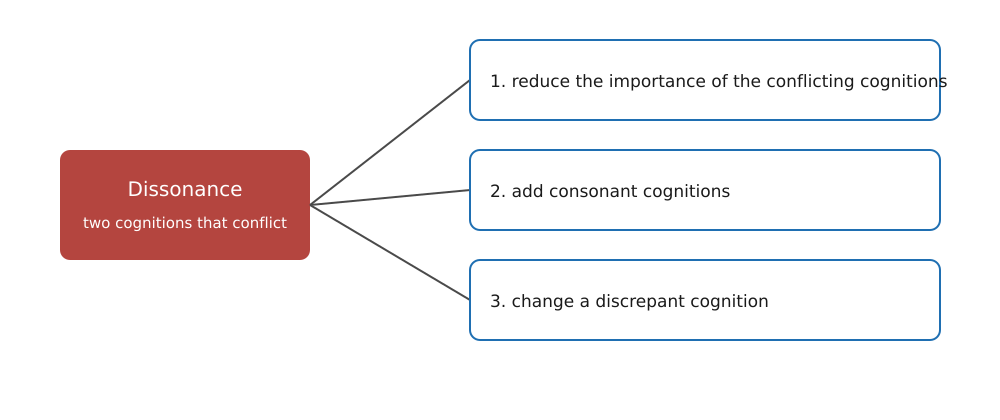

---
aliases:
  - MGMT 2010 cognitive dissonance
  - cognitive dissonance
  - cognitive dissonance MGMT 2010
  - dissonance
tags:
  - flashcard/active/special/academia/HKUST/MGMT_2010/cognitive_dissonance
  - language/in/English
---

# cognitive dissonance

Cognitive dissonance is the discomfort of holding an attitude and a behaviour that disagree. Leon Festinger, an American social psychologist, originated cognitive dissonance theory and social comparison theory. He built the discomfort into a theory of attitude change: reward, punishment, and choice all bear on what a person comes to believe. Kenneth G. DeBono wrote the encyclopaedia entry.

---

Flashcards for this section are as follows:

- the subject of cognitive dissonance theory ::@:: The effects of inconsistency between a person's attitudes and behaviours.
- the social psychologist who developed cognitive dissonance theory ::@:: Leon Festinger.
- the author of the entry on cognitive dissonance theory ::@:: Kenneth G. DeBono.
- what cognitive dissonance theory became ::@:: A theory of attitude change, not only an account of discomfort.
- the three influences on attitudes that the theory covers ::@:: Reward, punishment, and choice.
- what cognitive dissonance names ::@:: The discomfort of holding an attitude and a behaviour that disagree.
- the two theories that Leon Festinger, an American social psychologist, originated ::@:: Cognitive dissonance theory and social comparison theory.

## dissonance and consonance

People tend to keep their cognitions consistent. A __cognition__ is what a person knows about their own attitudes and behaviours, and an __attitude__ is a positive or negative evaluation of a person, place, or thing. A behaviour that conflicts with an attitude sets two cognitions in opposition.

The conflict produces __dissonance__, an uncomfortable state of physiological and psychological tension that moves a person to restore consistency. __Consonance__ is the state in which they no longer conflict.

---

Flashcards for this section are as follows:

- cognition ::@:: What a person knows about their own attitudes and behaviours.
- attitude ::@:: A positive or negative evaluation of a person, place, or thing.
- dissonance ::@:: An uncomfortable state of physiological and psychological tension, produced when a person's cognitions conflict.
- consonance ::@:: The psychological state in which cognitions are not in conflict.
- what a person who feels dissonance is motivated to do ::@:: End the discomfort by restoring consistency among the cognitions.

## restoring consonance

Dissonance reduction works in three ways: reduce the importance of the conflicting cognitions, add consonant cognitions, or change a discrepant cognition. Dissonance grows with how important the conflicting cognitions are, and all three routes start from that point. 
 

---

Flashcards for this section are as follows:

- the three routes to restoring consonance ::@:: Reduce the importance of the conflicting cognitions, add consonant cognitions, or change a discrepant cognition.
- what the amount of dissonance depends on ::@:: How important the conflicting cognitions are to the person.
-  ::@:: Three routes out of the dissonance of two cognitions that conflict, numbered in this order: 1. reduce the importance of the conflicting cognitions; 2. add consonant cognitions; 3. change a discrepant cognition.
- the three numbered routes out of cognitive dissonance ::@:: Three arrows leave one point on the dissonance of two cognitions that conflict, numbered 1. reduce the importance of the conflicting cognitions, 2. add consonant cognitions, 3. change a discrepant cognition. 
 
- dissonance reduction ::@:: The restoration of consonance, so that the conflicting cognitions no longer produce discomfort.

### reducing the importance of the conflicting cognitions

A person who wants a suntan knows that tanning raises the risk of skin cancer, which conflicts with staying healthy and long-lived. One way out is to decide that a shorter life full of enjoyable things is worth more than a longer, quieter one. The inconsistency remains, but it now matters little.

---

Flashcards for this section are as follows:

- how a suntanner reduces the importance of the conflicting cognitions ::@:: By deciding that a shorter life full of enjoyable things is worth more than a longer, quieter one.

### adding consonant cognitions

A second route piles up consonant cognitions, and the discrepancy looks smaller beside them. The tanner may decide a tan is needed for social acceptance, since all their friends have one. Tanning makes them look healthier and more attractive, and may promote health.

---

Flashcards for this section are as follows:

- how a suntanner adds consonant cognitions ::@:: Friends all have tans, so a tan earns social acceptance; tanning looks healthier and more attractive, and may promote health.
- a consonant cognition ::@:: A cognition that agrees with the behaviour, so that piling several of them up makes a discrepancy look smaller.

### changing a discrepant cognition

The simplest route changes one of the two discrepant cognitions. The tanner can stop tanning, or decide that tanning carries no extra risk of skin cancer; either change ends the inconsistency. An attitude can move to match a behaviour already performed, which is what makes this a theory of attitude change.

A person who wants a friend to favour a candidate takes the friend to a rally for that candidate, though the friend favours the opponent. The friend now holds two conflicting cognitions: the rally backed a candidate they oppose, and they went anyway. The pair resolves by a change of attitude: the friend convinces themselves that the candidate is not so bad and does have some good points.

---

Flashcards for this section are as follows:

- how a suntanner changes a discrepant cognition ::@:: Stop tanning, or decide that tanning carries no extra risk of skin cancer.
- why changing a discrepant cognition makes behaviour a source of attitude ::@:: An attitude can move to match a behaviour already performed, so acting against a belief can change the belief.
- the setting of the rally case in which an attitude follows a behaviour ::@:: A person who wants a friend to favour a candidate takes the friend to a rally for a candidate the friend opposes.
- how the friend in the rally case resolves the dissonance ::@:: By convincing themselves that the candidate is not so bad and does have some good points.
- a discrepant cognition ::@:: One of two cognitions that conflict with each other, which a person changes to end the inconsistency between them.

## conditions for dissonance-induced attitude change

Attitude does not follow behaviour every time. __Dissonance-induced attitude change__, the adjustment of an attitude to fit a behaviour, needs three conditions.

The first is the absence of external justification, any environmental cause that could explain the inconsistency. A person paid a hundred dollars to attend a rally for a candidate they oppose, or promised a fancy dinner, has reason enough to go, so no dissonance arises.

The second is personal responsibility, the sense that the behaviour was a person's own free choice. Someone taken out for an exciting evening and told about the rally only on arrival did not choose to attend, so the conflict never forms.

The third is a foreseeable negative consequence. A person who knew every attendee had to donate or hand out pamphlets, and went anyway, now campaigns for the candidate they oppose.

---

Flashcards for this section are as follows:

- dissonance-induced attitude change ::@:: The adjustment of an attitude so that it is consistent with a behaviour already performed.
- when a behaviour changes an attitude ::@:: When the behaviour has no external justification, the person feels personally responsible for it, and a negative consequence was foreseeable.
- external justification ::@:: An environmental cause that could explain the behaviour, such as a payment or a promised dinner. With one, no dissonance arises.
- personal responsibility for a behaviour ::@:: The sense that the behaviour was a person's own free choice. Without it, as when someone is taken along without being told, no dissonance arises.
- foreseeable negative consequence ::@:: A known bad result of the behaviour, as when a rally attendee knows that every attendee must donate or hand out pamphlets. It makes dissonance more likely.

## insufficient justification

Reward is the most researched application of the theory: what it does to the attitude of a person who acts against their belief, a case called induced compliance. A reward or a threat justifies the behaviour, so most inducements stop dissonance before it starts. The smaller the inducement, the less of the behaviour it explains, so the more the attitude must move to close the gap.

---

Flashcards for this section are as follows:

- the most researched application of cognitive dissonance theory ::@:: What happens to an attitude when a person is rewarded for doing something they do not believe in.
- why a large reward stops attitude change ::@:: It is enough external justification for the behaviour, so no dissonance arises.
- how the size of an inducement relates to attitude change ::@:: The smaller the inducement, the less of the behaviour it explains, so the more the attitude moves.
- induced compliance ::@:: Doing something a person does not believe in under a reward or a threat, after which the attitude may move to match the act.
- insufficient justification ::@:: An inducement too small to explain the behaviour, so the attitude moves to close the gap between what the person did and what they believe.

### reward for a boring task

Leon Festinger and J. M. Carlsmith had students spend an hour turning screws, a deliberately dull task. Each student then told the next, who was waiting to do the same task, that it was very interesting. Half were paid twenty dollars to say so and half one dollar. Asked afterwards what they really thought, the twenty-dollar students called the task quite boring and the one-dollar students called it interesting and enjoyable.

Twenty dollars justified the lie, so those students felt no dissonance. A dollar does not, so the one-dollar students held two conflicting cognitions: the task was boring, and they had just called it enjoyable. They closed that gap by changing their attitude to the task.

---

Flashcards for this section are as follows:

- the procedure in Leon Festinger and J. M. Carlsmith's reward study ::@:: Turning screws for an hour, a deliberately dull task.
- what the students in Leon Festinger and J. M. Carlsmith's reward study told the waiting student ::@:: That the screw-turning task was very interesting, which was a lie.
- what the twenty-dollar and one-dollar groups said about the screw-turning task ::@:: The twenty-dollar group called it quite boring; the one-dollar group called it interesting and enjoyable.
- why the twenty-dollar students felt no dissonance ::@:: Twenty dollars was enough external justification for the lie, so nothing needed resolving.
- why the one-dollar students changed their attitude ::@:: A dollar is not enough justification for telling a lie, so they resolved the dissonance by deciding the task was enjoyable.

### threat against a forbidden toy

Elliot Aronson and Carlsmith had preschool children rate how attractive the toys were, then told them not to play with the one they had rated most attractive. Some heard a mild threat, that the researcher would be upset; others a severe one, that he would be angry, pack up the toys, and call the child a baby. No child played with the forbidden toy under either threat.

The second rating left the toy as attractive for the severely threatened children and less attractive for the mildly threatened ones. A severe threat fully justifies leaving the toy alone, so nothing has to change. A mild threat leaves the restraint unexplained, so the child closes the gap by deciding the toy is not worth wanting.

---

Flashcards for this section are as follows:

- the procedure in Elliot Aronson and Carlsmith's punishment study ::@:: Preschool children rated toys for attractiveness, then were told not to play with the toy they had rated most attractive.
- the mild and the severe threat in Elliot Aronson and Carlsmith's study ::@:: Mild: the researcher would be upset. Severe: he would be angry, pack up the toys, and consider the child a baby.
- how the two threats affected play ::@:: No child played with the forbidden toy under either threat.
- how the severely threatened children re-rated the forbidden toy ::@:: Still quite attractive, because a severe threat justified leaving it alone.
- how the mildly threatened children re-rated the forbidden toy ::@:: Much less attractive, because they resolved the unexplained restraint by deciding the toy was not so attractive.

## post-decision rationalisation

A decision between two attractive alternatives creates its own dissonance, called post-decision dissonance: the chosen one has its flaws, and the rejected one had its merits. People close that gap by deciding the chosen alternative is clearly superior, so two evenly matched alternatives separate after the decision.

---

Flashcards for this section are as follows:

- the two conflicting cognitions that follow a decision ::@:: The chosen alternative has unattractive qualities, and the unchosen one had attractive qualities.
- how people resolve the dissonance of a decision ::@:: They convince themselves that the chosen alternative is clearly superior to the unchosen one.
- what a decision does to two equally attractive alternatives ::@:: The chosen one is seen as much more attractive after the decision than before it.
- post-decision dissonance ::@:: The dissonance a decision creates on its own.

### racetrack bettors

Robert Knox and James Inkster asked bettors at a racetrack how confident they were that their horse would win. They put the question to people waiting to bet and to people leaving the betting window. Those who had already placed their money were much more confident. A bet creates the possibility of dissonance, since the bettor backed one horse and passed over the others, and confidence in the chosen horse removes it. Confidence in the horses passed over falls too.

---

Flashcards for this section are as follows:

- what Robert Knox and James Inkster measured at the racetrack ::@:: How confident bettors were that their horse would win, among people waiting to bet and people who had just bet.
- the racetrack finding about confidence ::@:: Bettors were much more confident after placing their bet than before.
- why placing a bet raises confidence in the chosen horse ::@:: Backing one horse and passing over the others creates dissonance, and confidence in the chosen horse resolves it.

## prominence in social psychology

Cognitive dissonance theory appeared in 1957, when interest in the motives behind attitudes and behaviour was at its peak. It was one of a handful of theories, now called __cognitive consistency theories__, that held people to be motivated toward consistency among thoughts, feelings, and behaviours. It became perhaps the best known theory in social psychology.

---

Flashcards for this section are as follows:

- when cognitive dissonance theory was introduced ::@:: In 1957, when interest in the motives behind attitudes and behaviour was at its peak.
- cognitive consistency theories ::@:: The family of theories holding that people are motivated to seek consistency among thoughts, feelings, and behaviours.
- how cognitive dissonance theory ranks among social psychology theories ::@:: Perhaps the best known of them all.

### contrast with learning theory

Psychology at the time took behaviour to be a function of its consequences: people do what is rewarded and drop what is not. Changing an action, an attitude, or a belief needs an incentive, and a bigger one buys more change. Dissonance theory predicted the opposite: a smaller reward sometimes produces more change. That prediction brought attention from outside social psychology.

---

Flashcards for this section are as follows:

- learning theory's account of behaviour ::@:: Behaviour is a function of its consequences: people do what is rewarded and drop what is not.
- the prediction that set cognitive dissonance theory against learning theory ::@:: That sometimes less reward or incentive produces more change, not more.

### shift from groups to the individual

Social psychology had been the study of groups and intergroup relations. Dissonance theory was one of the first social psychological theories to take the cognitive processes inside a single person as its subject. The study of groups became the work of sociologists, and the individual in social settings came to define the field.

---

Flashcards for this section are as follows:

- what social psychology studied before cognitive dissonance theory ::@:: Groups and intergroup relations.
- what cognitive dissonance theory moved to the centre of social psychology ::@:: The cognitive processes within the individual, at the expense of the study of groups.
