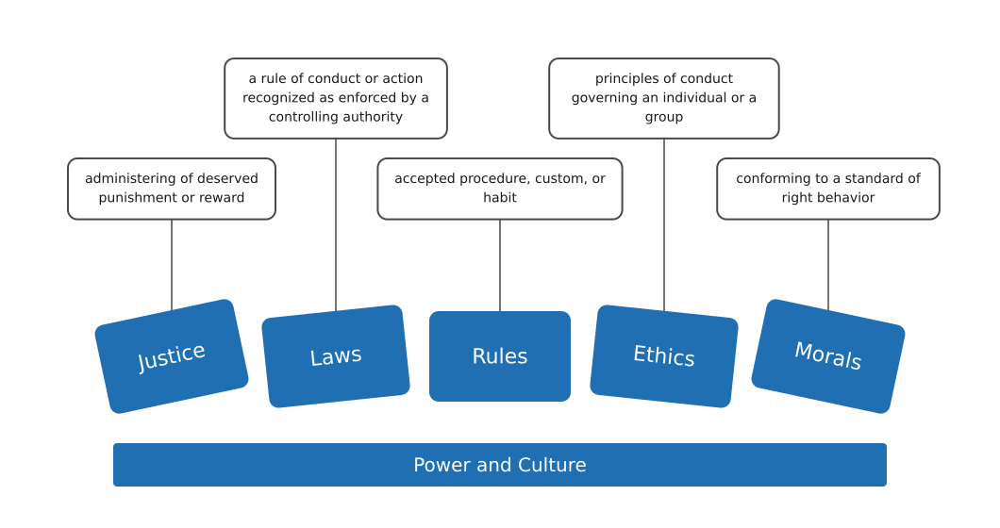

---
aliases:
  - MGMT 2010 ethics and morals
  - ethics and morals
  - ethics versus morals
tags:
  - flashcard/active/special/academia/HKUST/MGMT_2010/ethics_and_morals
  - language/in/English
---

# ethics and morals

## distinction

Ethics and morals both concern right or wrong conduct. They differ in where the rule comes from.

| | Ethics | Morals |
| --- | --- | --- |
| Source | An external source or social system | A person's own compass of right and wrong |
| Content | Rules of conduct in a particular culture or group | Principles or habits relating to right and wrong conduct |

A medical code of ethics is an external rule. Family, education, and religion shape a person's morals. Ethics and morals influence each other, and both change meaning with context and country.

---

Flashcards for this section are as follows:

- Ethics versus morals ::@:: Ethics come from an external source or social system. Morals come from a person's own compass of right and wrong.
- Ethics ::@:: Rules of conduct in a culture or group, set by an external source or social system.
- Morals ::@:: Principles or habits of right and wrong conduct, taken from a person's own compass.
- Where dilemmas arise ::@:: Where the group's demand clashes with the individual's belief.
- Ethics as societal decisions and morals as self-determined ::@:: Ethics are societal decisions carrying rigour and structure; morals are the individual's own work.
- What shapes a person's morals ::@:: Family, education, and religion.
- An external rule of ethics, by example ::@:: A medical code of ethics that professionals must follow.
- Code of ethics ::@:: Rules of conduct a group or profession sets for its members from an external source.
- What separates ethics from morals ::@:: The source of the rule, not its content; the two definitions otherwise read alike.
- How ethics and morals influence each other ::@:: The group's rules shape personal principles, and personal principles shape the rules the group accepts.
- How the meaning of ethics and morals varies ::@:: By context, such as research, business, or health, and by culture and country.

### dictionary senses

Ethics also names the branch of knowledge that deals with moral principles, usually treated as singular. Morals has a second sense, drawn from the code of behaviour a society considers right or acceptable.

The plural sense of ethics covers a person's behaviour and the conducting of an activity. A sense of morals drawn from a society's code attaches to a practice rather than a person, as in the moral dimensions of medical intervention. That code belongs to the society, which puts this sense close to ethics.

---

Flashcards for this section are as follows:

- The branch-of-knowledge sense of ethics ::@:: The study of moral principles, usually treated as singular.
- The sense of morals tied to a society's code ::@:: Concerned with, or derived from, the code a society considers right or acceptable.
- The plural sense of ethics ::@:: Moral principles that govern a person's behaviour or the conducting of an activity, as when medical ethics enter into a question.
- What the sense of morals drawn from a society's code attaches to ::@:: A practice, not a person, as in the moral dimensions of medical intervention.
- Where the sense of morals drawn from a society's code sits ::@:: Close to ethics, because the code belongs to the society, not the individual.

## moral compass spectrum

A moral compass is the standard a person holds inside, by which they judge right and wrong conduct. Justice, laws, rules, ethics, and morals run in that order, from formal external constraint to a standard held inside. One bar labelled power and culture runs under all five: where a society sits on the spectrum depends on how power is spread and which cultural norms carry weight. 
 

---

Flashcards for this section are as follows:

- Moral compass ::@:: The standard a person holds inside, by which they judge right and wrong conduct.
- Justice ::@:: Giving out deserved punishment or reward.
- Laws ::@:: Rules of conduct enforced by a ruling authority.
- Rules ::@:: Accepted procedures, customs, or habits. Less formal than laws, still maintained from outside.
- What shapes a society's position on the spectrum ::@:: How power is spread and which cultural norms carry weight.
-  ::@:: The moral compass spectrum: justice, laws, rules, ethics, and morals in that order, running from a formal external constraint to a standard a person holds inside, with power and culture as one bar under all five.
- What the moral compass spectrum shows ::@:: Five tilted boxes in that order, each with the definition of its term in a callout above it, running from a formal external constraint to a standard a person holds inside. 
 

## contested questions

Disputes over conduct often turn on whether the question is ethical or moral. Equal parental leave for men and women is one. Horsemeat in prepared meals is another: it caused an uproar in a country that already eats chicken, beef, pork, and lamb, because cultures disagree over whether horse is food. Pig-derived food brings religion into the question. Building on green space turns on whether the housing is affordable for a family or for the poor. Every dispute of this kind ends at who decides.

---

Flashcards for this section are as follows:

- What every contested question about ethics and morals turns on ::@:: Whether the practice is an ethical question or a moral one.
- Parental leave as a contested question ::@:: Whether men and women should have equal leave for childcare.
- Horsemeat in prepared meals as a contested question ::@:: Why it caused an uproar in a country that already eats chicken, beef, pork, and lamb.
- Why cultures disagree over eating horse ::@:: Some cultures treat horse as food, others do not.
- Eating pig-derived food as a contested question ::@:: What part religion plays in whether pig-derived food is acceptable.
- Green space and affordable housing as a contested question ::@:: Whether building on green space is acceptable when the housing is affordable for a family or for the poor.
- The question every contested practice ends at ::@:: Who decides.

## three approaches to ethics

Western philosophy divides ethics, roughly, into three schools. [Virtue ethics](virtue%20ethics.md) draws on Aristotle: the virtues, justice, charity, and generosity among them, predispose whoever has them, and their society, to act well. [Deontology](deontology.md) comes chiefly from Immanuel Kant (1724-1804): rational beings are bound to respect other rational beings. [Utilitarianism](utilitarianism.md) takes as its principle the greatest happiness, or the least sorrow, for the greatest number.

Ethics applies a society's beliefs and values to short-term and long-term decisions. Integrity is the match between the values a person states and the conduct they practise, kept whether or not anyone is watching. Professionalism is conduct that meets the standard a profession sets toward clients, colleagues, and the public. Accountability is answering for what a decision causes, to the people it falls on.

---

Flashcards for this section are as follows:

- The three approaches Western ethics divides into ::@:: Virtue ethics, which draws on Aristotle; deontology, defended by Immanuel Kant; and utilitarianism.
- Virtue ethics in the three-way division ::@:: Draws on Aristotle: the virtues, justice, charity, and generosity among them, predispose whoever has them, and their society, to act well.
- Aristotle in the three-way division ::@:: The ancient Greek philosopher whose teaching virtue ethics rests on.
- Deontology in the three-way division ::@:: The approach defended by Immanuel Kant, where duty binds rational beings to respect other rational beings.
- Immanuel Kant in the three-way division ::@:: The German philosopher of Königsberg (1724-1804) whose duty ethics deontology rests on.
- Utilitarianism in the three-way division ::@:: The approach whose guiding principle is the greatest happiness, or the least sorrow, for the greatest number.
- What separates the three approaches to ethics ::@:: What each centres on: the virtues of the person acting, the duty binding rational beings, or the happiness the act produces.
- How a society applies its beliefs and values ::@:: Through ethics, which turns them into short-term and long-term decisions.
- What careful application of ethics and morals maintains ::@:: Integrity, professionalism, and accountability.
- Integrity ::@:: The match between the values a person states and the conduct they practise, kept whether or not anyone is watching.
- Professionalism ::@:: Conduct that meets the standard a profession sets toward clients, colleagues, and the public.
- Accountability ::@:: Answering for what a decision causes, to the people it falls on.
