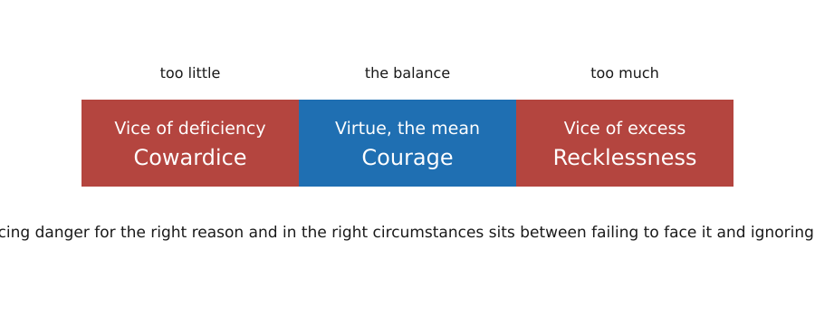

---
aliases:
  - MGMT 2010 virtue ethics
  - aretaic ethics
  - character ethics
  - eudaimonism
  - virtue ethics
  - virtue ethics MGMT 2010
tags:
  - flashcard/active/special/academia/HKUST/MGMT_2010/virtue_ethics
  - language/in/English
---

# virtue ethics

Virtue ethics is a family of normative theories that judges an action by the character of the person performing it. A right act is what a virtuous person would do in the same circumstances. Character ethics is the wider family, holding virtue ethics and care ethics.

It takes a whole life as its subject rather than an episode, since virtue is what a person carries across situations, and it guides moral education: a society becomes good by helping its members become good people, not only by punishing bad acts.

---

Flashcards for this section are as follows:

- a right act in virtue ethics ::@:: The action a virtuous person would do in the same circumstances.
- the question virtue ethics asks ::@:: What sort of person should I be, rather than what should I do.
- what virtue ethics studies instead of rules and results ::@:: The moral character of the person acting.
- the two types in the family of character ethics ::@:: Virtue ethics and care ethics, both centred on character rather than the act alone.
- the scope of virtue ethics ::@:: A whole life, rather than particular episodes or actions.
- how virtue ethics says a good society is built ::@:: By helping its members become good people, not only by punishing bad acts.

## agent-centred question

People judge another person's character more often than they judge one act. A deontologist asks which rules apply, a consequentialist which action brings the best result, and a virtue ethicist what a kind or honest person would do. Most virtue theorists add that the virtuous person acts from rational thought, not instinct.

Alasdair MacIntyre puts the question in three parts: who am I, who ought I to become, and how ought I to get there.

---

Flashcards for this section are as follows:

- the question each of the three families of normative ethics asks ::@:: The deontologist asks which rules apply, the consequentialist which action brings the best result, and the virtue ethicist what a kind or honest person would do.
- the three questions Alasdair MacIntyre places at the heart of moral thinking ::@:: Who am I, who ought I to become, and how ought I to get there.
- the chain that takes a right action back to the virtues ::@:: An action is right if a virtuous person would do it, and a virtuous person acts virtuously, which means living the virtues, a virtue being a moral characteristic a person needs to live well.
- what makes a virtuous person act virtuously for most virtue theorists ::@:: Rational thought, rather than instinct.
- what people judge more often than whether a particular action was good or bad ::@:: Another person's character.

## plato and aristotle

Plato, the ancient Greek philosopher of Classical Athens, followed Socrates in holding that the moral judgements of daily life presuppose a good life independent of experience, personality, and circumstances.

Aristotle, who founded the Peripatetic school in the Lyceum at Athens, rejected that, since for him moral principles are immanent in daily activity. His inquiry therefore opens with an empirical study of what people desire, which he calls happiness, or _eudaimonia_, and the guiding question moves from how a person should live to what happiness consists in and what conditions attain it.

---

Flashcards for this section are as follows:

- Plato's position, following Socrates, on the standing of the moral judgements of daily life ::@:: They presuppose a good life independent of experience, personality, and circumstances.
- the alternative Aristotle offers to Plato's account of where moral principles are found ::@:: Moral principles are immanent in daily activity, discoverable only by studying that activity.
- why Aristotle's ethical inquiry opens with an empirical study of what people desire ::@:: Because moral principles are immanent in daily activity, only a study of that activity finds them, so the inquiry asks first what people desire, which Aristotle takes to be happiness.
- how the guiding question changes from Plato to Aristotle ::@:: From how a person should live to what happiness consists in and what conditions attain it.
- the ancient Greek philosopher of Classical Athens who held, following Socrates, that the moral judgements of daily life presuppose a good life independent of experience, personality, and circumstances ::@:: Plato, whose good stands independent of experience rather than immanent in daily activity as Aristotle's does.
- the ancient Greek philosopher who founded the Peripatetic school in the Lyceum at Athens and set out the theory of virtue ethics in the _Nicomachean Ethics_ ::@:: Aristotle, for whom moral principles are immanent in daily activity, so that the inquiry opens with an empirical study of what people desire.

## virtue and vice

A virtue is a stable character trait that disposes a person to feel, choose, and act well, such as generosity or bravery. Its opposite is a vice, a quality that worsens character, such as cruelty or dishonesty.

---

Flashcards for this section are as follows:

- virtue as a character trait ::@:: A stable character trait that disposes a person to feel, choose, and act well.
- what a virtue and a vice each do to character ::@:: A virtue builds character, and a vice worsens it.
- what a single brave act shows about a person's character ::@:: Nothing yet, because virtue is a steady disposition rather than one act.

### acting for the right reasons

Virtue requires the right act for the right reason. A person honest only because he fears being caught in a lie is not virtuous. A virtuous person is honest because honesty matters to him, so he deals honestly with people, seeks honest company, and speaks up for honesty.

---

Flashcards for this section are as follows:

- the person honest only from fear of being caught ::@:: Not virtuous, since virtue requires the right act for the right reason.
- how a person honest because honesty matters to him acts beyond the single case ::@:: He deals honestly with others, seeks honest company, and speaks up for honesty.

### sensitivity to circumstance

A strict deontologist keeps the rule "do not lie" even when the truth harms. A virtuous person weighs honesty against the case's other features, such as the hurt a blunt answer would cause. The answer may be a tactful version of the truth, a refusal to give an opinion, or, where the consequences are bad enough, a lie.

---

Flashcards for this section are as follows:

- how a virtuous person treats the rule not to lie ::@:: He weighs honesty against the case's other features, such as the hurt a blunt answer would cause, where a strict deontologist tells the truth whatever follows.
- answers an honest person may give instead of a blunt truth ::@:: A tactful version of the truth, a refusal to give an opinion, or, where the consequences are bad enough, a lie.

## flourishing

Aristotle set out the theory in the _Nicomachean Ethics_. Its goal is _eudaimonia_, flourishing or living well, and a virtue is an excellence of character that leads there.

---

Flashcards for this section are as follows:

- Aristotle's goal in the _Nicomachean Ethics_ ::@:: _Eudaimonia_, meaning flourishing or living well.
- virtue in Aristotle's ethics ::@:: An excellence of character that leads a person to flourish.

### eudaimonia

_Eudaimonia_ is a fulfilled life, judged over the long term and as a whole, while feeling happy is a passing state. It is an activity rather than a state: a life spent functioning well, grown out of the virtues exercised over time.

---

Flashcards for this section are as follows:

- _eudaimonia_ against feeling happy ::@:: _Eudaimonia_ is a life judged as a whole over the long term, while feeling happy is a passing state.
- why _eudaimonia_ is an activity rather than a state ::@:: It is a life spent functioning well, grown out of the virtues a person exercises over time.

### hierarchy of goods

External goods such as wealth, friends, and political standing rank lowest, then the goods of the body such as health, then the goods of the soul, intellectual and moral. _Eudaimonia_ stands above them as the final, complete, and self-sufficient end: virtue is pursued for its own sake, and other goods for the sake of that end.

Abraham Maslow, an American psychologist, set out a hierarchy of needs in 1943 in the paper _A Theory of Human Motivation_: five levels, physiological needs at the base, then safety, love and belonging, esteem, and self-actualization. The lower four are deficiency needs and the top is a growth need, and he later added a sixth level of meta-needs. Maslow ranked needs by prepotency, the strength that makes a lower need press until it is reasonably met, though it need not be fully satisfied before the next appears. Maslow did not draw the pyramid: Charles McDermid, a consulting psychologist, published that shape in 1960 in the journal _Business Horizons_.

Both hierarchies are a ranked ladder with a highest term, the lower rungs serving the one above, and the body's needs at the base with the mind's goods above them. Maslow ranks what motivates a person, so his levels are needs that press until they are satisfied. Aristotle ranks what makes a life go well, so his ranks are goods judged by how well they serve the human function and the end. Maslow's top is a need a person may never reach, while Aristotle's end is the standard every good is measured against. 
  
 ![A pyramid of five bands labelled from the base up: Physiological, holding breathing, food, water, sex, sleep, homeostasis, and excretion; Safety, holding security of body, of employment, of resources, of morality, of the family, of health, and of property; Love and Belonging, holding friendship, family, and sexual intimacy; Esteem, holding self-esteem, confidence, achievement, respect of others, and respect by others; and Self-actualization, holding morality, creativity, spontaneity, problem solving, lack of prejudice, and acceptance of facts](../../../../archives/Wikimedia%20Commons/Maslow%27s%20hierarchy%20of%20needs.svg)

---

Flashcards for this section are as follows:

- Aristotle's ranking of the goods of a life ::@:: External goods such as wealth, friends, and political standing come lowest, then the goods of the body such as health, then the goods of the soul, intellectual and moral.
- why _eudaimonia_ stands above the other goods ::@:: It is the final, complete, and self-sufficient end, and other goods are pursued for its sake.
-  
 ![A pyramid of five bands labelled from the base up: Physiological, holding breathing, food, water, sex, sleep, homeostasis, and excretion; Safety, holding security of body, of employment, of resources, of morality, of the family, of health, and of property; Love and Belonging, holding friendship, family, and sexual intimacy; Esteem, holding self-esteem, confidence, achievement, respect of others, and respect by others; and Self-actualization, holding morality, creativity, spontaneity, problem solving, lack of prejudice, and acceptance of facts](../../../../archives/Wikimedia%20Commons/Maslow%27s%20hierarchy%20of%20needs.svg) ::@:: The first drawing is Aristotle's hierarchy of goods: eudaimonia as the final, complete, and self-sufficient end, with the goods of the soul, the goods of the body, and external goods ranked below it. The second drawing is Abraham Maslow's hierarchy of needs: physiological needs at the base, then safety, love and belonging, esteem, and self-actualization at the top.
- what the two drawings that compare Aristotle's ranking of goods with Abraham Maslow's hierarchy of needs show ::@:: The first drawing sets eudaimonia above three bands: the goods of the soul, intellectual and moral, the goods of the body, health, and external goods, wealth, friends, and political standing. The second draws Abraham Maslow's hierarchy of needs as a pyramid, physiological needs at the base, then safety, love and belonging, esteem, and self-actualization at the apex. 
  
 ![A pyramid of five bands labelled from the base up: Physiological, holding breathing, food, water, sex, sleep, homeostasis, and excretion; Safety, holding security of body, of employment, of resources, of morality, of the family, of health, and of property; Love and Belonging, holding friendship, family, and sexual intimacy; Esteem, holding self-esteem, confidence, achievement, respect of others, and respect by others; and Self-actualization, holding morality, creativity, spontaneity, problem solving, lack of prejudice, and acceptance of facts](../../../../archives/Wikimedia%20Commons/Maslow%27s%20hierarchy%20of%20needs.svg)
- what Aristotle's ranking of goods and Abraham Maslow's hierarchy of needs share ::@:: A ranked ladder with a highest term, the lower rungs serving the one above, and the body's needs at the base with the mind's goods above them.
- where Aristotle's ranking of goods and Abraham Maslow's hierarchy of needs part ::@:: Maslow ranks what motivates a person, so his levels are needs that press until they are satisfied, while Aristotle ranks what makes a life go well, so his ranks are goods judged by how well they serve the human function and the end. Maslow's top is a need a person may never reach, while Aristotle's end is the standard every good is measured against.

### function argument

The goods rank by how well they help a person fulfil the human function, the _ergon_. A good thing performs its own function well, so a good human being performs the human function well, and the excellence that lets it is the _arete_. Reason marks that function, so the goods of the soul rank highest among the subordinate goods.

---

Flashcards for this section are as follows:

- the _ergon_ argument for a good human life ::@:: A good thing of any kind performs its function well, so a good human being performs the human function well.
- what _arete_ names in Aristotle's ethics ::@:: The excellence that lets something perform its function well.
- what _ergon_ names in Aristotle's ethics ::@:: The function of a thing, which for a human being is the activity that reason marks.

## habituation and practical wisdom

Repeated practice builds a virtue until it becomes second nature, and Aristotle calls the settled habit of character a _hexis_. Habit spreads by imitation, and a community decides which role models its members admire. Books on ethics do not make a person virtuous: the trait comes from lived experience and from handling difficult situations well.

A virtue forms in two stages. Education of thought, the habit of contemplation, is acquiring knowledge and using the mind well, which forms intellectual virtue. The habitual practice of moral virtue turns that understanding into action. Aristotle holds that people are adapted by nature to receive the virtues and made perfect by habit.

Each honest choice makes the next one easier, while a habit of lying leaves a person less able to tell the truth when the stakes are high. Aristotle's remedy for a person without a virtue is to act as though he had it, choosing what the most generous version of himself would choose, until the gap between what he is and what he wants to be closes.

---

Flashcards for this section are as follows:

- how virtue is acquired ::@:: By repeated practice until the trait becomes second nature, not by reading books on ethics.
- what Aristotle calls the settled habit of character behind a virtue ::@:: A _hexis_.
- how role models and community shape virtue ::@:: Role models teach by imitation, and a community decides which role models its members admire.
- what a person needs, besides habituation, to act well in difficult situations ::@:: Lived experience and practical wisdom.
- how repetition shapes later behaviour ::@:: Each honest choice makes the next one easier, while a habit of lying makes the truth harder to tell when the stakes are high.
- Aristotle's advice to a person without a virtue ::@:: Act as though the virtue were already held, choosing what the most generous version of oneself would choose, until the gap between who one is and who one wants to be closes.
- the two stages by which a virtue forms ::@:: Education of thought, which forms intellectual virtue, and the habitual practice of moral virtue, which puts that understanding into action.
- what the habit of contemplation consists in ::@:: Acquiring knowledge and using the mind well.
- what makes repeated practice settle into a habit ::@:: People are adapted by nature to receive the virtues and are made perfect by habit.

### practical wisdom

Practical wisdom, _phronesis_, is the capacity to see what a situation calls for and to deliberate well about it. It keeps a virtue from hardening into a rule by reading the particular case, and it answers the charge of vagueness, since whoever has it, the _phronimos_, knows what to do where a rule runs out.

---

Flashcards for this section are as follows:

- practical wisdom (_phronesis_) ::@:: The capacity to see what a situation calls for and to deliberate well about it.
- the _phronimos_ in Aristotle's ethics ::@:: The practically wise person, who has practical wisdom (_phronesis_) and so knows what to do where a rule runs out.
- what practical wisdom does where a rule runs out ::@:: It reads the particular case and gives the response it asks for, so the theory answers the charge of vagueness.

## doctrine of the mean

Each moral virtue sits between two vices, one of excess and one of deficiency. Courage lies between cowardice, which fails to face danger when it is called for, and recklessness, which ignores danger and takes pointless risks. The brave person acts for appropriate reasons and in appropriate circumstances. 
 

Temperance lies between self-denial and indulgence, generosity between stinginess and wastefulness, and justice between favouritism and harshness. Truthfulness, which the Greek calls _aletheia_, lies between boastfulness and mock modesty.

A colleague asks for feedback on a badly managed project. He can state exactly what he thinks, which shatters the colleague's confidence, and that tactlessness is a vice. He can praise the work and deceive the colleague, and that dishonesty is also a vice. He can name what could be improved next time without dwelling on the failures, which is both honest and empathetic, the mean between caring for the colleague and telling the truth.

---

Flashcards for this section are as follows:

- the doctrine of the mean ::@:: Every moral virtue sits between two vices, one of excess and one of deficiency.
- the two vices around courage ::@:: Cowardice, which fails to face danger when it is called for, and recklessness, which ignores danger and takes pointless risks.
- how a brave person faces danger ::@:: For appropriate reasons and in appropriate circumstances.
- the vices around temperance, generosity, and justice ::@:: Temperance lies between self-denial and indulgence, generosity between stinginess and wastefulness, and justice between favouritism and harshness.
- the vices around truthfulness, which the Greek calls _aletheia_ ::@:: Boastfulness and mock modesty.
- the Greek word for truthfulness, the virtue lying between boastfulness and mock modesty ::@:: _Aletheia_.
- the three responses open to a person giving feedback on a badly managed project ::@:: State what one thinks, praise the work, or name what could be improved next time.
- which two of the three responses to the request for feedback are vices ::@:: Stating what one thinks is tactless, and praising the work is dishonest.
- why naming what could be improved next time is the mean ::@:: It is both honest and empathetic, the balance between caring for the colleague and telling the truth.
-  ::@:: The doctrine of the mean applied to courage: cowardice, the vice of deficiency, is too little, recklessness, the vice of excess, is too much, and courage, the virtue, is the balance between them.
- the doctrine of the mean drawn for courage ::@:: Cowardice, the vice of deficiency, marked too little, and recklessness, the vice of excess, marked too much, flank courage, the virtue, marked the balance. 
 

## cardinal virtues

The classical list holds four cardinal virtues: prudence, justice, fortitude or bravery, and temperance. Most virtue theorists take one set to serve every human being, not one set per sort of person, and to come naturally to a mature person even where hard to acquire. The set stops short of sainthood, since a theory demanding that much would guide nobody.

James F. Keenan draws a shorter list. Justice requires treating all human beings equally and impartially, and fidelity requires treating the people closer to oneself with special care. Each person also has to care for himself or herself, affectively, mentally, physically, and spiritually. Prudence holds the other three together, since the prudent person weighs justice, fidelity, and self-care and looks for chances to acquire more of them.

---

Flashcards for this section are as follows:

- the four cardinal virtues ::@:: Prudence, justice, fortitude or bravery, and temperance.
- what most virtue theorists claim about the set of virtues ::@:: One set benefits every human being rather than a different set per sort of person, and the virtues are natural to mature human beings even where hard to acquire.
- what James F. Keenan's justice and fidelity each require ::@:: Justice treats all human beings equally and impartially, and fidelity treats the people closer to oneself with special care.
- the responsibility James F. Keenan gives every person ::@:: To care for oneself affectively, mentally, physically, and spiritually.
- the work James F. Keenan gives prudence ::@:: To keep justice, fidelity, and self-care in view, and to look for chances to acquire more of them.

## assessment

### strengths

The theory centres ethics on the person, so a whole life counts rather than a run of separate acts. It names the traits a person should build, and hands a person facing a choice the concrete question of what a kind or honest person would do.

---

Flashcards for this section are as follows:

- the strengths of virtue ethics ::@:: It centres ethics on the person and takes in a whole life rather than a run of separate acts.
- how virtue ethics treats moral education ::@:: It names the traits a person should build.
- the question virtue ethics gives a person facing a choice ::@:: What would a kind or honest person do in these circumstances.

### criticisms

The standing objection is vagueness: the theory says how to be a good person but not what to do in a moral dilemma. Cultural relativity is the second: lists of virtues differ across history and between societies, so any list may be relative to the culture that draws it. Elitism is the third: the theory asks for a lifetime of practised virtue that few people complete.

Three replies answer the main charges: human flourishing as a universal standard, practical wisdom as the guide to action, and the virtues as traits that adapt to context.

---

Flashcards for this section are as follows:

- the vagueness objection to virtue ethics ::@:: The theory says how to be a good person but not what to do in a moral dilemma.
- the cultural relativity objection to virtue ethics ::@:: Lists of virtues differ across history and between societies, so any list may be relative to the culture that draws it.
- the elitism objection to virtue ethics ::@:: It asks for a lifetime of practised virtue that few people complete.
- the three replies to the criticisms of virtue ethics ::@:: Human flourishing as a universal standard, practical wisdom as the guide to action, and virtues that adapt to context.

## virtue ethics and animals

Any plausible virtue ethic counts cruelty and indifference to suffering as vices, and compassion, kindness, and sensitivity as virtues, so it leaves little room to justify discrimination against nonhuman animals. The traits it counts as excellences fix the ethic, so treating an animal as a means displays cruelty, and no separate premise about what animals are owed is needed.

Kindness to animals draws admiration too, at least for companion animals: rescuing a sick or injured animal earns praise for kindness, and a firefighter who risks injury to save animals from a burning building is admired as brave.

A defender of discrimination might argue from function: if a cow has a function of providing food, killing it for food is not wrong, though killing it for sport would be. The people the arrangement benefits set that function, so the cow's own good never enters, and a cow killed for food and a cow killed for sport undergo the same death. Assigning a sentient being a function that benefits others and not the being itself is discrimination, and it abuses the power imbalance between people and animals, which consists in the standing to decide what another being's life is for. No abusive or insensitive attitude counts as virtuous.

A society that accepts speciesism, discrimination against nonhuman animals, may make an antispeciesist position too hard to demand of a person. Virtue ethicists reject that: a person should act virtuously whether or not the context favours it, and some argue that virtue in difficult circumstances counts for more than virtue in easy ones. Difficulty raises what the virtuous course costs, not what it demands.

To be virtuous is to fulfil one's potential to become a full moral agent, which a person does only by letting others satisfy their own interests too, nonhuman animals included. The most virtuous course does not stop at avoiding harm: it stays out of animal exploitation, supports animal advocacy, and helps animals in need.

---

Flashcards for this section are as follows:

- how virtue ethics bears on discrimination against nonhuman animals ::@:: Any plausible virtue ethic counts cruelty and indifference to suffering as vices, and compassion, kindness, and sensitivity as virtues, so it resists such discrimination.
- what follows once cruelty and indifference to suffering count as vices in a virtue ethic ::@:: Treating an animal as a means displays those vices, so the theory needs no separate premise about what animals are owed.
- what animal exploitation shows about character ::@:: Serious vices of character.
- what admiration for a person who cares for a sick or injured animal shows ::@:: Kindness to animals counts as a virtue.
- the firefighter who risks injury to save animals from a burning building ::@:: Admired as brave, so a virtue spent on animals is admired, and not only kindness.
- the argument from function for killing a cow for food ::@:: If a cow has a function of providing food, killing a cow for food is permissible while killing a cow for sport is not.
- whose interests the function in the argument from a cow's function of providing food serves ::@:: Those of the people the arrangement benefits, so the cow's own good never enters the argument.
- what a cow killed for food and a cow killed for sport each undergo in the argument from function ::@:: The same death, so the argument turns on the benefit to people rather than on the harm to the cow.
- the reply to the argument from a cow's function of providing food ::@:: Assigning a sentient being a function that benefits others and not itself is discrimination, an abuse of the power imbalance between people and animals, and no such attitude is virtuous.
- what the power imbalance between people and animals consists in ::@:: The standing to decide what another being's life is for.
- the objection a speciesist society raises ::@:: In a society that accepts speciesism, discrimination against nonhuman animals, an antispeciesist position is too hard for a person to demand.
- the reply to the objection that a speciesist society makes an antispeciesist position too hard ::@:: A person should act virtuously whether the context favours it or not, and some hold that virtue in a hard context counts for more than virtue in an easy one.
- why virtue in difficult circumstances counts for more than virtue in easy ones ::@:: Difficulty raises what the virtuous course costs without lowering what it demands.
- what being virtuous consists in, and what it requires towards other beings ::@:: To fulfil one's potential as a full moral agent, which a person can do only by letting others satisfy their own interests, nonhuman animals included.
- the most virtuous course of action towards animals ::@:: Not only to avoid harm but to do good: stay out of animal exploitation, support animal advocacy, and help animals in need.
