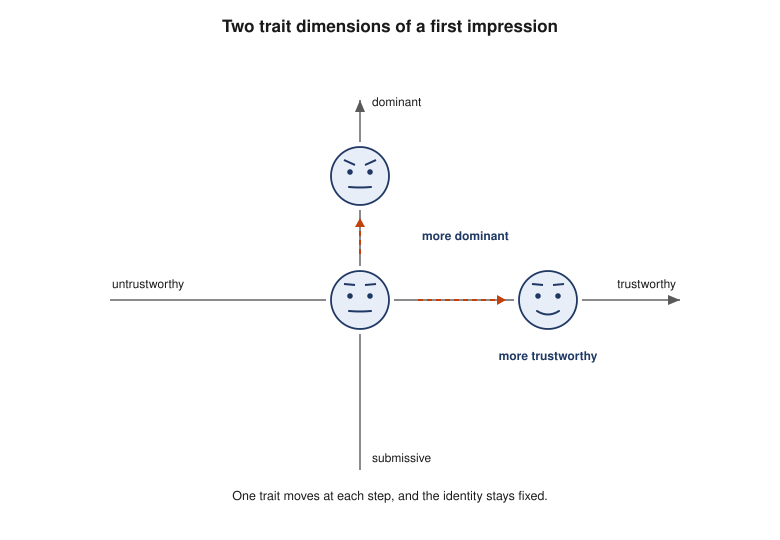

---
aliases:
  - First impression
  - first impression
  - first impressions
tags:
  - flashcard/active/special/academia/HKUST/SOSC_1960/first_impression
  - language/in/English
---

# first impression

A first impression is the judgment a perceiver forms of another person on meeting them. It forms early, from a brief sample of behavior.

---

Flashcards for this section are as follows:

- what a first impression is ::@:: The judgment a perceiver forms of another person on meeting them.

## content of an impression

### thin slice judgment

A thin slice is a brief sample of behavior, such as a 10-second video clip. Judgments from a thin slice are accurate about emotional state, personality traits, and sexual orientation (Ambady, Bernieri, & Richeson, 2000; Ambady, Hallahan, & Conner, 1999).

Students rated a teacher's warmth, enthusiasm, and attentiveness from a 30-second clip. Their ratings predicted the evaluations the teacher's own students gave after a whole semester (Ambady & Rosenthal, 1993).

---

Flashcards for this section are as follows:

- what a thin slice is ::@:: A brief sample of behavior, such as a 10-second video clip.
- what thin-slice judgments read accurately ::@:: Emotional state, personality traits, and sexual orientation.
- what the 30-second teaching clip was rated for ::@:: The teacher's warmth, enthusiasm, and attentiveness.
- what the 30-second teacher ratings predicted ::@:: The evaluations the teacher's own students gave after a whole semester.

### face traits

A first impression of a face is read on two trait dimensions, dominance and trustworthiness (Oosterhof & Todorov, 2008). The two are separate axes, so a face can read as more dominant while its trustworthiness holds. Changing one trait still shifts the other trait's ratings. A [generative adversarial network](generative%20adversarial%20network.md) varies one trait and holds the person's identity fixed (Sobieszek, Siemiątkowski, & Imbir, 2024).

---

Flashcards for this section are as follows:

- the two trait dimensions a first impression of a face is read on ::@:: Dominance and trustworthiness (Oosterhof & Todorov, 2008).
- what a generative adversarial network (GAN) holds fixed while it varies one face trait ::@:: The person's identity (Sobieszek, Siemiątkowski, & Imbir, 2024).
- what changing one perceptual face trait does to ratings of the other trait ::@:: Those ratings also change (Sobieszek, Siemiątkowski, & Imbir, 2024).
- how the two trait dimensions are laid out for a face:  ::@:: On two separate axes, trustworthiness across and dominance up.
- what changes between the two faces placed along the dominant axis ::@:: The inner ends of the eyebrows are lowered.

<!-- check: ignore-next-line[header_deep_nesting]: the cues and attention behind a face trait belong to the trait, not beside it -->
#### cues and attention

A face is also read for attractiveness, dominance, and sexual dimorphism. A different set of features cues each of the three, as eye-tracking and deep learning show (Sano et al., 2024). The determinants of those impressions can be extracted independently of visual attention (Sano et al., 2024).

---

Flashcards for this section are as follows:

- the three facial impressions studied with eye-tracking and deep learning ::@:: Attractiveness, dominance, and sexual dimorphism (Sano et al., 2024).
- what cues a facial impression of attractiveness, dominance, or sexual dimorphism ::@:: A different set of features for each of the three impressions (Sano et al., 2024).
- whether the determinants of facial impressions of attractiveness, dominance, and sexual dimorphism depend on where the perceiver looks ::@:: No. They can be extracted independently of visual attention (Sano et al., 2024).

### free-text descriptions

A free-text description is not scored on the two trait dimensions. Natural language processing of the text yields two topics, one of positive emotional valence and warmth, one of negative emotional valence and potential threat. Valence and dominance explain only about 44 percent of the variance in those topics (Jones, Shiramizu, & Jones, 2024).

---

Flashcards for this section are as follows:

- what two topics natural language processing (NLP) extracts from free-text descriptions of first impressions ::@:: One of positive emotional valence and warmth, one of negative emotional valence and potential threat (Jones, Shiramizu, & Jones, 2024).
- how much of the variance in the topics extracted from free-text descriptions do valence and dominance explain ::@:: About 44 percent (Jones, Shiramizu, & Jones, 2024).
- what a free-text description of a first impression adds beyond the two trait dimensions ::@:: The emotional content of its topics (Jones, Shiramizu, & Jones, 2024).

## accuracy with more information

Accuracy is agreement with a measure the perceiver did not supply. More information makes many of these impressions more accurate (Carney, Colvin, & Hall, 2007). It sharpens some and leaves others unchanged.

---

Flashcards for this section are as follows:

- what more information does to thin-slice judgments ::@:: It makes many of them more accurate (Carney, Colvin, & Hall, 2007).
- whether every first impression improves with more information ::@:: No. It sharpens some impressions and leaves others where they started.

## references

- Hess, Y. D., & Pickett, C. L. (2023). [Social Cognition and Attitudes](https://nobaproject.com/modules/social-cognition-and-attitudes). In R. Biswas-Diener & E. Diener (Eds), _Noba textbook series: Psychology_. Champaign, IL: DEF Publishers.
    - Source of the material on thin-slice judgments, on the 30-second teacher ratings, and on accuracy with more information.
    - Available under the [CC BY-NC-SA 4.0](https://creativecommons.org/licenses/by-nc-sa/4.0/) license.
- O'Toole, A. J., & Ludvig, E. A. (2026). [The use of AI in psychology: A historical perspective](https://doi.org/10.1111/bjop.70061). _British Journal of Psychology_, _117_(2).
    - Source of the material on the two face trait dimensions as tested by generative networks, and on the free-text topics and the 44 percent figure.
    - Open access under a Creative Commons license; the publisher footer does not name the variant.
- \[missing\].
    - Source of the Oosterhof and Todorov (2008) attribution of the two trait dimensions, which the cited editorial does not state.
