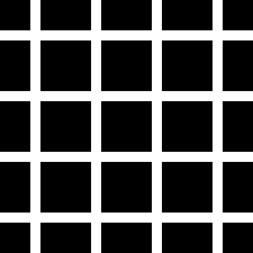

---
aliases:
  - Lateral inhibition
  - lateral inhibition
tags:
  - flashcard/active/special/academia/HKUST/SOSC_1960/lateral_inhibition
  - language/in/English
---

# lateral inhibition

Lateral inhibition is a firing neuron's suppression of its neighbors. A neuron that responds to light sends two signals: one onward to the next stage, and one sideways to the neurons beside it. The harder it fires, the stronger that sideways signal. In the retina the bipolar cells send it. The photoreceptors feed into them. Each bipolar cell's output is its input minus nearby inhibition.

---

Flashcards for this section are as follows:

- what lateral inhibition is ::@:: Suppression of nearby neurons by a neuron that fires.
- what decides how strong the inhibition is ::@:: The neuron's own excitation: the harder it fires, the stronger the sideways signal.
- what the bipolar cells do in the retina ::@:: They send the lateral signal, and each cell subtracts nearby inhibition from its input.

## contrast

Neighboring neurons look at neighboring points of the scene, so much of what they report is the same. Lateral inhibition removes that shared part, and what survives is contrast, the difference between a point and its surroundings. The retina reports that difference rather than the brightness at the point: the same patch drives its cell less on a bright surround than on a dark one. At an edge, the neuron on the bright side is inhibited less than the one just inside the dark side, and the step between the two sharpens.

The retina has little to gain from absolute light. Coding it would spend most of the output on the sameness that fills a scene: a wall, a table, or an arm is one flat region, and every cell inside it reports the same thing. The changes fall on the lines where one surface ends and the next begins, and those lines carry most of what a picture says. An outline shows the objects of a scene; one flat patch shows almost nothing.

---

Flashcards for this section are as follows:

- why lateral inhibition sharpens an edge ::@:: Neighbors report much the same light, so suppressing them leaves only where they differ.
- what survives when lateral inhibition removes what neighboring retinal cells share ::@:: Contrast, the difference between a point and its surroundings.
- what the retina reports, rather than the brightness at each point ::@:: A difference: the same patch of light drives its cell less on a bright surround than on a dark one.
- why the boundaries in a scene carry most of what a picture says ::@:: A scene holds much sameness and few changes, so the changes fall on the lines where one surface ends and the next begins.

## Hermann grid

The Hermann grid is a lattice of dark squares separated by white streets of even width. A grey smudge appears at each intersection of the streets, and none appears along a street between two intersections.

How bright a cell's surround is decides how hard the cell is inhibited. For a cell in the middle of an intersection, the whole surround is white street, and dark squares reach it only at the four diagonal corners. A cell midway along a street sits on the same white, but its surround runs down the street and meets a dark square on both sides. That dark spares it inhibition, so it fires harder than the intersection, which is suppressed and looks grey.

The account puts the smudges where they appear and gets the rest wrong. A smudge vanishes the moment the eye lands on it, though moving the eye changes neither the picture nor the surround of a cell. Bending the streets into waves abolishes the illusion. The illusion also holds over a wide range of street widths, where a surround fixed in size and shape would predict it to fail as the grid shrinks. So the grid demonstrates the mechanism and shows the limits of the explanation built on it.

---

Flashcards for this section are as follows:

- Hermann grid:  ::@:: Dark squares separated by white streets of even width, with a grey smudge at every intersection of the streets.
- draw the Hermann grid, the arrangement that puts a grey smudge at each intersection ::@:: Dark squares in a lattice, separated by white streets of even width. 
 
- where the grey smudge appears in the Hermann grid ::@:: At the intersections of the white streets, not midway along a street between two of them.
- why a Hermann grid intersection looks grey ::@:: Its surround is white street in four directions, with dark only at the diagonal corners, so it is inhibited harder than a mid-street cell.
- what happens to a Hermann grid smudge once the eye lands on it, and to the illusion when the streets are bent into waves ::@:: The smudge vanishes when the eye lands on it, though the eye's movement changes neither the picture nor a cell's surround, and bending the streets into waves abolishes the illusion.
- how the Hermann grid illusion depends on the width of its streets ::@:: It holds over a wide range of them, where a surround fixed in size and shape would predict the illusion to fail as the grid shrinks.

## references

- Buetti, S., & Lleras, A. (2023). [Vision](https://nobaproject.com/modules/vision). In R. Biswas-Diener & E. Diener (Eds), _Noba textbook series: Psychology_. Champaign, IL: DEF Publishers.
    - Source of the material on the two signals a firing neuron sends, on the inhibition scaling with excitation, on the bipolar cells as the source of the lateral signal, and on the exaggeration of contrast at edges.
    - Available under the [CC BY-NC-SA 4.0](https://creativecommons.org/licenses/by-nc-sa/4.0/) license.
- Wikipedia contributors. (n.d.). _Lateral inhibition_. Wikipedia, The Free Encyclopedia. Retrieved November 5, 2026, from <https://en.wikipedia.org/wiki/Lateral_inhibition>
    - Source of the material on lateral inhibition as the capacity of an excited neuron to reduce the activity of its neighbours.
- Wikipedia contributors. (n.d.). _Grid illusion_. Wikipedia, The Free Encyclopedia. Retrieved November 25, 2026, from <https://en.wikipedia.org/wiki/Grid_illusion>
    - Source of the material on the Hermann grid, on its grey smudges vanishing when looked at directly, on the account of the smudges through a receptive field whose surround inhibits, and on wavy streets and street width defeating that account.
