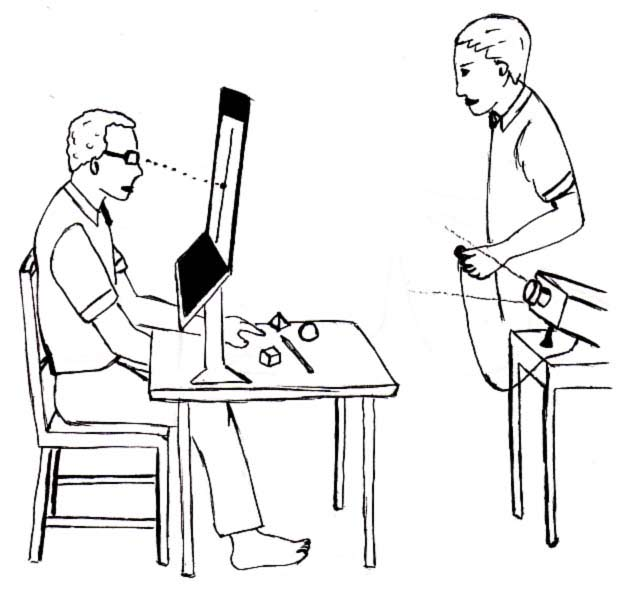

---
aliases:
  - split brain
  - split-brain patients
tags:
  - flashcard/active/special/academia/HKUST/SOSC_1960/split-brain
  - language/in/English
---

# split-brain

A split-brain patient has had the corpus callosum severed, the band of white matter that joins the two hemispheres. Almost every pathway into the brain crosses the midline, so what one hemisphere knows the other does not. Everyday tasks reach both hemispheres, so the patient behaves normally. A task that reaches only one shows what the cut cost.

---

Flashcards for this section are as follows:

- what a split-brain patient has had severed ::@:: The corpus callosum, the band of white matter joining the two hemispheres.
- where the corpus callosum sits relative to the thalamus:  ::@:: Above it, joining the two hemispheres as an arch.
- why a split-brain patient behaves normally ::@:: Everyday tasks reach both hemispheres.
- how the cost of the cut is shown ::@:: By a task that reaches only one hemisphere.
- the three parts of the corpus callosum the drawing labels ::@:: The genu at the front, the rostrum below it, and the splenium at the back. 
 

## rationale for the cut

Epilepsy means having recurrent and unprovoked seizures. A patient whose seizures do not respond to drugs has no other way to control them.

In a healthy brain the timing of activity in different regions tends not to line up, which is what desynchronised means. An epileptic seizure is the opposite: activity across regions falls into step and spreads. Wherever it starts, it reaches the rest of that hemisphere, then the other hemisphere.

Cutting the corpus callosum stops the seizure's discharge from spreading between hemispheres. William Van Wagenen, a neurosurgeon in Rochester, New York, performed the first human callosotomies on patients with epilepsy in the 1940s. Vogel and Bogen followed, and the operation reduced seizure activity while leaving patients unchanged in personality, intelligence, and behaviour. Roger Sperry's studies of these patients won him the Nobel Prize in 1981.

---

Flashcards for this section are as follows:

- why the corpus callosum is cut ::@:: To stop the seizure's discharge from spreading between the hemispheres.
- what desynchronised activity means ::@:: The timing of activity in different regions does not line up.
- what a seizure is ::@:: Electrical activity across regions falling into step, with the synchrony spreading.
- what epilepsy means ::@:: Having recurrent and unprovoked seizures.
- who performed the first human callosotomies, and when ::@:: William Van Wagenen, a neurosurgeon in Rochester, New York, in the 1940s.
- what the operation left unchanged in the patients ::@:: Their personality, intelligence, and behaviour.
- what Roger Sperry's findings earned ::@:: The Nobel Prize, in 1981.

## after the cut

In the first days after surgery, acute disconnection syndrome brings muteness, difficulty controlling the left side of the body, and a splitting headache. In rare cases the left hand struggles against the right. The struggle suggests hemispheric communication is inhibitory: before the cut, each hemisphere held the other back.

The lasting difficulties are the ones that call for both hemispheres, such as putting a name to a face or solving a geometry problem. Knowledge learned in one hemisphere cannot be transferred to the other.

---

Flashcards for this section are as follows:

- what acute disconnection syndrome brings ::@:: Muteness, difficulty controlling the left side of the body, and a splitting headache.
- what the left hand struggling against the right suggests ::@:: That hemispheric communication is inhibitory, so before the cut each hemisphere held the other back.
- the tasks split-brain patients find difficult ::@:: Putting a name to a face, and solving a geometry problem.
- what naming a face and solving a geometry problem both need ::@:: Both hemispheres working together.
- whether knowledge learned in one hemisphere transfers ::@:: It does not.

## visual half-field testing

### visual pathway

Light on the retina becomes a signal that runs along the optic nerve to the optic chiasm, where the optic nerves partially cross. Each retina has a nasal half, the half nearer the nose, and a temporal half, the half nearer the temple. The nasal fibres cross to the far side. The temporal fibres stay on their own side. What leaves the chiasm is called the optic tract. It reaches the lateral geniculate nucleus, a relay station of the thalamus, then runs through the optic radiations to the primary visual cortex in the occipital lobe.

The partial crossing is what makes the method possible. Each retina sends fibres to both sides, so each eye feeds both hemispheres, but each half of the visual field feeds only one. An intact chiasm is all a researcher needs to send one image to one hemisphere without touching the skull.

---

Flashcards for this section are as follows:

- what the optic chiasm does ::@:: The point where the optic nerves partially cross.
- what the nasal half of a retina is ::@:: The half nearer the nose.
- what the temporal half of a retina is ::@:: The half nearer the temple.
- which fibres cross at the chiasm ::@:: The nasal fibres, which cross to the far side.
- which fibres do not cross ::@:: The temporal fibres, which stay on their own side.
- what leaves the chiasm ::@:: The optic tract.
- where the signal reaches before the cortex ::@:: The lateral geniculate nucleus, a relay station of the thalamus, then the optic radiations.
- where the primary visual cortex is ::@:: In the occipital lobe.
- why the partial crossing makes the split-brain method work ::@:: Each eye feeds both hemispheres, but each half of the visual field feeds only one hemisphere.
- the visual pathway as drawn:  ::@:: Both eyes running back to the occipital lobe, with the ipsilateral and contralateral fibres kept apart, the optic nerve, chiasm and tract marked in turn, and the lateral geniculate nucleus feeding the optic radiations.
- draw the visual pathway end to end: what is each segment called in turn? ::@:: The optic nerve from the eye, the optic tract after the chiasm, the lateral geniculate nucleus, then the optic radiations into the occipital lobe. 
 

### sending an image to one hemisphere

The patient keeps their gaze on a point at the centre of the screen. A stimulus is flashed briefly, entirely on one side of that point, for less time than an eye movement takes. That leaves no time to shift it into the other half of the visual field. Because the chiasm partially crosses, everything in the left visual field reaches only the right hemisphere. The callosum is cut, so the image cannot cross to the other hemisphere.

The examiner compares what the patient says about the image with what the patient does with it, and the two answers come apart.

---

Flashcards for this section are as follows:

- what the patient fixes on before a stimulus is shown ::@:: A point at the centre of the screen.
- what stands between the patient and the objects in a split-brain trial:  ::@:: A vertical screen on a stand, which divides the visual field at the fixation point.
- draw the trial arrangement: who sits where? ::@:: The patient at the table facing a vertical screen, the objects on the table beyond it, and the examiner seated opposite. 
 
- how long the stimulus is shown ::@:: Briefly, for less time than an eye movement takes.
- why the stimulus has to be flashed briefly ::@:: So the patient has no time to shift the image into the other half of the visual field.
- where a stimulus flashed left of fixation reaches ::@:: Only the right hemisphere.
- why the stimulus stays in one hemisphere ::@:: The corpus callosum is cut, so the image cannot cross to the other hemisphere.
- what is compared in the test ::@:: What the patient says about the image, and what the patient does with it.
- the split-brain test setup as drawn:  ::@:: A fixation cross with the stimulus flashed to its left, arrows to the right-hand half of each eye, the two nasal fibres crossing at the optic chiasm, and the corpus callosum marked as cut.
- draw the test setup: which half of each retina takes a stimulus flashed left of fixation? ::@:: The nasal half of the left eye and the temporal half of the right eye, the right-hand half of each. 
 

## hemisphere specialisation

Language areas are generally lateralised to the left hemisphere, so the right hemisphere cannot say what it has been shown. It can still act. The left hand, which the right hemisphere controls, points at or reaches for the object that matches what was shown, while the patient gives a different answer out loud.

The same dissociation appears without any object to name. A patient asked to reproduce a design does it with the right hand while the left hand works on a different version of the same design. The two hands interfere.

An Arcimboldo image is a face built out of fruits and vegetables. When one is flashed, the two hemispheres give two answers: the right reports a face, the left the fruits. Two words flashed at once, one to each field, come apart the same way. The patient says aloud the word that reached the left hemisphere. Asked about the other word, the patient reports not seeing it, though the left hand can still pick it out.

---

Flashcards for this section are as follows:

- where the language areas are lateralised ::@:: To the left hemisphere.
- what the right hemisphere does with something it cannot name ::@:: It acts. The left hand points at or reaches for the object that matches the one shown, while the patient gives a different answer aloud.
- which hand the right hemisphere controls ::@:: The left hand.
- what interferes when a split-brain patient copies a design with both hands ::@:: The left hand works on a different version of the same design at the same time.
- what an Arcimboldo image is ::@:: A face built out of fruits and vegetables.
- what the two hemispheres report about an Arcimboldo image ::@:: The right hemisphere reports a face, and the left reports the fruits.
- what a split-brain patient says when one word reaches each field ::@:: The word that reached the left hemisphere; asked about the other, the patient reports not seeing it.

### left-hemisphere interpreter

A patient shown a claw in one visual field and a snow scene in the other points to a shovel and says chicken. One picture reaches each hemisphere: the claw goes to the left hemisphere, which speaks, and the snow scene to the right, which moves the left hand.

The claw goes with the chicken, and cleaning out a chicken shed takes a shovel. The left hemisphere saw the claw and nothing else, yet it gives an account of an act the snow scene started.

That account is not a recollection. It is a story built after the fact, offered without any sign that it is a guess. A reason invented to explain an act the hemisphere did not initiate is a confabulation.

The left hemisphere keeps making them because it holds the language. The right has no way to explain itself, and the left does not wait for one. It watches what the body did and invents a reason, so the left half is the interpreter.

When the right hemisphere directs the left hand, the patient still gives a fluent account of having chosen the act. The account shows no sign of guessing, so it cannot be checked against what it explains. That leaves one question open: whether an account of a chosen act is evidence that the act was chosen.

---

Flashcards for this section are as follows:

- which picture reaches which hemisphere in the claw and snow scene trial ::@:: The claw goes to the left hemisphere, which speaks, and the snow scene to the right, which moves the left hand.
- what the patient's hand does, and what the patient says, in the claw and shovel trial ::@:: The hand points to a shovel and the patient says chicken.
- how the chicken claw and shovel account goes ::@:: The claw goes with the chicken, and cleaning out a chicken shed takes a shovel.
- why the left hemisphere's account of an act it did not set going is built rather than recalled ::@:: It had seen only the claw, while the hand was set going by the snow scene.
- what confabulation names ::@:: A reason built after the fact to explain an act the hemisphere did not initiate, offered with no sign that it is a guess.
- what the right hemisphere cannot do about its own actions ::@:: Explain them, since language sits in the left hemisphere.
- which half of the brain acts as interpreter ::@:: The left half: it has the language, so it watches what the body did and invents a reason.
- what the interpreter finding leaves open ::@:: Whether an account of a chosen act is evidence that the act was chosen, since the account shows no sign of guessing.

## references

- Beck, D. & Tapia, E. (2026). The brain. In R. Biswas-Diener & E. Diener (Eds), _Noba textbook series: Psychology_. Champaign, IL: DEF Publishers. <https://nobaproject.com/modules/the-brain>
    - Source of the material on the corpus callosum, on the callosotomy and its outcome, and on the visual pathway.
    - Available under the [CC BY-NC-SA 4.0](https://creativecommons.org/licenses/by-nc-sa/4.0/) license.
- \[missing\]. (source missing). Early split brain research — Gazzaniga [Video]. YouTube. <https://www.youtube.com/watch?v=0lmfxQ-HK7Y>
    - Source of the material on sending a stimulus to one hemisphere, on the block-design interference, and on knowledge not transferring between hemispheres.
- \[missing\]. (source missing). Severed corpus callosum [Video]. YouTube. <https://www.youtube.com/watch?v=lfGwsAdS9Dc>
    - Source of the material on the Arcimboldo finding and on the left hemisphere as interpreter.
- \[missing\]. (source missing). Understanding epilepsy (Epilepsy #1) [Video]. YouTube. <https://www.youtube.com/watch?v=MNQlq004FkE>
    - Source of the material on desynchronised activity, on what a seizure is, and on what epilepsy means.
